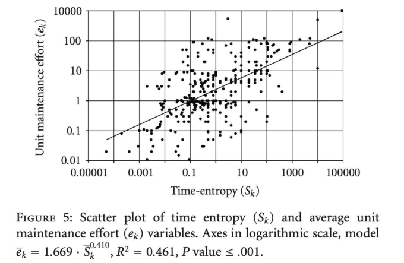

# TÓPICOS AVANÇADOS EM SI 3

---

A disciplina (IF1006, professor Delano Oliveira, Centro de Informática da UFPE) tem como tema **Legibilidade e Manutenabilidade de Código** (*Code Understandability and Code Maintainability*). A tese central percorre toda a disciplina: a maior parte do custo de um software não está em escrevê-lo, mas em mantê-lo — e manter código bem é, sobretudo, uma questão de o código ser compreensível por humanos, não apenas correto para a máquina. A disciplina **não** cobre testes de software, TDD, design patterns ou reparo automático de código em profundidade (vistos apenas de forma panorâmica); o foco é legibilidade, code smells, débito técnico e ferramentas de análise estática.

!!! note "Metodologia e avaliação"
    - **Metodologia**: aulas expositivas, aulas práticas e seminário, em grupos.
    - **Avaliação**: nota composta por um **Seminário** (grupo) e um **Projeto** (grupo) em que cada equipe avalia projetos reais open-source no GitHub, propõe uma métrica própria de legibilidade de código Java e constrói uma ferramenta que a calcule — ver seção [Projeto final](#projeto-final-metrica-de-legibilidade-de-codigo-java) mais abaixo.
    - Todo o material prático (atividades, códigos-base, app de inspeção de código) é centralizado no repositório da disciplina, hospedado por [Delano Helio](https://delanohelio.github.io/if006/).

## 01 — Software como organismo vivo: as Leis de Lehman e a entropia

### O mito do software "terminado"

A Engenharia Civil constrói uma ponte: há um plano fixo, fases sequenciais, uma estrutura tangível e um altíssimo custo de mudança após a inauguração. A Engenharia de Software se parece mais com cultivar um jardim: design evolutivo, crescimento iterativo, um sistema abstrato que se adapta continuamente. **Nós nunca finalizamos um software; apenas entregamos uma versão dele** — um software que não sofre mudanças é, por definição, um software morto.

A **Dinâmica da Evolução de Software** é o processo de adaptação contínua de um sistema após sua entrega inicial, motivado por mudanças de negócio, novos hardwares, bugs e expectativas dos usuários.

### Leis de Lehman

Manny Lehman estudou sistemas na IBM e provou estatisticamente que o software não evolui de forma aleatória, mas se comporta de acordo com certas "leis da natureza" (Lehman, *"Programs, life cycles, and laws of software evolution"*, Proceedings of the IEEE, 1980). Ele dividiu os programas em **sistemas Tipo-S** (estáticos, com especificação fechada, como uma calculadora simples) e **sistemas Tipo-E** (evolutivos), que estão embutidos no mundo real e tanto afetam quanto são afetados pelo ambiente. Lehman formulou oito leis para sistemas Tipo-E; três delas são centrais para a disciplina:

!!! example "1ª Lei — Mudança Contínua (1974)"
    Um sistema Tipo-E deve ser continuamente adaptado ou se tornará progressivamente menos satisfatório.

    **Exemplo**: um aplicativo de caronas no iOS. Se a Apple mudar suas regras de privacidade de localização em segundo plano, o app precisa ser atualizado obrigatoriamente para não parar de funcionar ou ser banido — mesmo que tenha zero bugs.

!!! example "2ª Lei — Complexidade Crescente (1974)"
    À medida que um sistema Tipo-E evolui, sua complexidade aumenta, a menos que um trabalho seja feito para mantê-la ou reduzi-la. Esse "trabalho explícito" é o que chamamos de **refatoração**.

    **Exemplo**: um checkout de e-commerce começa com um único `if` para Cartão de Crédito; com o tempo, ganha `else if`s para PayPal, Apple Pay e cripto. Sem redesenhar a arquitetura, o código vira um "monstro" frágil e complexo.

!!! example "7ª Lei — Qualidade em Declínio (1996)"
    A qualidade de um sistema Tipo-E parecerá declinar a menos que ele seja rigorosamente mantido e adaptado às mudanças do ambiente operacional.

    **Exemplo**: um software de cálculo de imposto de renda era perfeito em 2025. Em 2026 o governo muda as faixas de imposto; o código não mudou um único byte, mas sua qualidade "declinou" porque deixou de refletir a realidade.

As outras cinco leis completam o quadro: **Autorregulação** (processos de evolução de um sistema Tipo-E são autorregulatórios), **Conservação da Estabilidade Organizacional** (a taxa média de atividade efetiva é invariante ao longo da vida do produto), **Conservação da Familiaridade** (o crescimento incremental médio permanece invariante, pois todos os envolvidos precisam manter domínio do conteúdo do sistema), **Crescimento Contínuo** (o conteúdo funcional deve crescer continuamente para manter a satisfação do usuário) e **Sistema de Feedback** (a evolução constitui um sistema de feedback multi-nível e multi-agente).

### Entropia de software

Na física (2ª Lei da Termodinâmica), entropia é a tendência natural de sistemas isolados caminharem para a desordem. Trazendo para a computação, a **Entropia de Software** é a medida da desordem e do declínio de design do código ao longo do tempo — também chamada de *Software Rot* (podridão do software). Quando ignoramos a 2ª Lei de Lehman, somos vítimas da entropia: prazos apertados ("fazer funcionar primeiro, consertar depois" — spoiler: nunca é consertado), correções de bug que viram workarounds de desespero, e rotatividade de equipe que apaga o modelo mental original.

**Sintomas de alta entropia**: código frágil (conserta em um lugar, quebra em três); rigidez (uma mudança simples leva semanas); medo de alterar o código ("se funciona, não toque!").

Um estudo empírico (Capra, Francalanci & Merlo, *"The economics of community open source software projects: an empirical analysis of maintenance effort"*, Advances in Software Engineering, 2010) encontrou uma relação de potência entre entropia de tempo e esforço médio de manutenção: ēk = 1,669 · S̄k^0,410 (R² = 0,461, p ≤ 0,001) — quanto maior a entropia acumulada, maior o esforço de manutenção, de forma não linear.

??? note "Gráfico: Esforço vs. Tempo, com e sem manutenção preventiva"
    

    Sem manutenção preventiva, a dívida técnica se acumula, a complexidade sobe e o esforço para adicionar uma nova feature cresce exponencialmente até que o projeto paralisa (*Project Stalls*), impossibilitando a criação de valor. Com manutenção preventiva regular (redução da entropia), o esforço se mantém estável e baixo ao longo do tempo.

O **"Custo Total de Possuir uma Bagunça"**, detalhado por Robert C. Martin em *Clean Code*, descreve exatamente esse sintoma de paralisação: à medida que a bagunça (entropia) se acumula, a produtividade da equipe diminui, aproximando-se assintoticamente de zero, forçando a gestão a alocar mais pessoas que, não entendendo o design original, criam ainda mais bagunça — a **Lei de LeBlanc** resume isso em uma frase: *"Mais tarde significa nunca"*.

A metáfora das **Janelas Quebradas** (Dave Thomas e Andy Hunt) ilustra o mecanismo social da entropia: um prédio com janelas quebradas passa a impressão de que ninguém se importa, o que estimula outras pessoas a quebrarem mais janelas e a pichar o local. O código funciona da mesma forma — um pequeno declínio de design (uma "janela quebrada") inicia um ciclo de entropia. Para combater isso, o Clean Code prega a **Boy Scout Rule** (Regra do Escoteiro): *"Sempre deixe o acampamento (código) mais limpo do que o encontrou"*. Se cada desenvolvedor reduzir um pouco da complexidade toda vez que tocar no código, a entropia nunca se acumula a ponto de estagnar o projeto.

## 02 — Complexidade, débito técnico e o custo do código

### Complexidade inerente vs. complexidade acidental

Frederick Brooks, em seu artigo seminal *"No Silver Bullet — Essence and Accident in Software Engineering"* (1987), afirma que *"there is no single development, in either technology or management technique, which by itself promises even one order-of-magnitude improvement within a decade in productivity, in reliability, in simplicity"*. A partir dessa ideia, a aula separa a dificuldade que vem do próprio problema de negócio daquela que o programador inventa:

| Tipo | O que é | Pode ser eliminada? | Exemplo |
|---|---|---|---|
| **Complexidade inerente/essencial** | Dificuldade natural do domínio: regras de negócio, matemática do algoritmo, requisitos de segurança | Não — só pode ser resolvida | Cálculo de imposto de renda exige múltiplas faixas, deduções e taxas |
| **Complexidade causal/acidental** | Dificuldade adicionada pela forma como implementamos a solução: frameworks errados, nomes ruins, lógica confusa, falta de abstração | Sim — é aqui que o engenheiro deve atuar | Implementar todas as regras de imposto numa única função gigante com parâmetros booleanos e números mágicos |

!!! example "Mesma complexidade inerente, complexidade causal diferente"
    Código com alta complexidade causal (ruim):
    ```js
    function calc(t, v) {
      if (t == 1) {
        if (v > 100) return v * 0.9;
        else return v;
      } else if (t == 2) {
        if (v > 100) return v * 0.8;
        else return v * 0.95;
      }
      return v;
    }
    ```
    Mesma lógica, sem complexidade causal (bom) — nomes claros, early return, constantes nomeadas em vez de códigos numéricos mágicos:
    ```js
    function calculateDiscount(customerType, purchaseValue) {
      const IS_ELIGIBLE_FOR_EXTRA_DISCOUNT = purchaseValue > 100;
      if (customerType === 'VIP') {
        return IS_ELIGIBLE_FOR_EXTRA_DISCOUNT ? purchaseValue * 0.8 : purchaseValue * 0.95;
      }
      if (customerType === 'REGULAR') {
        return IS_ELIGIBLE_FOR_EXTRA_DISCOUNT ? purchaseValue * 0.9 : purchaseValue;
      }
      return purchaseValue;
    }
    ```

### A metáfora do débito técnico

O termo **débito técnico** (*technical debt*) foi cunhado por **Ward Cunningham**: assim como um empréstimo financeiro, o time "pega emprestado" contra sua velocidade futura em troca de velocidade de entrega agora, e "paga juros" em forma de progresso mais lento daí em diante.

- **O principal** (*the principal*): o tempo que o time ganha no curto prazo ao entregar uma versão do código sem pensar em legibilidade.
- **Os juros** (*the interest*): o tempo que o time perde no futuro, toda vez que precisa mudar aquele arquivo, decifrar números mágicos ou corrigir um bug gerado pela bagunça.

!!! danger "Falência técnica (Technical Bankruptcy)"
    Ocorre quando os juros superam a capacidade de pagamento do time — em um **desenvolvimento sustentável**, o time aloca cerca de 80% do sprint em criação de valor e 20% em refatoração/manutenção; numa **armadilha de débito** (*debt trap*), o time passa 100% do tempo "apagando incêndios" e 0% criando valor novo.

Nem todo débito é ruim — o problema real é o débito criado por ignorância. **Martin Fowler** propôs um quadrante que classifica o débito técnico cruzando **Intenção** (deliberado vs. não-intencional) com **Prudência** (imprudente vs. prudente):

| | Deliberado | Não-intencional |
|---|---|---|
| **Imprudente** | **Débito de bagunça** ❌ — *"We don't have time for design, just make it work"* (e nunca "veem depois"). Juros altos. | **Débito acidental** ❌ — *"What is readability? What is a Code Smell?"* — complexidade causal gerada por desconhecimento. |
| **Prudente** | **Débito estratégico** ✅ — *"We must ship now, we'll fix it later"* — trade-off calculado, com plano explícito de repagamento. | **Débito de descoberta** ⊖ — *"Now we know how we should have built it"* — boas práticas aplicadas, mas o entendimento do domínio evoluiu e revelou um design melhor depois. Juros gerenciáveis. |

### Pagando a dívida

Como o débito se manifesta na prática: velocidade do time caindo mês a mês, medo de mexer no código, comentários "apologéticos" (`// TODO: refactor this mess later`). A **Ilusão da Reescrita Total** (jogar o sistema fora e recomeçar do zero) geralmente falha e cria novo débito com tecnologias mais novas. A forma recomendada de pagar o débito é a **refatoração contínua** — reduzir a complexidade causal sem alterar o comportamento — seguindo a mesma Boy Scout Rule já vista: *"Leave the code cleaner with every commit!"*.

## 03 — Os 4 tipos de manutenção de software

### O Custo Total de Propriedade (TCO)

Historicamente, a fatia de custo de "manutenção" no ciclo de vida de um software cresce muito com o tempo em relação ao desenvolvimento inicial (Van Vliet, *Software Engineering: Principles and Practice*, 2008): o **desenvolvimento inicial** consome entre 20% e 40% do orçamento total; **manutenção e evolução**, de 60% a 80%. Juniores focam no lançamento; seniores focam no ciclo de vida.

!!! quote "O Paradoxo do Sucesso"
    *"The only software that requires no maintenance is dead software."* Alta manutenção costuma significar um produto vivo e lucrativo — sucesso traz novas integrações, demandas de escala e desafios arquiteturais que exigem manutenção contínua.

O ambiente de teste é previsível e controlado (o "caminho feliz"); o ambiente de produção é caótico, com milhares de usuários simultâneos gerando comportamentos imprevisíveis — daí a enxurrada constante de pedidos de manutenção após o lançamento.

### Os quatro tipos de manutenção

| Tipo | Apelido | Definição | Gatilho | Quem percebe |
|---|---|---|---|---|
| **Corretiva** | "Apagar incêndio" | Reparar bugs, erros de lógica ou crashes para restaurar a funcionalidade | Reclamações de usuários, alarmes de monitoramento | Reativa e estressante; não adiciona nenhuma funcionalidade nova |
| **Adaptativa** | "A regra da sobrevivência" | Modificar o software porque o mundo externo onde ele opera mudou | Novas leis (ex.: GDPR), novas versões de SO, mudanças em APIs de terceiros | Liga-se diretamente à 1ª Lei de Lehman (Mudança Contínua) |
| **Perfectiva** | "A evolução" | Aprimorar o software: novas funcionalidades, UI mais polida, mais performance | Pedidos de negócio, pesquisa de mercado, feedback de usuários | É a manutenção que clientes veem, apreciam e pagam por ela |
| **Preventiva** | "O foco central da disciplina" | Medidas proativas para evitar problemas futuros e melhorar a manutenabilidade | Pagar débito técnico, refatorar código obscuro, atualizar dependências legadas | Invisível para usuário e gestão — mas garante manutenção futura |

### O equilíbrio de custos

Um **modelo de otimização de custo de qualidade** mostra duas curvas: o custo de implementar qualidade cresce com o nível de qualidade; o custo de corrigir defeitos decresce com o nível de qualidade. A soma das duas forma uma curva em "U", cujo ponto mínimo é o equilíbrio ótimo entre investir em qualidade e o custo de corrigir defeitos.

Ignorar a manutenção preventiva alimenta o **Ciclo Vicioso da Manutenção**: sem prevenção → mais entropia → mais bugs → manutenção corretiva assume o controle → sem tempo sobrando para manutenção perfectiva → o produto estagna. A frase *"não temos tempo para refatorar agora"* deveria ser lida como: *"você não tem tempo para **não** refatorar"* — o débito técnico se acumula (compounds) como juros financeiros. Regra prática: *"uma limpeza de 1 hora hoje evita uma reescrita de 2 semanas no próximo ano"*. A manutenção preventiva deve ser um hábito diário (Boy Scout Rule), não um evento anual.

## 04 — Qualidade e manutenabilidade

### Qualidade interna vs. qualidade externa

**Qualidade externa** é o que o usuário experimenta (performance, UI/UX, confiabilidade); **qualidade interna** é o que o desenvolvedor experimenta (arquitetura, legibilidade, acoplamento). Usuários pagam pela qualidade externa — mas ela depende inteiramente da qualidade interna.

### O modelo ISO/IEC 25010

Padrão global para avaliação de qualidade de produto de software, com oito características principais:

| Característica | Subcaracterísticas |
|---|---|
| Adequação funcional | Inadequação funcional, acurácia, conformidade |
| Confiabilidade | Maturidade, disponibilidade, tolerância a falhas, recuperabilidade, conformidade |
| Eficiência de desempenho | Comportamento temporal, utilização de recursos, conformidade |
| Operabilidade | Reconhecimento de adequação, aprendizibilidade, facilidade de uso, atratividade, acessibilidade técnica, conformidade |
| Segurança | Confidencialidade, integridade, não-repúdio, responsabilização, autenticidade, conformidade |
| Compatibilidade | Coexistência, interoperabilidade, conformidade |
| **Manutenabilidade** | **Modularidade, reusabilidade, analisabilidade, modificabilidade, estabilidade de modificação, testabilidade, conformidade** |
| Portabilidade | Adaptabilidade, instalabilidade, substitutibilidade, conformidade |

### Dissecando a manutenabilidade

Cada sub-característica é apresentada como uma pergunta-chave, um "inimigo" e uma "solução":

| Atributo | Pergunta-chave | O inimigo | A solução |
|---|---|---|---|
| **Analisabilidade** (diagnosticar o problema) | Quão fácil é avaliar o impacto de uma mudança ou diagnosticar um bug? | Números mágicos, nomes crípticos, arquivos enormes | Código autodocumentado, nomes significativos |
| **Modificabilidade** (fazer a mudança) | O código pode ser modificado sem degradar sua qualidade existente? | Alto acoplamento, "spaghetti code", falta de abstração | Funções pequenas, Single Responsibility Principle |
| **Testabilidade** (verificar a mudança) | Quão facilmente o software modificado pode ser testado? | Funções que fazem coisas demais, dependências hardcoded | Testes automatizados, funções puras |
| **Reusabilidade** ("Princípio Lego") | Esse código pode ser usado em mais de um sistema/componente? | Lógica de negócio misturada com UI/banco de dados | Design modular, funções puras, separação de responsabilidades |
| **Modularidade** (conter o "raio da explosão") | Uma mudança em um componente impacta outros? | Variáveis globais, "God Classes" | Encapsulamento, interfaces bem definidas |

Atributos de qualidade frequentemente competem entre si — por exemplo, modificabilidade extrema (muitas camadas de abstração) pode prejudicar a analisabilidade (mais difícil rastrear a execução); o papel do engenheiro é encontrar o equilíbrio certo para o contexto de negócio.

!!! quote "O efeito dominó da manutenabilidade"
    Alta analisabilidade → busca rápida de bugs. Alta modificabilidade → desenvolvimento barato de features. Alta testabilidade → zero medo de fazer deploy.

    *"We know WHAT maintainability is. But HOW do we measure it?"* — gancho para a aula seguinte, sobre a economia da compreensibilidade.

## 05 — A economia da compreensibilidade e o custo da manutenção

### A proporção 10:1 entre ler e escrever código

!!! quote "Robert C. Martin, Clean Code"
    *"Indeed, the ratio of time spent reading versus writing is well over 10 to 1. [...] Therefore, making it easy to read makes it easier to write."*

Estamos constantemente lendo código antigo como parte do esforço de escrever código novo: mais de 90% do tempo é gasto lendo e analisando código existente, menos de 10% escrevendo código novo. Daí a conclusão prática: tornar o código fácil de ler torna mais fácil escrevê-lo.

!!! example "Quanto custa um nome de variável ruim?"
    Com um salário médio de desenvolvedor de ~$50/hora, se 5 desenvolvedores gastam 2 horas tentando decifrar um módulo não documentado, o custo desse único *code smell* é de **5 × 2 × $50 = $500**.

Ao defender refatoração para a gestão, o enquadramento importa: nunca diga *"quero refatorar porque o código está feio"* — diga *"refatorar este módulo vai reduzir o tempo de correção de bugs em 30% e acelerar a entrega da próxima feature"*. Qualidade interna precisa ser enquadrada como *business enabler*, não preferência estética.

### Legibility vs. Readability: a distinção central

Os dois termos são frequentemente usados como sinônimos, mas são tecnicamente diferentes — demonstração com a mesma função `sumup` em três versões funcionalmente equivalentes:

**Versão 1** (original, compacta):
```js
function sumup(a, b) {
  s=0; i=a;
  while(b-i) s+=++i; return s;
}
```

**Versão 2** (mesma lógica, só formatação): adiciona quebras de linha, indentação, espaçamento ao redor de operadores, chaves. Essas mudanças são de **legibility**: relacionam-se a **características visuais** do código-fonte.

**Versão 3** (nomes e expressões mudados):
```js
function sumup(from, end) {
  sum = 0;
  i = from;
  while (i < end) {
    i = i + 1;
    sum = sum + i;
  }
  return sum;
}
```
Essas mudanças (nomenclatura de variáveis, mudança da condição `b-i` para `i < end`, remoção de efeitos colaterais como `++i`) são de **readability**: relacionam-se a **características semânticas** do código-fonte.

| Termo | Define | Natureza |
|---|---|---|
| **Legibility** (legibilidade) | Características visuais do código-fonte | Formatação, quebras de linha, espaçamento, indentação, alinhamento |
| **Readability** (leiturabilidade/compreensibilidade) | Características semânticas do código-fonte | Nomenclatura, construções de linguagem, idiomas de código |

**Understandability** (compreensibilidade) é o conceito guarda-chuva que engloba os dois: Legibility + Readability.

## 06 — Psicologia da programação e carga cognitiva

### Compilador vs. humano

*"Why your brain crashes before the compiler does?"* — compiladores têm memória praticamente infinita, recuperação de informação fácil e são livres de influência de contexto; humanos têm memória limitada, recuperação de informação difícil, e sofrem forte influência de contexto.

### O gargalo da memória de trabalho

O cérebro humano consegue reter apenas cerca de **4 a 7 itens de informação** por vez na memória de curto prazo (**Lei de Miller**). Se uma função força o desenvolvedor a rastrear 10 variáveis simultâneas, o "buffer mental" transborda.

### Teoria da Carga Cognitiva (Cognitive Load Theory)

Desenvolvida por **John Sweller (1988)**: a quantidade total de esforço mental em uso na memória de trabalho. Em programação, divide-se em dois tipos:

| Tipo | Definição | Exemplo | Como lidar |
|---|---|---|---|
| **Carga intrínseca** | Dificuldade inerente do problema de negócio | Calcular órbitas planetárias, faixas de imposto complexas | Não pode ser eliminada, só gerenciada |
| **Carga extrínseca** | Esforço mental gerado pela forma como a informação é apresentada | Nomes de variáveis ruins, `if/else` profundamente aninhados, números mágicos | **O trabalho primário do engenheiro é eliminá-la completamente** |

### Code Beacons e chunking

**Beacons** (faróis) são características reconhecíveis no código que disparam a recuperação de um bloco (*chunk*) da memória de longo prazo — nomes de variáveis significativos (ex.: `calculateTotal`) e padrões de design padronizados funcionam como beacons. Código ruim destrói os beacons, tornando o *chunking* impossível.

- **Função COM beacon**: `filterActiveUsers(users)` → nome descritivo dispara *chunking*, o cérebro recupera o significado instantaneamente da memória de longo prazo, pulando os detalhes do loop interno.
- **Função SEM beacon**: `process(arr)` → nome vago força leitura linha-a-linha, como um computador faria, aumentando a carga cognitiva extrínseca.

**Compiladores fazem parsing sequencial, caractere por caractere. Humanos fazem *scanning* visual**, pulando ao redor, procurando beacons e estrutura. Formatação adequada otimiza o código para o escaneamento humano, não para o parsing.

!!! quote "Síntese da aula"
    A memória de trabalho é altamente limitada. Código ruim maximiza a carga cognitiva extrínseca. Código limpo usa beacons e estruturas claras para habilitar o *chunking*. **"Code is UI for developers."**

## 07 — Átomos de confusão: o micro nível de dificuldade

### O conceito

**Átomo de confusão** (*atom of confusion*): "o menor trecho de código que rotineiramente faz programadores interpretarem mal sua saída" — sintaticamente válido e determinístico. **Não é um bug**: é uma falha de compreensão humana, em que o modelo mental do programador entra em conflito com a especificação formal da linguagem.

O conceito vem do estudo de **Gopstein et al., "Understanding Misunderstandings in Source Code"** (FSE 2017) — ver resumo completo na seção de [artigos de referência](#artigos-de-referencia-da-disciplina). O achado central: programadores são **até 56 vezes mais propensos a cometer erros** ao ler certos padrões de código específicos e indivisíveis.

### Exemplos trabalhados em aula

| Átomo | O problema | Confuso | Não confuso |
|---|---|---|---|
| **Chaves omitidas** | Indentação sugere escopo para humanos, mas o compilador ignora espaços em branco | `if (c) doA(); doB();` (parece condicional, mas `doB()` sempre roda) | `if (c) { doA(); } doB();` |
| **Pós-incremento em expressão** | Ambíguo se multiplica antes ou depois do incremento | `result = value++ * 2;` | `result = value * 2; value++;` |
| **Lógica como controle de fluxo** | Mistura avaliação booleana de curto-circuito com efeitos colaterais | `isValid && saveToDatabase();` | `if (isValid) { saveToDatabase(); }` |
| **Mudança de codificação de literal** | Zero à esquerda faz o compilador interpretar como octal | `int delay = 013;` (vale 11 em decimal, não 13) | `int delay = 11;` |

!!! danger "Implicação real: o bug \"goto fail\" da Apple (CVE-2014-1266)"
    Uma linha `goto fail;` duplicada e "órfã" por falta de chaves pulava verificações críticas de certificado SSL/TLS em iOS, Apple TV e OS X Mavericks — um exemplo direto do átomo "chaves omitidas" causando uma falha de segurança grave em produção.

### A armadilha do "código inteligente"

Por que desenvolvedores escrevem átomos de confusão? Por tentar economizar digitação (código mais curto) ou por mostrar domínio da linguagem (ego). A verdade: **"código esperto é inimigo da manutenabilidade"**. Como citado em aula (atribuído a Brian Kernighan): *"Debugging is twice as hard as writing the code in the first place"* — se você escrever no limite da sua inteligência, por definição não será inteligente o suficiente para depurar depois.

Defesas práticas contra átomos de confusão: *code review* bloqueando lógica "esperta"; *linters* automatizados (ESLint, SonarQube) sinalizando chaves ausentes e incrementos perigosos; *style guides* com regras rígidas de formatação.

## 08 — Métricas de legibilidade e leiturabilidade: estado da arte

### Por que medir

Uma métrica ajuda a medir algo; uma medição ajuda a comparar duas coisas; uma comparação ajuda a tomar uma decisão. O percurso vai de **métricas** (dados brutos) → **medições** (valores formais e padronizados) → **comparações** (benchmarking entre alternativas) → **decisão** (escolha orientada a dados) — transformando confusão subjetiva em clareza objetiva.

### O que estudos empíricos pedem para humanos fazerem

A revisão sistemática de **Oliveira, Bruno, Castor e Madeiral, "Evaluating Code Readability and Legibility: An Examination of Human-centric Studies"** (2021) mapeou 54 estudos humano-centrados sobre o tema (ver resumo completo na seção de artigos). Ela também cunha a distinção conceitual usada na disciplina: **readability** mede características estruturais/semânticas que afetam a compreensão do código; **legibility** mede características visuais que afetam a identificação de elementos do código.

As tarefas pedidas aos participantes se dividem em três grandes grupos: **fornecer informação sobre o código** (explicar o que faz, responder perguntas, lembrar partes dele — 40/54 estudos), **agir sobre o código** (achar e corrigir bugs, modificar, escrever — 15/54) e **dar opinião pessoal** (avaliar legibilidade, confiança, dificuldade — 30/54). As variáveis de resposta mais usadas são **corretude** (83%), **opinião** (56%) e **tempo** (50%); métricas visuais (eye tracking) e cerebrais (fMRI, EEG) são raras.

### Três modelos de métrica de legibilidade

| Modelo | Autores / venue | Ideia central | Acurácia/AUC |
|---|---|---|---|
| **Modelo de 25 features** | Buse & Weimer, TSE 2010 | Classificador treinado com 12.000 julgamentos humanos sobre features sintáticas locais (comprimento de linha, nº de identificadores, indentação, comentários etc.) | 75–80% de acurácia; Spearman ρ = 0,71 com a média humana (16% acima da concordância humano-humano) |
| **Modelo simplificado (3 features)** | Posnett, Hindle & Devanbu, MSR 2011 | Reanálise do dataset de Buse & Weimer mostrando que **linhas + Volume de Halstead (+ entropia de bytes)** já supera o modelo de 25 features | Supera Buse & Weimer em ROC, F-measure e % correto, com muito menos features |
| **Modelo combinado estrutural + textual** | Scalabrino, Linares-Vásquez, Oliveto & Poshyvanyk, JSEP 2018 | Soma às features estruturais 7 *features* textuais: consistência comentário-identificadores (CIC), termos em dicionário (ITID), especificidade semântica (NMI), legibilidade de comentários via Flesch-Kincaid (CR), polissemia (NM), coerência textual entre blocos (TC) e número de conceitos por clustering (NOC) | Acurácia de 84,4% (vs. 77–80% dos baselines estruturais isolados) — features textuais capturam ~30% de informação não coberta pelas estruturais |

!!! note "A fórmula de Posnett et al."
    Volume de Halstead: **V = N·log₂(n)**, onde N = N1+N2 (operadores + operandos totais) e n = n1+n2 (operadores + operandos únicos). Combinado ao número de linhas, esse único par de features já supera o modelo de 25 features de Buse & Weimer em poder preditivo.

Resultados consistentes entre os três estudos: linhas em branco e boa separação visual tendem a melhorar a legibilidade percebida; linhas densas e longas, muitos identificadores por linha e identificadores muito longos tendem a piorá-la; comprimento de identificador isoladamente tem poder preditivo quase nulo (contra a intuição de que nomes mais longos sempre ajudam).

## 09 — Introdução à análise estática de código

### Os limites da revisão humana

Revisores humanos são ótimos avaliando *readability* (intenção, lógica de domínio, nomenclatura), mas são ruins em achar chaves faltando, complexidade ciclomática profunda e falhas de segurança obscuras. *"Humans get tired. Machines don't."*

### O que é análise estática

**Análise estática** (SAST/SCA) examina o código-fonte **sem executá-lo**, analisando estrutura, sintaxe e fluxo de dados para encontrar vulnerabilidades, bugs e *code smells* — como um *proofreading* de um livro antes de ir para a gráfica. As ferramentas não leem o código como texto: constroem uma **Árvore de Sintaxe Abstrata (AST)** e percorrem essa árvore contando nós (`if`, `while`) para calcular métricas como complexidade ciclomática.

Três categorias no espectro de ferramentas, da mais simples à mais avançada:

1. **Formatters** (ex.: Prettier) — corrigem espaços, tabs, indentação (foco em *legibility*).
2. **Linters** (ex.: ESLint, Checkstyle) — impõem padrões de codificação, detectam más práticas superficiais.
3. **Analisadores avançados** (ex.: SonarQube) — rastreiam fluxo de dados entre arquivos, calculam complexidade cognitiva, encontram vulnerabilidades de segurança.

### "Clean as You Code"

É impossível limpar da noite para o dia um sistema legado de dez anos. A regra de ouro: focar exclusivamente no **código novo**. Se você editar um arquivo legado, deixe-o mais limpo do que encontrou (de novo, a Boy Scout Rule). O ciclo contínuo de uso de ferramentas de análise estática é: **executar o SAT** (escanear o código) → **o SAT mostra avisos e issues** → **programadores checam e revisam os avisos** → **corrigem os problemas no código** → o ciclo recomeça.

!!! warning "Nem todo alerta é corrigido (dado empírico)"
    Um estudo (Marcilio, Bonifácio, Monteiro, Canedo, Luz & Pinto, *"Are Static Analysis Violations Really Fixed? A Closer Look at Realistic Usage of SonarQube"*, ICPC 2019) encontrou uma **taxa média de resolução de apenas 13%** dos issues reportados pelo SonarQube nos sistemas analisados, com mediana de **18,99 dias** para corrigir os que de fato foram corrigidos — mais rápido que a correção típica de bugs, segundo estudos anteriores. Os autores conjecturam que apenas um subconjunto dos *checkers* revela falhas reais de design/código, podendo artificialmente inflar a percepção de débito técnico do sistema.

**Quality Gates** ("o segurança"): conjunto de condições booleanas (passa/falha) baseadas em métricas — ex.: cobertura de código > 80%, zero bugs críticos, complexidade ciclomática < 15. Se o *quality gate* falha, o código não pode ser mesclado ou implantado.

### O dilema dos falsos positivos

Análise estática não é infalível. Um **falso positivo** é quando a ferramenta sinaliza um *code smell* que, no contexto específico de negócio, é perfeitamente correto. O perigo é a **fadiga de alertas** (*alert fatigue*): se a ferramenta reclamar demais de problemas falsos, os desenvolvedores passam a ignorá-la completamente.

## Artigos de referência da disciplina

A disciplina se apoia em seis artigos acadêmicos centrais, que sustentam boa parte do conteúdo das aulas 07, 08 e 09:

### Understanding Code Understandability Improvements in Code Reviews
**Delano Oliveira, Reydne Santos, Benedito de Oliveira, Martin Monperrus, Fernando Castor, Fernanda Madeiral** — *IEEE Transactions on Software Engineering*, 2024.

Estudo empírico em larga escala (2.401 comentários inline de *code review* amostrados de 363 projetos Java open-source com mais de 349.000 comentários) sobre como desenvolvedores reais melhoram a compreensibilidade do código via revisão de código. Achados principais:

- **42,15%** dos comentários de code review tratam de melhorias de compreensibilidade — mais de 2 em cada 5.
- Identifica **8 categorias de "understandability smells"**, lideradas por documentação incompleta/inadequada (22,3%), identificadores ruins (20,3%) e lógica complexa/longa/inadequada (18,2%).
- Sugestões de melhoria de compreensibilidade são **significativamente mais aceitas** que outros comentários de review (83,9% de aceitação) e **raramente revertidas** depois (menos de 1% permanecem revertidas).
- Quatro *linters* populares (SpotBugs, PMD, SonarQube, Checkstyle) juntos cobrem apenas **27,6%** das instâncias de smells identificadas pelos revisores humanos — os dois smells mais populares (identificador ruim e documentação inadequada) são justamente os menos detectáveis automaticamente, por envolverem linguagem natural.

### A Comprehensive Model for Code Readability
**Simone Scalabrino, Mario Linares-Vásquez, Rocco Oliveto, Denys Poshyvanyk** — *Journal of Software: Evolution and Process (JSEP)*, 2018.

Propõe um modelo de legibilidade combinando as features estruturais/visuais já conhecidas (Buse & Weimer, Posnett, Dorn) com sete *features* textuais novas, baseadas no léxico de identificadores e comentários (CIC, ITID, NMI, CR, NM, TC, NOC — ver tabela na seção 08). O modelo combinado atinge **84,4% de acurácia**, superando todos os baselines estruturais isolados em 6 a 13 pontos percentuais, e também prevê melhor a incidência de alertas do FindBugs em projetos reais — reforçando a ligação entre legibilidade e propensão a bugs.

### A Simpler Model of Software Readability
**Daryl Posnett, Abram Hindle, Prem Devanbu** — *MSR 2011* (Working Conference on Mining Software Repositories).

Reanalisa estatisticamente o dataset de Buse & Weimer e mostra que um modelo com apenas **3 features** (linhas de código, Volume de Halstead e entropia de bytes) supera o modelo original de 25 features em todas as métricas de desempenho (ROC, F-measure, % correto). Conclusão central: tamanho isolado não explica legibilidade, mas tamanho combinado com densidade de informação (Volume de Halstead) sim.

### Learning a Metric for Code Readability
**Raymond P.L. Buse, Westley Weimer** — *IEEE Transactions on Software Engineering*, 2010.

O artigo fundador da linha de pesquisa quantitativa sobre legibilidade. Treina um classificador sobre 12.000 julgamentos humanos (120 anotadores, 100 snippets Java) usando 23 features sintáticas locais, atingindo 75–80% de acurácia e Spearman ρ = 0,71 com a opinião humana média — superando a própria concordância média entre humanos (ρ = 0,55). Mostra também que a legibilidade prevista pelo modelo se correlaciona com métricas externas de qualidade: densidade de defeitos do FindBugs, *code churn*, menções a bugs em logs de versionamento, e é um fenômeno distinto de complexidade ciclomática tradicional.

### Evaluating Code Readability and Legibility: An Examination of Human-centric Studies
**Delano Oliveira, Reydne Bruno, Fernando Castor, Fernanda Madeiral** — preprint arXiv, 2021.

Revisão sistemática da literatura sobre 54 estudos "human-centric" de legibilidade/compreensibilidade de código. Propõe a distinção conceitual entre **readability** (características estruturais/semânticas) e **legibility** (características visuais) usada ao longo de toda a disciplina, e mapeia as tarefas e variáveis de resposta mais usadas nesse tipo de estudo (ver detalhes na seção 08). Aponta limitações sistemáticas da área: 37% dos estudos avaliam uma única habilidade cognitiva e 16,7% dependem exclusivamente de opinião pessoal como variável de resposta.

### Understanding Misunderstandings in Source Code
**Dan Gopstein, Jake Iannacone, Yu Yan, Lois DeLong, Yanyan Zhuang, Martin K.-C. Yeh, Justin Cappos** — *ESEC/FSE 2017*.

O artigo que origina o conceito de **átomos de confusão** (ver seção 07 para detalhes). Dois experimentos controlados com programadores (73 e 43 participantes) identificam **15 átomos de confusão estatisticamente validados**, com tamanhos de efeito de médio a muito grande — o de maior efeito é a mudança de codificação de literal (ex.: `013` interpretado como octal). Em programas IOCCC maiores e mais realistas, remover os átomos conhecidos elevou a taxa de acerto de interpretação de **47% para 73%**. O artigo também confronta os achados com recomendações de *style guides* populares de C e encontra **contradições**: por exemplo, o GNU Coding Standard aceita atribuição dentro da condição de um `while`, mas os dados mostram 38% mais acertos quando essa atribuição é movida para fora.

## Prática: ferramentas de análise estática

O repositório da disciplina traz exemplos prontos de execução para quatro ferramentas de análise estática em Java, cada uma com seu próprio foco:

| Ferramenta | Foco | O que detecta bem |
|---|---|---|
| **SonarQube** | Inspeção contínua de qualidade | Agrega regras de qualidade e *code smells*, integrável ao CI para bloquear regressão de qualidade |
| **SpotBugs** | Bytecode Java | Padrões de bugs; também sinaliza coisas que afetam clareza, como campos não usados |
| **PMD** | Código-fonte | Regras de estilo, design e boas práticas — forte em nomeação, documentação e código desnecessário |
| **Checkstyle** | Convenções de estilo | Padronização de legibilidade a nível de linha, bloco e arquivo |

A partir da RQ6 do artigo "Understanding Code Understandability Improvements in Code Reviews" (que lista quais regras de *linters* conseguem detectar os *understandability smells* identificados), o material do repositório consolida quais regras específicas de cada ferramenta estão associadas à detecção de problemas de legibilidade — por exemplo, no Checkstyle: `LineLength`, `MagicNumber`, `MissingJavadocMethod`, `NeedBraces`, `UnusedImports`; no PMD: `UnnecessaryImport`, `UnusedLocalVariable`, `UselessParentheses`; no SonarQube: regras sobre convenção de nomes, blocos sem chaves, números mágicos e Javadoc de API pública.

## Prática: auditoria de código legado

**Atividade "Sistema de Processamento de Pedidos E-commerce"**: os grupos recebem duas implementações (Projeto A e Projeto B) funcionalmente equivalentes de um motor de vendas — ambas calculam desconto por tipo de cliente (Bronze 5%, Silver 10%, Gold 15%, Platinum 20%) e frete por região (SP, MG, BA, SC, outras), aplicando 20% de taxa adicional de frete acima de R$500. A tarefa ("Auditoria de Código Legado: O Desafio do E-commerce") pede que os grupos leiam ambos os códigos e respondam, sem jargão técnico, a perguntas como: quanto tempo levaram para descobrir as condições exatas de um desconto de 15%? Seria seguro adicionar uma nova regra de negócio ("Super VIP") sem quebrar as regras antigas? É possível reaproveitar isoladamente a lógica de cálculo de desconto num app mobile, sem o `System.out.println` do console? É possível testar a matemática isoladamente, sem acoplamento a banco de dados ou entrada de teclado? O objetivo é fazer o grupo sentir na pele os sintomas de baixa analisabilidade, modificabilidade e testabilidade discutidos na aula 04, antes de ter o vocabulário técnico para nomeá-los.

## Prática: o custo de ler código difícil

Atividade de medição empírica ("O Custo de Ler Código Difícil"), ligada diretamente à proporção 10:1 da aula 05: os grupos recebem um módulo de gestão de estoque (`InventoryManager.java`) com *code smells* propositais, e precisam (1) corrigir um bug de notificações duplicadas de estoque baixo e (2) implementar suporte a itens com desconto. A atividade exige cronometrar separadamente o **tempo de leitura** (entender o código sem alterar nada) e o **tempo de implementação** das duas mudanças, calculando ao final a razão leitura/implementação e listando cinco *code smells* que tornaram a leitura difícil — tornando tangível, com dados próprios do grupo, a afirmação de Robert Martin sobre o tempo desproporcional gasto lendo versus escrevendo código.

## Prática: avaliando LLMs em revisão e refatoração de código

Dois laboratórios usam LLMs (ChatGPT, Gemini, Claude, Copilot etc.) como objeto de estudo, testando se — e como — elas conseguem produzir ou revisar código compreensível, não apenas correto.

**Laboratório 1 — "O Teste de Estresse Semântico em LLMs"**: cada grupo escolhe um código-base e o submete a quatro fases de prompts, cada uma em um chat novo: (1) **zero contexto** ("refatore este código"), tipicamente melhora a estrutura mas mantém nomes ruins e números mágicos; (2) **modernização** ("reescreva usando recursos modernos e otimize"), tende a produzir código mais curto via streams/lambdas, porém mais denso e difícil de manter; (3) **superficial/estética** ("deixe este código altamente legível"), pode gerar excesso de comentários óbvios sem melhorar a semântica; (4) **engenharia cognitiva**, com um prompt detalhado pedindo que a LLM atue como revisora sênior, identifique carga cognitiva estranha, sugira nomes semânticos por domínio, remova números mágicos e explique cada mudança — fase que tipicamente produz a melhor relação entre clareza, semântica e manutenibilidade. Os grupos preenchem uma tabela de auditoria marcando quais falhas (nomes crípticos, números mágicos, ruído visual, alta densidade lógica) sobrevivem em cada fase, e uma rubrica comparando diferentes LLMs em semântica de domínio, nomes/constantes, clareza de fluxo, qualidade da explicação e testabilidade.

**Laboratório 2 — "Identificação de Átomos de Confusão por LLMs"**: usa diretamente os conceitos da aula 07 (e do artigo de Gopstein et al.). Os grupos trabalham com 10 trechos de código contendo átomos de confusão conhecidos (conversão implícita, precedência de operador, pré/pós-incremento em expressão, ternário aninhado, *variable shadowing*, efeito colateral em condição, atribuição em condição, precedência de concatenação, *off-by-one*, dupla negação) em quatro fases: análise genérica do código-base; análise com contexto semântico explícito ("este código foi escrito por um iniciante e gera confusão em code review"); geração do código a partir de um prompt funcional (sem mostrar o código original, para ver se a LLM reproduz os mesmos átomos de confusão "naturalmente"); e revisão/refatoração do código gerado na fase anterior, sem mencionar "átomos de confusão" explicitamente, observando se a LLM os elimina mesmo sem ser instruída a isso.

## Prática: app de inspeção de código

O repositório inclui uma ferramenta web própria de coleta de dados, hospedada em GitHub Pages ([Inspeção de Código](https://delanohelio.github.io/if006/inspecao-codigo/)), usada nas atividades em sala: define o grupo do estudante automaticamente pelo último dígito do CPF, apresenta questões em fluxo sequencial (sem botão de voltar), mede o tempo da resposta de saída, coleta nível de confiança (1 a 5), e gera no final um dashboard com histograma, box-plot, nuvem de palavras filtrável por outras respostas e exportação de um pacote de resultados (snippets, metadados e respostas anonimizadas) em CSV/ZIP — uma miniatura funcional da infraestrutura de coleta de dados usada nos próprios estudos acadêmicos discutidos na disciplina (aula 08).

## Projeto final: métrica de legibilidade de código Java

O projeto da disciplina pede que cada grupo proponha e implemente sua própria **métrica de legibilidade de código Java**, dividido em fases. Na **Fase 1 (Proposta)**, cada grupo deve apresentar em slides:

1. **Contextualização**: o que é legibilidade, por que é difícil medi-la objetivamente, e a motivação concreta do grupo (ancorada em um estudo, exemplo de código ou prática vista em aula — não em generalidades).
2. **Definição da métrica**: o que exatamente ela mede (legibilidade geral ou um aspecto específico — clareza de nomes, estrutura de métodos, complexidade cognitiva?); quais *features* serão extraídas do código-fonte, cada uma com sua justificativa fundamentada em literatura ou princípios vistos em aula; e como as *features* se combinam na nota final (fórmula explícita ponderada, ou modelo aprendido a partir de dados).
3. **Modelo de avaliação**: de onde vêm os dados de referência (rotulação manual, dataset público como os de Buse & Weimer/Scalabrino, ou os próprios códigos das práticas da disciplina); o critério de validade (comparação com avaliação humana, correlação com métricas conhecidas como complexidade ciclomática, teste com exemplos extremos); e as limitações assumidas.
4. **Arquitetura da ferramenta**: entrada (arquivo, diretório, repositório Git), análise (parsing manual, biblioteca como JavaParser, ou ferramentas existentes como PMD/Checkstyle — permitido usá-las como infraestrutura de extração, desde que a métrica em si seja contribuição original do grupo), cálculo da nota e forma de apresentação da saída.
5. **Cronograma** até a Fase 2.

A avaliação da apresentação pesa mais a clareza na definição da métrica e a justificativa das *features* (critérios de peso alto) do que a clareza da apresentação em si (peso baixo) — o professor prefere 3 a 5 *features* bem justificadas a 10 *features* superficiais.
