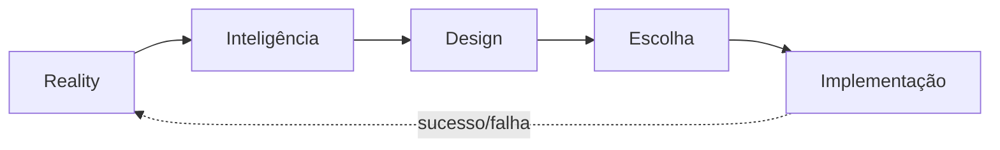
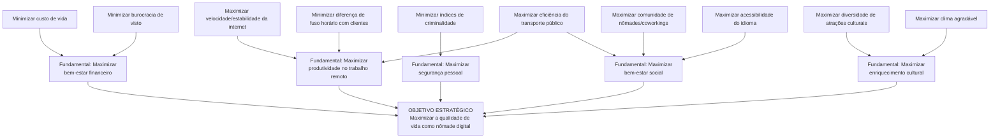
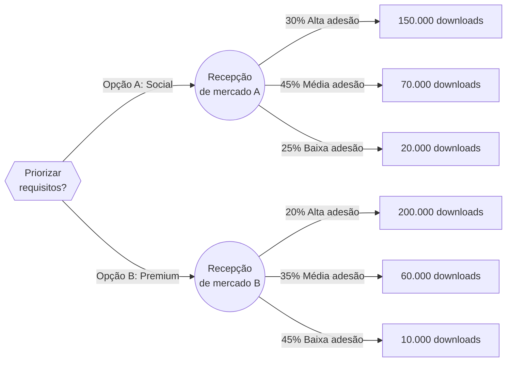

# SISTEMAS DE APOIO A DECISÃO

!!! note "Sobre a disciplina"
    **CIN0192 — Sistemas de Apoio a Decisão** (antiga IF983), UFPE, turma 2026.2.
    Professor: **Adiel Teixeira de Almeida Filho**. Aulas presenciais às terças e quintas, sala E113.
    Avaliação: prova + trabalho final (Projeto SAD), com bonificação eventual por participação.

    Esta página reúne o conteúdo apresentado em aula (handouts/slides fornecidos pelo professor) e, em
    seção dedicada ao final, as atividades propostas na disciplina que têm enunciado ou material associado
    — cada uma com seu passo a passo de resolução.

## Apresentação da disciplina

Aula de abertura (13/08), com a ementa e os objetivos da disciplina.

**Objetivo da disciplina**: entender e relacionar os principais conceitos ligados a Sistemas de Apoio a
Decisão (SAD): Processo Decisório, Estruturação de Problemas, Teoria da Decisão, Fundamentos de Teoria
da Utilidade, Teoria dos Jogos, Fundamentos de Decisão Multicritério e Aplicações de SAD. Avaliação:
prova e Projeto SAD.

**Motivações para estudar SAD**: investimentos em TI; problemas não estruturados; abundância de
informações/estratégias (McGee & Pruzak, 1994); concorrência, globalização e recursos escassos; Data
Science e Big Data (SADs, ERPs, CRMs, BI); Business Intelligence & Analytics.

??? note "O que é um problema não estruturado? (matriz de Gorry & Scott-Morton)"
    A disciplina usa o framework clássico de Gorry & Scott-Morton (1970), que cruza o **nível de
    estruturação** da decisão (Simon, 1977) com o **tipo de controle** (Anthony, 1965).

    **Nível de estruturação da decisão (Simon, 1977):**

    - **Decisão estruturada (ou programada)**: decisão repetitiva e rotineira, para a qual já existe um
      procedimento bem definido de solução — não precisa ser tratada como um problema novo a cada vez que
      ocorre. É facilmente automatizável, pois todas as suas etapas (dados necessários, regras de decisão,
      critério de escolha) são conhecidas e fixas. Exemplos: processamento de um pedido de compra,
      concessão de um crédito dentro de limites pré-definidos, cálculo de folha de pagamento.
    - **Decisão não estruturada (ou não programada)**: decisão "nebulosa", complexa, sem um procedimento
      de solução padronizado — nenhuma das três fases do processo decisório (inteligência, design, escolha)
      é estruturada. Costuma envolver múltiplos critérios, muitas vezes subjetivos, julgamento humano e
      criatividade, e não existe um método padrão aplicável a todos os casos. Exemplos: contratar um
      executivo, planejar P&D, definir uma estratégia de responsabilidade social.
    - **Decisão semiestruturada**: situação intermediária, em que **parte** do processo de decisão é
      estruturada (pode ser apoiada por modelos/procedimentos-padrão) e **parte** exige julgamento e
      experiência do decisor humano. É exatamente essa categoria — nem totalmente automatizável, nem
      totalmente dependente de intuição — que constitui o **principal público-alvo de um SAD**: ele apoia
      (em vez de substituir) o decisor justamente onde a decisão não pode ser completamente programada.
      Exemplos: programação de produção, avaliação de crédito fora dos limites-padrão, planejamento de um
      novo produto.

    | | Controle Operacional | Controle Gerencial | Planejamento Estratégico |
    |---|---|---|---|
    | **Estruturada** | Contas a receber/pagar, entrada de pedidos | Análise orçamentária, previsão de curto prazo, relatórios de pessoal, *make-or-buy* | Gestão financeira, portfólio de investimentos, localização de depósitos, sistemas de distribuição |
    | **Semiestruturada** | Programação de produção, controle de estoque | Avaliação de crédito, orçamento, layout de planta, planejamento de projeto | Construção de nova planta, fusões e aquisições, planejamento de novo produto |
    | **Não estruturada** | Compra de software, aprovação de empréstimos, help desk | Negociação, recrutamento de executivos, compra de hardware, *lobbying* | Planejamento de P&D, novas tecnologias, responsabilidade social |

## Arquitetura de um SAD

Handout "Arquitetura de um SAD: Fundamentos e tecnologias para tomada de decisão" (13/08). Bibliografia:
Sharda, Delen & Turban (2014); Burstein & Holsapple (2008); Sprague & Watson (1989).

**Definição de SAD**: *"Um sistema de informação consistindo de hardware/software e do elemento humano
designado para assistir um tomador de decisão de qualquer nível, com ênfase em tarefas semi-estruturadas
e não-estruturadas."*

### As quatro fases de Simon (1977)

O processo de decisão, consciente ou subconscientemente, segue quatro (ou cinco) fases:



- **Inteligência**: escanear o ambiente, identificar problemas/oportunidades, coletar dados, classificar e
  decompor o problema, estabelecer a "posse" (*ownership*) do problema. Resultado: uma definição formal do
  problema. Problemas típicos: falta/custo/imprecisão de dados, dados qualitativos, dependência temporal.
- **Design**: construir, testar e validar um modelo para o problema; selecionar um **princípio de escolha**
  (critério de aceitabilidade — otimizar vs. satisfazer). **Modelos normativos** (otimização: a melhor
  alternativa entre todas, assumindo racionalidade) vs. **modelos heurísticos** (sub-otimização: a melhor de
  um subconjunto, quando otimizar é inviável) vs. **modelos descritivos** (descrevem o sistema como é —
  simulação é o exemplo mais comum).
- **Escolha**: busca, avaliação e recomendação de uma solução para o modelo. Abordagens: técnicas
  analíticas, algoritmos, heurísticas, busca cega. Inclui análise de sensibilidade, análise se-então e busca
  de objetivos.
- **Implementação**: colocar a solução em prática — a fase mais difícil ("Nada mais difícil de realizar...
  que iniciar uma nova ordem de coisas", Maquiavel, *O Príncipe*).

### Componentes de um SAD

Quatro subsistemas principais, todos conectados à interface do usuário:

1. **Gerenciamento de Dados** — banco de dados, DBMS, eventualmente um *data warehouse* corporativo.
2. **Gerenciamento de Modelos** — base de modelos (estratégicos/táticos/operacionais), MBMS, linguagem de
   modelagem.
3. **Interface do Usuário** — GUI, portal, dashboards, processador de linguagem natural.
4. **Gerenciamento de Base de Conhecimento** — base de conhecimento organizacional.

### Classificações e capacidades de um SAD

A AIS SIGDSS classifica SAD como: orientado a comunicação/grupo, orientado a dados, orientado a
documentos, orientado a conhecimento ou orientado a modelos — na prática, a maioria é híbrida.

!!! tip "14 capacidades típicas de um SAD"
    Suporta problemas semi/não estruturados · decisores em todos os níveis · indivíduos e grupos · decisões
    interdependentes/sequenciais · todas as fases de Simon · vários estilos e processos de decisão ·
    adaptável e flexível · interativo e fácil de usar · eficaz e eficiente · controlado pelo humano · fácil
    de desenvolver por usuários finais · modelagem e análise · acesso a dados · standalone, integrado ou
    web-based.

## Modelagem e Problemas de Otimização

Conteúdo construído a partir do handout "Modelagem de Problemas - Parte I" (08/09) e de um capítulo do
livro-texto clássico *Pesquisa Operacional*, de Arenales, Armentano, Morabito e Yanasse (material "Modelagem
e Problemas de Otimização", 03/09).

### O que é modelagem

> "Essentially, all models are wrong, but some are useful." — George E. P. Box

Um modelo é uma simplificação da realidade. Existem **modelos físicos** (protótipos, maquetes),
**modelos análogos** (mapas, marcadores) e **modelos matemáticos** (a representação usada em Pesquisa
Operacional). Toda modelagem envolve um trade-off entre a distância da realidade e o custo/esforço de
construir e resolver o modelo.

**Processo de modelagem** (ciclo iterativo de 4 etapas, Arenales et al.):

1. **Formulação** — sistema/problema real → modelo matemático.
2. **Dedução/análise** — modelo matemático → conclusões do modelo (resolução via técnicas matemáticas).
3. **Interpretação** — conclusões do modelo → conclusões reais / decisões.
4. **Avaliação** — se as conclusões não forem adequadas, revisa-se o modelo e repete-se o ciclo.

### Pesquisa Operacional (PO)

**Definição**: *"Arte de aplicar técnicas de modelagem a problemas de tomada de decisão, resolvendo-os por
métodos matemáticos e estatísticos, visando a obtenção de uma solução ótima."* Sinônimo: *Operations
Research* (OR) / *Management Science* (MS).

??? note "Breve histórico da Pesquisa Operacional"
    - Origem: invenção do radar na Inglaterra (1934) e a Estação de Pesquisa Manor Bawdsey, estudando o uso
      tático do radar — termo cunhado por A. P. Rowe (1938).
    - 1941: seção de PO do Comando da Força Aérea de Combate britânico.
    - 1947: projeto SCOOP no Pentágono — George Dantzig desenvolve e formaliza o **método simplex** para
      programação linear, a partir de ideias precursoras do matemático soviético Leonid Kantorovich.
    - 1975: Prêmio Nobel de Economia para Koopmans e Kantorovich (alocação ótima de recursos).
    - No Brasil: 1º simpósio brasileiro de PO em 1968 (ITA); fundação da SOBRAPO.

**Abordagem científica (6 passos)**: (1) definir o problema e coletar dados; (2) formular um modelo; (3)
desenvolver um procedimento de solução; (4) testar e refinar o modelo; (5) aplicar o modelo e desenvolver
recomendações; (6) ajudar a implementar as recomendações adotadas.

### Exemplo introdutório: linhas de produção de rádios

Fábrica com 40 operários para alocar entre rádio **padrão** (linha comporta até 24 pessoas, 1 homem-dia por
rádio, lucro R$ 30) e rádio **luxo** (linha comporta até 32 pessoas, 2 homens-dia por rádio, lucro R$ 40).

$$
\begin{aligned}
\text{maximizar } & \text{Lucro} = 30X_1 + 40X_2 \\
\text{sujeito a: } & X_1 \le 24 \\
& X_2 \le 16 \\
& X_1 + 2X_2 \le 40 \\
& X_1, X_2 \ge 0
\end{aligned}
$$

### Tipos clássicos de problemas de otimização linear (Arenales et al., cap. 2)

- **Problemas de mistura** — combinar ingredientes a custo mínimo respeitando composição mínima/máxima
  (ex.: ração animal, ligas metálicas, agregados de concreto).
- **Problemas de transporte, transbordo e designação** — minimizar custo de distribuição de origens
  (ofertas) para destinos (demandas); transbordo adiciona pontos intermediários com conservação de fluxo;
  designação é um caso especial 1-para-1 (maximizando "interesse").
- **Planejamento da produção** — *mix* de produtos, seleção de processos, dimensionamento de lotes
  mono/multiestágio (com demanda dependente entre itens).
- **Programação de projetos** — sequenciamento de atividades com precedências (PERT/CPM simplificado).
- **Gestão financeira** — alocação de fluxo de caixa entre opções de investimento ao longo de períodos.
- **Corte e empacotamento** — minimizar número de peças/bobinas cortadas para atender uma demanda.
- **Ajuste de curvas e controle ótimo** — regressão linear por desvios absolutos; controle de sistemas
  dinâmicos lineares.

**Três hipóteses fundamentais de linearidade**: **aditividade** (o todo é a soma das partes), **proporcionalidade**
(o consumo de recursos escala linearmente com a quantidade produzida) e **fracionamento** (variáveis podem
assumir valores fracionários — quando isso não é aceitável, o problema é de otimização **inteira**).

**Forma padrão de um problema de otimização linear**:

$$
\begin{aligned}
\text{minimizar } & f(x) = c^Tx \\
\text{sujeito a: } & Ax = b \\
& x \ge 0
\end{aligned}
$$

### Problema de transporte — formulação geral

$$
\begin{aligned}
\text{minimizar } & \sum_i \sum_j c_{ij}x_{ij} \\
\text{sujeito a: } & \sum_j x_{ij} \le a_i \quad (i=1,...,m) \\
& \sum_i x_{ij} \ge b_j \quad (j=1,...,n) \\
& x_{ij} \ge 0
\end{aligned}
$$

onde $a_i$ é a oferta da origem $i$, $b_j$ a demanda do destino $j$ e $c_{ij}$ o custo de transportar uma
unidade de $i$ para $j$.

## Teoria da Decisão

Handout "Teoria da Decisão" (08/10). Bibliografia: Howard & Abbas (2015); Raiffa (1977); Souza (2007);
Hillier & Lieberman (2014); Berger (1980).

### O que é decisão

> "Uma boa decisão deverá ser uma função lógica daquilo que se quer, daquilo que se sabe e daquilo que se
> pode fazer." — Souza (2007)

- **O que se quer**: preferências pelas consequências (incertas ou distribuídas no tempo).
- **O que se sabe**: conhecimento dos elementos do problema.
- **O que se pode fazer**: alternativas de ação disponíveis (requer criatividade).

!!! warning "Decisão ≠ consequência"
    Uma boa decisão **não garante** uma boa consequência. Exemplos clássicos: dirigir sóbrio e sofrer um
    acidente (boa decisão, má consequência) vs. dirigir bêbado e chegar em segurança (má decisão, boa
    consequência). A qualidade da decisão deve ser avaliada pelo processo, não apenas pelo resultado.

**Decisão sob incerteza** (não se consegue estimar a probabilidade dos cenários) vs. **decisão sob risco**
(as probabilidades são conhecidas, permitindo avaliar o risco).

### Teoria da Utilidade de von Neumann-Morgenstern

A função utilidade $u$ é uma medida cardinal (numérica), em *utils*, das preferências do decisor. Para que
exista, quatro axiomas de racionalidade precisam valer sobre as relações de preferência $P \succsim Q$:

1. **Completeza (ordem total)**: $P \succsim Q$ ou $Q \succsim P$.
2. **Transitividade**: se $P \succ Q$ e $Q \succsim R$, então $P \succ R$.
3. **Dominância**: se $P \succ Q$, então $\lambda P + (1-\lambda)R \succ \lambda Q + (1-\lambda)R$ para
   qualquer $R$ e $\lambda > 0$ — garante a linearidade da utilidade em probabilidade.
4. **Arquimediano**: se $P \succ Q \succ R$, existem $\lambda, \mu$ tais que
   $\lambda P + (1-\lambda)R \succ Q \succ \mu P + (1-\mu)R$.

Satisfeitos os axiomas, existe $u$ tal que $P \succsim Q \Leftrightarrow u(P) \ge u(Q)$ e
$u[\lambda P + (1-\lambda)Q] = \lambda u(P) + (1-\lambda)u(Q)$ — ou seja, **a utilidade de uma loteria é o
valor esperado das utilidades das consequências**, ponderado pelas probabilidades.

??? example "Construção de uma função utilidade — exemplo das frutas (passo a passo)"
    **A ideia geral primeiro**: ordenar preferências ("gosto mais de maçã do que de pera") é fácil, mas não
    diz **o quanto** mais se gosta — não dá para fazer contas com um ranking. O método da **loteria de
    referência** transforma preferências em números fazendo uma pergunta engenhosa: *"você prefere ganhar
    este item com certeza, ou prefere apostar entre o seu item favorito e o seu item menos favorito?"* A
    probabilidade de ganhar o item favorito que te deixaria **indiferente** entre as duas opções é, por
    definição, a utilidade do item em questão. É basicamente perguntar "o quanto esse item vale, numa escala
    de 0 a 1, entre o pior e o melhor cenário possíveis?".

    **Dados do problema**: um decisor tem a seguinte ordem de preferência entre 5 frutas (da mais para a
    menos desejada):

    $$Maçã \succ Pera \succ Laranja \succ Goiaba \succ Uva$$

    Queremos transformar esse ranking em números (utilidades) que permitam, mais tarde, calcular valores
    esperados em situações de risco (ex.: "prefiro um saco com 50% de chance de maçã e 50% de uva, ou uma
    laranja certa?").

    ---

    **Passo 1 — Escolher dois pontos de referência e fixar suas utilidades.**

    Qualquer função utilidade é definida a menos de uma transformação linear (podemos escolher livremente os
    valores dos dois extremos, como "0°C" e "100°C" são escolhas arbitrárias na escala Celsius). Para
    começar, escolhe-se **Pera** (a mais desejável dentre as 3 frutas "do meio") como referência superior e
    **Goiaba** como referência inferior, e arbitra-se:

    $$u(Pera) = 1 \qquad u(Goiaba) = 0$$

    Isso **não** significa que Pera é a fruta mais desejada de todas (Maçã é) — é só a referência superior
    *desta primeira rodada* de perguntas. Resolveremos Maçã e Uva depois, numa segunda rodada.

    **Passo 2 — Descobrir a utilidade da Laranja por meio de uma loteria imaginária.**

    Pergunta-se ao decisor: *"Você prefere receber uma Laranja com certeza, ou participar de uma loteria em
    que você tem probabilidade $\lambda$ de ganhar uma Pera e probabilidade $(1-\lambda)$ de ganhar uma
    Goiaba?"* Varia-se $\lambda$ até o decisor ficar **indiferente** entre as duas opções:

    ```mermaid
    flowchart LR
        Q{{"Laranja certa<br/>⟷<br/>Loteria?"}}
        Q -.indiferente.-> L["Laranja (certa)"]
        Q -.indiferente.-> J((Loteria))
        J -->|"λ = 40%"| P["Pera (u=1)"]
        J -->|"1−λ = 60%"| G["Goiaba (u=0)"]
    ```

    Suponha que, por introspecção, o decisor diga que fica indiferente quando $\lambda = 0{,}4$ (ou seja,
    uma Laranja certa "vale" o mesmo que 40% de chance de Pera + 60% de chance de Goiaba). Como a utilidade
    de uma loteria é a **média ponderada** das utilidades dos prêmios (propriedade de linearidade vista
    acima), a utilidade da Laranja é exatamente esse $\lambda$:

    $$u(Laranja) = \lambda \cdot u(Pera) + (1-\lambda) \cdot u(Goiaba) = 0{,}4 \times 1 + 0{,}6 \times 0 = \mathbf{0{,}4}$$

    *(Note que isso só funciona porque fixamos $u(Pera)=1$ e $u(Goiaba)=0$ no Passo 1 — a conta "zera" o
    termo da Goiaba e "isola" o $\lambda$ como a própria utilidade procurada.)*

    **Passo 3 — Repetir o processo numa segunda rodada, agora para toda a escala (Uva até Maçã).**

    O problema do Passo 1-2 é que ele só cobre o intervalo entre Pera e Goiaba — não diz nada sobre Maçã
    (mais desejada que Pera) nem sobre Uva (menos desejada que Goiaba). Por isso, repete-se o mesmo
    procedimento, mas agora usando os **extremos reais** do conjunto como referência:

    $$u_{Uv,Ma}(Maçã) = 1 \qquad u_{Uv,Ma}(Uva) = 0$$

    *(a notação $u_{Uv,Ma}$ só indica "nesta escala, Uva vale 0 e Maçã vale 1" — é uma escala diferente da
    do Passo 1, com números que ainda não são diretamente comparáveis aos anteriores)*

    Repetindo a pergunta da loteria para Pera e para Goiaba **nesta nova escala**, suponha que o decisor
    responda, por introspecção:

    $$u_{Uv,Ma}(Pera) = 0{,}8 \qquad u_{Uv,Ma}(Goiaba) = 0{,}1$$

    (ou seja: nesta escala Uva–Maçã, uma Pera certa equivale a 80% de chance de Maçã + 20% de chance de Uva;
    uma Goiaba certa equivale a 10% de chance de Maçã + 90% de chance de Uva)

    **Passo 4 — Reconciliar as duas escalas numa única escala comum.**

    Agora temos dois conjuntos de números que usam escalas diferentes — é como ter uma temperatura em
    Celsius e outra em Fahrenheit e precisar comparar. A solução é a mesma: uma **transformação linear**
    (multiplicar por uma constante e somar outra), pois a propriedade de "extensão" da utilidade (Lema 5)
    garante que qualquer transformação $u^* = au + b$ (com $a>0$) representa as mesmas preferências.

    Queremos reescalar a escala $u_{Uv,Ma}$ de volta para a escala original do Passo 1 (onde Pera$=1$ e
    Goiaba$=0$). A fórmula de reescalonamento (uma regra de três disfarçada) é:

    $$u^*(F) = \frac{u_{Uv,Ma}(F) - u_{Uv,Ma}(Goiaba)}{u_{Uv,Ma}(Pera) - u_{Uv,Ma}(Goiaba)} = \frac{u_{Uv,Ma}(F) - 0{,}1}{0{,}8 - 0{,}1} = \frac{u_{Uv,Ma}(F) - 0{,}1}{0{,}7}$$

    O denominador $0{,}7$ é a "distância", na escala Uva–Maçã, entre os dois pontos que viram 0 e 1 na escala
    original — dividir por ele é o que "estica" a escala de volta ao tamanho certo.

    **Passo 5 — Aplicar a fórmula a cada fruta e montar a tabela final.**

    | Fruta | $u_{Uv,Ma}(F)$ (escala do Passo 3) | Cálculo de $u^*(F)$ | Utilidade final |
    |---|---|---|---|
    | Maçã | $1{,}0$ | $(1{,}0 - 0{,}1)/0{,}7$ | $9/7 \approx 1{,}29$ |
    | Pera | $0{,}8$ | $(0{,}8 - 0{,}1)/0{,}7$ | $1{,}00$ |
    | Laranja | *(não precisa recalcular — já está na escala certa desde o Passo 2)* | — | $0{,}40$ |
    | Goiaba | $0{,}1$ | $(0{,}1 - 0{,}1)/0{,}7$ | $0{,}00$ |
    | Uva | $0{,}0$ | $(0{,}0 - 0{,}1)/0{,}7$ | $-1/7 \approx -0{,}14$ |

    !!! tip "Como ler esse resultado"
        Note que a ordem dos números bate exatamente com a ordem de preferência original
        ($Maçã \succ Pera \succ Laranja \succ Goiaba \succ Uva$, e $1{,}29 > 1{,}00 > 0{,}40 > 0{,}00 >
        -0{,}14$) — isso é esperado, pois a utilidade **preserva a ordem** (Lema 3). A utilidade da Uva deu
        **negativa**: isso é normal e não representa um "dano" — é só consequência de termos fixado
        Goiaba$=0$ no Passo 1; o zero da escala é arbitrário, só a **ordem** e as **diferenças relativas**
        entre os valores têm significado (ex.: a "distância" de Pera a Laranja, $1{,}00-0{,}40=0{,}60$, é
        maior que a distância de Laranja a Goiaba, $0{,}40-0{,}00=0{,}40$ — ou seja, o decisor se importa
        relativamente mais com a diferença entre Pera e Laranja do que entre Laranja e Goiaba).

    **Para que serve, na prática**: com esses números, dá para comparar alternativas arriscadas calculando
    o valor esperado da utilidade. Por exemplo, um saco com 50% de chance de Maçã e 50% de chance de Uva tem
    utilidade esperada $0{,}5(9/7) + 0{,}5(-1/7) = 4/7 \approx 0{,}57$ — portanto esse saco é **preferível**
    a uma Laranja certa ($u=0{,}40$), mesmo sem saber "quanto vale" uma Maçã ou uma Uva em termos absolutos,
    só usando os números construídos acima.

### Utilidade para dinheiro e atitude ao risco

A relação entre dinheiro e utilidade tipicamente assume a **forma em "S"**: convexa (propensão ao risco)
para pequenas quantias, aproximadamente linear numa faixa intermediária, e côncava (aversão ao risco) para
grandes quantias — por exemplo, um decisor pode preferir R\$1.000.000 certo a um jogo 60%/40% entre
R\$2.000.000 e R\$0 (valor esperado R\$1.200.000, maior, mas ele "já está satisfeito" com o milhão certo).

### Árvore de decisão

**Componentes**: nó raiz, nós de evento (círculo — resultados de um processo estocástico), nós de decisão
(quadrado — escolhas do decisor) e nós de fim (desfechos).

**Etapas de análise**: (1) dividir em fases de risco; (2) estimar probabilidades; (3) definir pontos de
decisão; (4) calcular fluxos de caixa/valores nos nós de fim; (5) percorrer a árvore de trás para frente
(**fold back / rollback**), calculando o valor esperado em cada nó de evento e escolhendo, em cada nó de
decisão, o ramo de maior valor esperado.

**Vantagens**: resposta dinâmica ao risco, cálculo do valor da informação (*value of information*) e apoio
à gestão de risco (ex.: hedge). Um exemplo didático clássico trabalhado no handout é o desenvolvimento de um
medicamento, com 3 etapas sequenciais de testes clínicos (FDA), cada uma com custo e probabilidade de
sucesso/fracasso próprios, resolvido via *fold back* para decidir se vale a pena seguir testando.

---

## Atividades Resolvidas

!!! danger "Sobre esta seção"
    Esta seção cobre as atividades propostas na disciplina que vieram acompanhadas de enunciado ou material
    (as postagens do classroom que eram puramente administrativas, ou sem nenhuma descrição além do título,
    foram deixadas de fora a pedido). Para cada atividade, apresenta-se o passo a passo completo de
    resolução.

### 1. Desafio I — Problema do Transporte (slides)

*(postada em 08/09, editada no mesmo dia — material: exemplo numérico ao final do handout "Parte I
Handouts - IF983 SAD - Modelagem de Problemas.pdf", p. 20)*

**Enunciado**: determinar a distribuição de menor custo de um produto entre 3 fábricas (origens, com
capacidade de produção) e 4 depósitos (destinos, com demanda), dados os custos unitários de transporte
entre cada par origem-destino.

| Fábricas \ Depósitos | Florianópolis | Rio de Janeiro | Salvador | Manaus | Produção |
|---|---|---|---|---|---|
| Curitiba | 1,0 | 0,8 | 3,0 | 4,5 | 470 |
| São Paulo | 1,5 | 0,6 | 2,5 | 3,0 | 400 |
| Aracaju | 6,0 | 5,0 | 1,2 | 2,8 | 400 |
| **Demanda** | 350 | 300 | 300 | 120 | |

*(custos em R\$/unidade; produção e demanda em unidades)*

**Passo 1 — Variáveis de decisão**: $x_{ij}$ = quantidade transportada da fábrica $i$ para o depósito $j$,
$i \in \{\text{Curitiba, São Paulo, Aracaju}\}$, $j \in \{\text{Florianópolis, Rio, Salvador, Manaus}\}$.

**Passo 2 — Função objetivo** (minimizar custo total de transporte):

$$\text{minimizar } Z = \sum_i \sum_j c_{ij}\,x_{ij}$$

**Passo 3 — Restrições**: oferta de cada fábrica não pode ser excedida; demanda de cada depósito deve ser
exatamente atendida. Note que a **oferta total (470+400+400 = 1.270) é maior que a demanda total
(350+300+300+120 = 1.070)** — há 200 unidades de capacidade produtiva ociosa, o que é permitido (restrição
de oferta como "≤", não "=").

$$
\begin{aligned}
\sum_j x_{ij} &\le \text{Produção}_i \quad \text{(cada fábrica)}\\
\sum_i x_{ij} &= \text{Demanda}_j \quad \text{(cada depósito)}\\
x_{ij} &\ge 0
\end{aligned}
$$

**Passo 4 — Resolução** (método simplex para transporte — ou pelo método do canto noroeste seguido de
otimização, ou diretamente por solver de PL):

!!! example "Solução ótima"
    | Rota | Quantidade | Custo unitário | Custo da rota |
    |---|---|---|---|
    | Curitiba → Florianópolis | 350 | 1,0 | R\$ 350,00 |
    | São Paulo → Rio de Janeiro | 300 | 0,6 | R\$ 180,00 |
    | São Paulo → Manaus | 20 | 3,0 | R\$ 60,00 |
    | Aracaju → Salvador | 300 | 1,2 | R\$ 360,00 |
    | Aracaju → Manaus | 100 | 2,8 | R\$ 280,00 |

    **Custo total mínimo: R\$ 1.230,00**.

    **Uso da capacidade produtiva**: Curitiba usa 350/470 (folga de 120 — maior parte de sua capacidade
    fica ociosa, pois sua rota mais barata, Florianópolis, só tem demanda de 350); São Paulo usa 320/400;
    Aracaju usa 400/400 (capacidade **totalmente** utilizada, pois é a única fábrica com rota barata para
    Salvador).

    **Intuição**: o algoritmo aloca primeiro as rotas de menor custo unitário disponíveis para cada
    depósito — Curitiba→Florianópolis (1,0) e São Paulo→Rio (0,6) são as mais baratas e saturam totalmente
    essas demandas; o restante da demanda de Manaus (120 un.) é dividido entre São Paulo (3,0, mais barato
    que Aracaju) e Aracaju (2,8) apenas na medida necessária, já que Aracaju precisa reservar capacidade
    para atender Salvador, sua única rota realmente vantajosa (1,2, muito abaixo dos seus outros custos).

### 2. Estudo de Caso: Modelagem para Publicidade

*(postada em 10/09 — material: "Exercício Modelagem Mkt.pdf")*

**Enunciado**: uma companhia de propaganda planeja uma campanha em TV, rádio e revistas, maximizando o
número de clientes atingidos, sujeita a: orçamento total ≤ R\$ 800.000; mínimo de 2 milhões de mulheres
atingidas; gasto com TV ≤ R\$ 500.000; mínimo de 3 veiculações em TV horário normal e 2 em horário nobre;
entre 5 e 10 veiculações em rádio e em revistas.

| | TV normal | TV nobre | Rádio | Revistas |
|---|---|---|---|---|
| Custo por veiculação | R\$ 40.000 | R\$ 75.000 | R\$ 30.000 | R\$ 15.000 |
| Clientes atingidos | 400.000 | 900.000 | 500.000 | 200.000 |
| Mulheres atingidas | 300.000 | 400.000 | 200.000 | 100.000 |

**Passo 1 — Variáveis de decisão**: $x_1$ = nº de veiculações em TV horário normal; $x_2$ = TV horário
nobre; $x_3$ = rádio; $x_4$ = revistas.

**Passo 2 — Função objetivo** (maximizar clientes atingidos):

$$\text{maximizar } Z = 400.000\,x_1 + 900.000\,x_2 + 500.000\,x_3 + 200.000\,x_4$$

**Passo 3 — Restrições**:

$$
\begin{aligned}
40.000x_1 + 75.000x_2 + 30.000x_3 + 15.000x_4 &\le 800.000 \quad \text{(orçamento total)}\\
40.000x_1 + 75.000x_2 &\le 500.000 \quad \text{(orçamento TV)}\\
300.000x_1 + 400.000x_2 + 200.000x_3 + 100.000x_4 &\ge 2.000.000 \quad \text{(mulheres)}\\
x_1 &\ge 3\\
x_2 &\ge 2\\
5 \le x_3 &\le 10\\
5 \le x_4 &\le 10\\
x_1, x_2, x_3, x_4 &\ge 0 \text{ e inteiros}
\end{aligned}
$$

**Passo 4 — Resolução**: é um problema de **programação linear inteira** (número de veiculações é
discreto) com 4 variáveis — tratável por *branch-and-bound* (ex.: Excel Solver ou `scipy`/`PuLP`).
Resolvendo numericamente (maximizando $Z$ sujeito às restrições acima, com variáveis inteiras):

!!! example "Solução ótima"
    $x_1 = 3$ (mínimo de TV normal), $x_2 = 2$ (mínimo de TV nobre), $x_3 = 5$ (mínimo de rádio), $x_4 = 10$
    (máximo de revistas).

    **Verificação do orçamento**:

    $$40.000(3) + 75.000(2) + 30.000(5) + 15.000(10) = 120.000 + 150.000 + 150.000 + 150.000 = 570.000$$

    Custo total de R\$ 570.000, dentro do limite de R\$ 800.000. ✓

    **Verificação de mulheres atingidas**:

    $$300.000(3) + 400.000(2) + 200.000(5) + 100.000(10) = 900.000 + 800.000 + 1.000.000 + 1.000.000 = 3.700.000$$

    3.700.000 mulheres atingidas, acima do mínimo de 2.000.000. ✓

    **Clientes atingidos (valor da função objetivo)**:

    $$Z = 400.000(3) + 900.000(2) + 500.000(5) + 200.000(10) = 1.200.000 + 1.800.000 + 2.500.000 + 2.000.000$$

    $$Z = \mathbf{7.500.000 \text{ clientes}}$$

    **Intuição**: como TV horário nobre e rádio têm o maior "retorno por real" relativamente às suas
    restrições de mínimo/orçamento, o modelo investe nos mínimos obrigatórios de TV e maximiza revistas
    (barata e com boa razão clientes/custo: 200.000/15.000 ≈ 13,3 clientes por real investido), usando a
    folga orçamentária restante em rádio.

**Outras restrições/fatores que poderiam ser acrescentados** (conforme pedido no enunciado): alcance
duplicado (a mesma pessoa vendo o anúncio em mais de um meio); saturação de audiência (retornos
decrescentes ao aumentar veiculações no mesmo meio); sazonalidade (preços/audiência variam ao longo do
ano); segmentação por faixa etária ou classe social; restrições de concorrência (não veicular nos mesmos
horários que concorrentes); custo de produção de cada peça publicitária (distinto do custo de veiculação).

### 3. Estudo de Caso: Problema do Planejamento Agregado em Rede (Desafio!)

*(postada em 10/09 — material: "Exercício Modelagem PA e Transporte.pdf")*

**Contexto**: a Empresa X (bens de consumo, demanda sazonal com pico de setembro a janeiro) quer
distribuir seu produto, ao longo do ano, de 3 fábricas (Teresina, Natal, Recife) para 5 Centros de
Distribuição — CDs (Salvador, João Pessoa, São Luís, Aracaju, Fortaleza), minimizando o custo total de
transporte (suposto proporcional à distância × quantidade), respeitando capacidades de produção e
armazenagem.

**Passo 1 — Variáveis de decisão**: $x_{ij,m}$ = quantidade transportada da fábrica $i$ para o CD $j$ no
mês $m$ ($i=1,2,3$; $j=1,...,5$; $m=1,...,12$) — um modelo de **planejamento agregado**, pois cobre o ano
inteiro de uma vez (diferente do modelo de transporte convencional, que trata apenas um período).

**Passo 2 — Parâmetros**: $P_i$ = capacidade produtiva da fábrica $i$ no mês; $C_i$ = capacidade de
armazenagem (estoque máximo) da fábrica $i$; $c_j$ = capacidade de armazenagem do CD $j$; $d_{j,m}$ =
demanda do CD $j$ no mês $m$; $D_{i,m}$ = demanda direta da fábrica $i$ no mês $m$ (revendas atendidas sem
passar pelos CDs); $s_{ij}$ = distância entre a fábrica $i$ e o CD $j$; $E_{i,m}$, $e_{j,m}$ = estoques ao
final do mês $m$ nas fábricas e CDs, com $E_0, e_0$ os estoques iniciais.

**Passo 3 — Função objetivo** (minimizar custo total de transporte, com $c$ = custo por km por unidade):

$$\text{minimizar } CT = c\sum_{m=1}^{12}\sum_{i=1}^{3}\sum_{j=1}^{5} s_{ij}\cdot x_{ij,m}$$

**Passo 4 — Restrições**:

$$
\begin{aligned}
\text{Balanço de estoque da fábrica } i: \quad & E_{i,m} = E_{i,m-1} + P_{i,m} - D_{i,m} - \sum_j x_{ij,m} \\
\text{Balanço de estoque do CD } j: \quad & e_{j,m} = e_{j,m-1} + \sum_i x_{ij,m} - d_{j,m} \\
\text{Capacidade de armazenagem: } \quad & 0 \le E_{i,m} \le C_i, \qquad 0 \le e_{j,m} \le c_j \\
\text{Não-negatividade: } \quad & x_{ij,m} \ge 0
\end{aligned}
$$

O modelo é **linear** (custo proporcional à distância e quantidade — transporte unicamente rodoviário).

**Passo 5 — Resolução**: o problema completo tem $3 \times 5 \times 12 = 180$ variáveis de transporte (mais
as variáveis de estoque mensal), exigindo um solver de PL (ex.: `scipy.optimize.linprog`, Excel Solver ou
CPLEX) — não é tratável manualmente mês a mês. Para ilustrar o **método de solução**, resolve-se abaixo um
recorte de um único mês (janeiro) como um problema de transporte clássico (ofertas = capacidade produtiva
menos demanda direta; demandas = demanda de cada CD), minimizando a soma de distância × quantidade:

| Fábrica | Produção (jan) | Demanda direta (jan) | Oferta disponível p/ CDs |
|---|---|---|---|
| Teresina | 107.465 | 18.000 | 89.465 |
| Natal | 69.508 | 20.100 | 49.408 |
| Recife | 131.134 | 20.052 | 111.082 |

| CD | Demanda (jan) |
|---|---|
| Salvador | 82.426 |
| João Pessoa | 43.722 |
| São Luís | 34.728 |
| Aracaju | 22.614 |
| Fortaleza | 66.480 |

Resolvendo este subproblema de transporte (método simplex/solver, distâncias da Tabela 5 do material):

!!! example "Solução do subproblema de janeiro"
    - Teresina → São Luís: 34.728 un (429 km)
    - Teresina → Fortaleza: 54.737 un (624 km)
    - Natal → João Pessoa: 37.665 un (221 km)
    - Natal → Fortaleza: 11.743 un (527 km)
    - Recife → Salvador: 82.426 un (836 km)
    - Recife → João Pessoa: 6.057 un (132 km)
    - Recife → Aracaju: 22.614 un (528 km)

    A solução aloca as rotas de menor distância prioritariamente (ex.: Natal→João Pessoa a apenas 221 km),
    deixando as rotas mais longas (Recife→Salvador, 836 km) apenas para suprir demandas que as fábricas mais
    próximas não conseguem atender sozinhas — exatamente o comportamento esperado de uma solução ótima de
    transporte.

**Passo 6 — Extensão ao problema completo**: para resolver o ano inteiro, o mesmo princípio se aplica mês a
mês, mas **acoplado** pelas equações de balanço de estoque (o que sobra ou falta em um mês carrega para o
seguinte, respeitando as capacidades de armazenagem) — por isso não pode ser resolvido como 12 subproblemas
de transporte independentes, mas sim como um único problema de PL com 180 variáveis de fluxo, resolvido de
uma vez por um solver.

### 4. Desafio II — Problema de Alocação de Capital e Portfólio de Projetos

*(postada em 22/09, editada — material: enunciado + imagem com a tabela de investimentos)*

**Enunciado**: a Volto Venture Capital (VVC) tem orçamento de R\$ 200 milhões (ano 0), R\$ 250 milhões (ano
1) e R\$ 150 milhões (ano 2) para investir em 7 projetos (A–G), que podem ser **fracionados** (participação
proporcional ao longo dos anos). Objetivo: maximizar a lucratividade total.

| Projeto | Ano 0 | Ano 1 | Ano 2 | Lucratividade |
|---|---|---|---|---|
| A | 12 | 34 | 12 | 20 |
| B | 54 | 94 | 67 | 15 |
| C | 65 | 28 | 49 | 34 |
| D | 38 | 0 | 8 | 17 |
| E | 52 | 21 | 42 | 56 |
| F | 98 | 73 | 25 | 76 |
| G | 15 | 48 | 53 | 29 |

*(valores em milhões de R\$; a tabela original rotula a 3ª coluna como "Ano 3" — tratado aqui como o
terceiro ano do orçamento, "Ano 2", conforme o enunciado em texto, que descreve apenas 3 períodos
orçamentários: este ano, o próximo e o seguinte)*

**Passo 1 — Variáveis de decisão**: $x_i \in [0,1]$ = fração do projeto $i$ em que a VVC investe
($i \in \{A,...,G\}$) — fracionável, pois o enunciado permite participação proporcional, sem limite mínimo
de compra.

**Passo 2 — Função objetivo**:

$$\text{maximizar } Z = 20x_A + 15x_B + 34x_C + 17x_D + 56x_E + 76x_F + 29x_G$$

**Passo 3 — Restrições** (uma por ano, orçamento em milhões de R\$):

$$
\begin{aligned}
12x_A + 54x_B + 65x_C + 38x_D + 52x_E + 98x_F + 15x_G &\le 200 \quad \text{(Ano 0)}\\
34x_A + 94x_B + 28x_C + 0x_D + 21x_E + 73x_F + 48x_G &\le 250 \quad \text{(Ano 1)}\\
12x_A + 67x_B + 49x_C + 8x_D + 42x_E + 25x_F + 53x_G &\le 150 \quad \text{(Ano 2)}\\
0 \le x_i &\le 1, \quad i \in \{A,...,G\}
\end{aligned}
$$

**Passo 4 — Resolução** (programação linear contínua, resolvida via método simplex/solver):

!!! example "Solução ótima"
    | Projeto | Fração investida ($x_i$) |
    |---|---|
    | A | 100% |
    | B | 0% |
    | C | **35,4%** |
    | D | 0% |
    | E | 100% |
    | F | 100% |
    | G | 100% |

    **Lucratividade total máxima ≈ 193,0** (em milhões de R\$, na mesma unidade dos valores de
    lucratividade da tabela).

    **Verificação do uso do orçamento**: Ano 0: R\$ 200,0M usados / 200,0M disponíveis (restrição **ativa**
    — o orçamento do ano 0 é o fator limitante); Ano 1: R\$ 185,9M usados / 250,0M (folga de ~64M); Ano 2:
    R\$ 149,3M usados / 150,0M (quase todo usado).

    **Interpretação**: os projetos A, E, F e G (que têm boa lucratividade por unidade de capital
    consumido, especialmente no Ano 0) entram **integralmente** (100%); o projeto C entra parcialmente
    (35,4%) porque é o "projeto marginal" que absorve exatamente o capital restante do Ano 0, sem violar os
    limites dos anos 1 e 2; B e D não entram porque consomem muito capital nos primeiros anos para a
    lucratividade que oferecem (B, especialmente, tem alto consumo nos 3 anos e lucratividade relativamente
    baixa).

### 5. Desafio III — Problema da Refinaria

*(postada em 22/09, editada — material: enunciado completo)*

**Enunciado**: uma refinaria produz gasolina **verde**, **azul** e **comum**, a partir de gasolina pura
(9.600.000 L/semana disponíveis), octana (4.800.000 L/semana) e aditivo (2.200.000 L/semana).

| | Gasolina pura | Octana | Aditivo | Margem de lucro |
|---|---|---|---|---|
| Verde (por litro) | 0,22 L | 0,50 L | 0,28 L | R\$ 0,30 |
| Azul (por litro) | 0,52 L | 0,34 L | 0,14 L | R\$ 0,25 |
| Comum (por litro) | 0,74 L | 0,20 L | 0,06 L | R\$ 0,20 |

Regras de produção: comum ≥ 16 × verde; azul ≤ 600.000 L/semana.

**Passo 1 — Variáveis de decisão**: $x_v, x_a, x_c$ = litros/semana de gasolina verde, azul e comum.

**Passo 2 — Função objetivo**:

$$\text{maximizar } Z = 0{,}30x_v + 0{,}25x_a + 0{,}20x_c$$

**Passo 3 — Restrições**:

$$
\begin{aligned}
0{,}22x_v + 0{,}52x_a + 0{,}74x_c &\le 9.600.000 \quad \text{(gasolina pura)}\\
0{,}50x_v + 0{,}34x_a + 0{,}20x_c &\le 4.800.000 \quad \text{(octana)}\\
0{,}28x_v + 0{,}14x_a + 0{,}06x_c &\le 2.200.000 \quad \text{(aditivo)}\\
x_c &\ge 16x_v \quad \text{(demanda mínima de comum)}\\
x_a &\le 600.000 \quad \text{(demanda máxima de azul)}\\
x_v, x_a, x_c &\ge 0
\end{aligned}
$$

**Passo 4 — Resolução** (programação linear, 3 variáveis, resolvida via método simplex/solver):

!!! example "Solução ótima"
    $x_v \approx 770.149$ L/semana, $x_a = 600.000$ L/semana (no limite máximo), $x_c \approx 12.322.388$
    L/semana. **Lucro máximo ≈ R\$ 2.845.522/semana**.

    **Restrições ativas (binding) na solução ótima**:

    - **Gasolina pura**: $0{,}22(770.149) + 0{,}52(600.000) + 0{,}74(12.322.388) = 9.600.000$ — usada
      **100%** (recurso escasso/gargalo).
    - **Demanda mínima de comum**: $x_c = 16x_v$ exatamente (12.322.388 ≈ 16 × 770.149) — a razão mínima
      exigida pelo mercado é usada no limite, pois a gasolina comum é a que menos consome gasolina pura por
      litro (0,22 vs. 0,74... na verdade o inverso: comum consome **mais** gasolina pura por litro, 0,74 L,
      mas tem a menor margem; ver nota abaixo).
    - **Azul no teto**: $x_a = 600.000$ — compensa, por ter a segunda maior margem (R\$0,25) e consumir
      relativamente pouco do recurso mais escasso proporcionalmente ao seu lucro.
    - **Octana** (3.053.552 / 4.800.000) e **aditivo** (1.038.985 / 2.200.000) ficam com folga — não são
      fatores limitantes.

    !!! tip "Intuição econômica"
        A gasolina pura é o recurso mais restritivo. Apesar da gasolina comum ter a menor margem unitária
        (R\$0,20), a restrição $x_c \ge 16x_v$ obriga a produção de uma quantidade de comum **16 vezes
        maior** que a de verde sempre que se produz verde — então o modelo maximiza verde e azul (melhores
        margens) até o ponto em que o consumo de gasolina pura se esgota, e o volume de "comum" acaba sendo,
        em sua maior parte, consequência direta da restrição de proporção mínima, não uma escolha livre de
        lucratividade.

### 6. APS — Estruturação de Problemas (VFT)

*(postada em 06/10 — material: vídeo de Ralph Keeney + artigo de Keeney 1996 + artigos de aplicação em
anexo)*

**Enunciado**: assistir à aula de Ralph Keeney sobre *Value-Focused Thinking* (VFT) e ler o artigo
seminal (Keeney, 1996); em grupo, elaborar a rede de **objetivos-meio** e **objetivos-fim** para o problema
da escolha de cidade para um nômade digital.

#### O método VFT (Keeney, 1996)

VFT é o oposto do "pensamento focado em alternativas": em vez de começar pela lista de alternativas
disponíveis e só depois formular critérios, começa-se pelos **valores** (o que realmente importa), que
guiam tanto a criação de alternativas quanto a identificação de melhores *oportunidades* de decisão.

- **Objetivo fundamental**: um **fim** que o decisor valoriza naquele contexto — "simplesmente importante".
- **Objetivo-meio**: um **método** para alcançar outro objetivo — sua importância deriva de levar a outro
  objetivo.
- **Teste "por que isso é importante?"** (*why-is-it-important* / WITI): aplicado repetidamente a cada
  objetivo candidato. Se a resposta aponta para outro objetivo, o candidato é objetivo-meio; se a resposta é
  "simplesmente importante" (não leva a mais nada), é um objetivo fundamental.

**10 técnicas de Keeney para levantar a lista inicial de objetivos** (Tabela 3 do artigo): lista de desejos;
pensar em alternativas (o que é bom/ruim em cada); problemas e deficiências; consequências (boas/más já
ocorridas); metas, restrições e diretrizes; perspectivas diferentes (concorrente, futuro); objetivos
estratégicos; objetivos genéricos (clientes, funcionários, meio ambiente); estruturação (relações meio-fim);
quantificação (como medir, pesos relativos).

#### Passo a passo da resolução — rede de objetivos para "escolha de cidade para um nômade digital"

**Passo 1 — Levantamento da lista inicial (técnica "wish list" + perspectivas)**: aplicando as perguntas de
Keeney ("o que você quer alcançar ao escolher uma cidade?"), levanta-se uma lista bruta de itens — alguns
serão objetivos-meio, outros fundamentais, e alguns nem objetivos são (seriam alternativas ou restrições):
custo de vida baixo; boa internet; fuso horário compatível com clientes; clima agradável; comunidade de
nômades/coworkings; visto fácil; segurança pública; boa qualidade de vida geral; idioma acessível;
experiências culturais; transporte público eficiente.

**Passo 2 — Aplicar o teste "por que isso é importante?" a cada item**, para separar objetivos-meio de
objetivos fundamentais:

| Item | "Por que isso é importante?" | Classificação |
|---|---|---|
| Internet rápida/estável | Porque permite trabalhar sem interrupções | **Meio** → leva a "maximizar produtividade no trabalho remoto" |
| Fuso horário compatível | Porque facilita reuniões com clientes/equipe | **Meio** → leva a "maximizar produtividade no trabalho remoto" |
| Custo de vida baixo | Porque sobra mais renda disponível | **Meio** → leva a "maximizar bem-estar financeiro" |
| Visto fácil/barato | Porque reduz burocracia e permite ficar mais tempo | **Meio** → leva a "minimizar atrito logístico" |
| Segurança pública | "Simplesmente importante" (não leva a mais nada) | **Fundamental** |
| Comunidade de nômades/coworkings | Porque gera conexões sociais e profissionais | **Meio** → leva a "maximizar bem-estar social" |
| Clima agradável | "Simplesmente importante" (qualidade de vida direta) | **Fundamental** |
| Experiências culturais | "Simplesmente importante" (enriquecimento pessoal) | **Fundamental** |
| Transporte público eficiente | Porque reduz tempo perdido em deslocamento | **Meio** → leva a "maximizar produtividade" e "bem-estar" |

**Passo 3 — Objetivo estratégico**: aplicando o teste recursivamente aos objetivos fundamentais
encontrados, todos eles convergem, em última instância, para um único objetivo estratégico mais amplo:
**"Maximizar a qualidade de vida como nômade digital"**.

**Passo 4 — Rede de objetivos-meio e objetivos-fim**:



**Passo 5 — Uso da rede para gerar/avaliar alternativas** (conforme a Fase 3 do VFT): tomando cada objetivo
fundamental isoladamente, geram-se candidatos "ideais" para aquele objetivo — ex., para "maximizar
produtividade", cidades-hub conhecidas por internet rápida e comunidades de coworking (Lisboa, Chiang Mai,
Medellín, Bali); para "minimizar custo de vida", cidades do Sudeste Asiático ou América Latina. Combinando
pares e trios de objetivos (passo recomendado por Keeney), chega-se a um conjunto reduzido de alternativas
"muito promissoras" que equilibram vários objetivos simultaneamente — e não apenas um, evitando o viés de
ancoragem em alternativas óbvias.

### 7. Árvore de Decisão — Desenvolvimento de App

*(postada em 13/10 — material: enunciado completo)*

**Enunciado**: estruturar um problema de decisão com etapas de decisão e etapas de resultados incertos
(até 3 cenários, probabilidades arbitradas), elaborando uma árvore de decisão com pelo menos 6 desfechos
possíveis, considerando a influência de decisões na fase de priorização de requisitos sobre um indicador de
interesse; calcular o valor esperado do indicador.

#### Passo a passo da resolução

**Passo 1 — Contexto e indicador de interesse**: uma equipe de desenvolvimento de app precisa decidir **que
conjunto de requisitos priorizar** na primeira versão do produto. O indicador de interesse escolhido:
**downloads no 1º trimestre após o lançamento**.

**Passo 2 — Nó de decisão**: priorizar requisitos entre duas estratégias competidoras (restrição de tempo
de equipe impede fazer as duas completamente):

- **Opção A** — Funcionalidades **sociais** (convite de amigos, compartilhamento, feed de atividade).
- **Opção B** — Funcionalidades **premium** (assinatura paga, personalização avançada).

**Passo 3 — Nós de evento (incerteza de mercado)**: para cada opção, a recepção do mercado é incerta, com 3
cenários (6 desfechos no total, conforme pedido):



*(probabilidades e desfechos arbitrados conforme autorizado pelo enunciado — "arbitre as probabilidades")*

**Passo 4 — Fold back (cálculo do valor esperado em cada nó de evento)**:

$$
\begin{aligned}
EMV(\text{Opção A}) &= 0{,}30(150.000) + 0{,}45(70.000) + 0{,}25(20.000) \\
&= 45.000 + 31.500 + 5.000 = \mathbf{81.500 \text{ downloads}}
\end{aligned}
$$

$$
\begin{aligned}
EMV(\text{Opção B}) &= 0{,}20(200.000) + 0{,}35(60.000) + 0{,}45(10.000) \\
&= 40.000 + 21.000 + 4.500 = \mathbf{65.500 \text{ downloads}}
\end{aligned}
$$

**Passo 5 — Decisão** (escolher o ramo de maior valor esperado no nó de decisão):

!!! example "Resultado"
    $EMV(\text{A}) = 81.500 > EMV(\text{B}) = 65.500$ → a árvore recomenda a **Opção A (priorizar
    funcionalidades sociais)**, com valor esperado de **81.500 downloads no 1º trimestre**.

    **Interpretação**: embora a Opção B tenha o *melhor cenário individual* (200.000 downloads no caso de
    alta adesão — mais que o melhor cenário de A), essa alta adesão é menos provável (20% vs. 30%) e o
    cenário de baixa adesão é mais provável e mais penalizante (45% de chance de apenas 10.000 downloads).
    A Opção A tem uma distribuição de resultados mais estável, resultando em maior valor esperado — este é
    exatamente o tipo de *trade-off* entre risco e retorno que a árvore de decisão torna explícito e
    quantificável, em vez de depender apenas de intuição.

**Requisitos recomendados para o App** (conforme pedido no enunciado, "apresente os requisitos para o App
em planejamento"): priorizar, na primeira versão, convite de amigos, compartilhamento em redes sociais e
feed de atividade — funcionalidades premium (assinatura, personalização) ficam para uma segunda iteração,
após validado o crescimento orgânico via adoção social.
