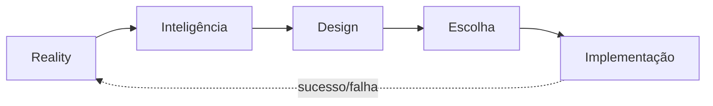
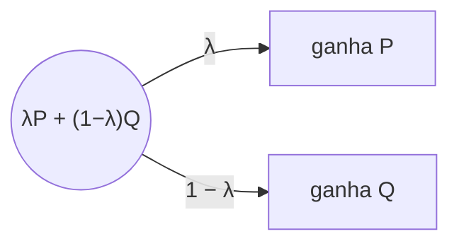
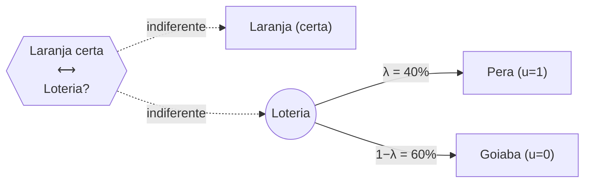
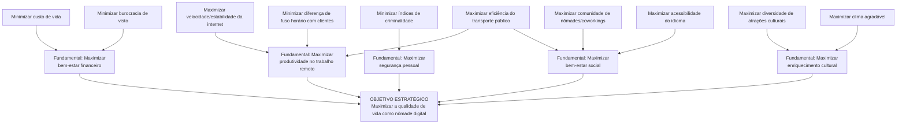
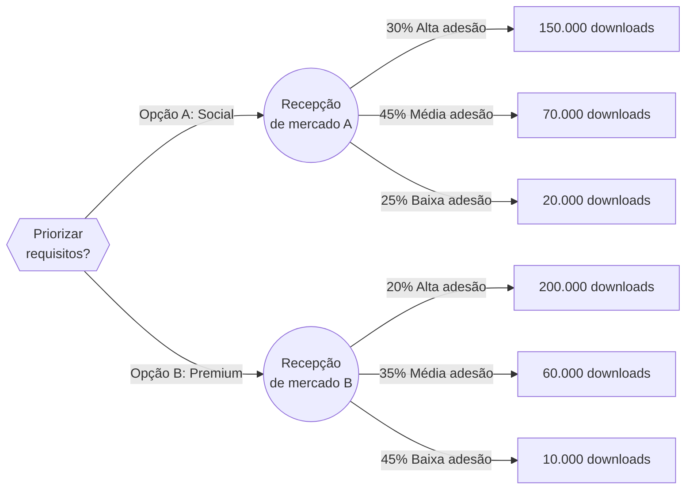

# SISTEMAS DE APOIO A DECISÃO

!!! note "Sobre a disciplina"
    **CIN0192 — Sistemas de Apoio a Decisão** (antiga IF983), UFPE, turma 2026.2.
    Professor: **Adiel Teixeira de Almeida Filho**. Aulas presenciais às terças e quintas, sala E113.
    Avaliação: prova + trabalho final (Projeto SAD), com bonificação eventual por participação.

    Esta página reúne o conteúdo apresentado em aula (handouts/slides fornecidos pelo professor) e, em
    seção dedicada ao final, as atividades propostas na disciplina que têm enunciado ou material associado
    — cada uma com seu passo a passo de resolução.

## Apresentação da disciplina

Aula de abertura (13/08), com a ementa e os objetivos da disciplina.

**Objetivo da disciplina**: entender e relacionar os principais conceitos ligados a Sistemas de Apoio a
Decisão (SAD): Processo Decisório, Estruturação de Problemas, Teoria da Decisão, Fundamentos de Teoria
da Utilidade, Teoria dos Jogos, Fundamentos de Decisão Multicritério e Aplicações de SAD. Avaliação:
prova e Projeto SAD.

**Motivações para estudar SAD**: investimentos em TI; problemas não estruturados; abundância de
informações/estratégias (McGee & Pruzak, 1994); concorrência, globalização e recursos escassos; Data
Science e Big Data (SADs, ERPs, CRMs, BI); Business Intelligence & Analytics.

??? note "O que é um problema não estruturado? (matriz de Gorry & Scott-Morton)"
    A disciplina usa o framework clássico de Gorry & Scott-Morton (1970), que cruza o **nível de
    estruturação** da decisão (Simon, 1977) com o **tipo de controle** (Anthony, 1965).

    **Nível de estruturação da decisão (Simon, 1977):**

    - **Decisão estruturada (ou programada)**: decisão repetitiva e rotineira, para a qual já existe um
      procedimento bem definido de solução — não precisa ser tratada como um problema novo a cada vez que
      ocorre. É facilmente automatizável, pois todas as suas etapas (dados necessários, regras de decisão,
      critério de escolha) são conhecidas e fixas. Exemplos: processamento de um pedido de compra,
      concessão de um crédito dentro de limites pré-definidos, cálculo de folha de pagamento.
    - **Decisão não estruturada (ou não programada)**: decisão "nebulosa", complexa, sem um procedimento
      de solução padronizado — nenhuma das três fases do processo decisório (inteligência, design, escolha)
      é estruturada. Costuma envolver múltiplos critérios, muitas vezes subjetivos, julgamento humano e
      criatividade, e não existe um método padrão aplicável a todos os casos. Exemplos: contratar um
      executivo, planejar P&D, definir uma estratégia de responsabilidade social.
    - **Decisão semiestruturada**: situação intermediária, em que **parte** do processo de decisão é
      estruturada (pode ser apoiada por modelos/procedimentos-padrão) e **parte** exige julgamento e
      experiência do decisor humano. É exatamente essa categoria — nem totalmente automatizável, nem
      totalmente dependente de intuição — que constitui o **principal público-alvo de um SAD**: ele apoia
      (em vez de substituir) o decisor justamente onde a decisão não pode ser completamente programada.
      Exemplos: programação de produção, avaliação de crédito fora dos limites-padrão, planejamento de um
      novo produto.

    | | Controle Operacional | Controle Gerencial | Planejamento Estratégico |
    |---|---|---|---|
    | **Estruturada** | Contas a receber/pagar, entrada de pedidos | Análise orçamentária, previsão de curto prazo, relatórios de pessoal, *make-or-buy* | Gestão financeira, portfólio de investimentos, localização de depósitos, sistemas de distribuição |
    | **Semiestruturada** | Programação de produção, controle de estoque | Avaliação de crédito, orçamento, layout de planta, planejamento de projeto | Construção de nova planta, fusões e aquisições, planejamento de novo produto |
    | **Não estruturada** | Compra de software, aprovação de empréstimos, help desk | Negociação, recrutamento de executivos, compra de hardware, *lobbying* | Planejamento de P&D, novas tecnologias, responsabilidade social |

## Arquitetura de um SAD

Handout "Arquitetura de um SAD: Fundamentos e tecnologias para tomada de decisão" (13/08). Bibliografia:
Sharda, Delen & Turban (2014); Burstein & Holsapple (2008); Sprague & Watson (1989).

**Definição de SAD**: *"Um sistema de informação consistindo de hardware/software e do elemento humano
designado para assistir um tomador de decisão de qualquer nível, com ênfase em tarefas semi-estruturadas
e não-estruturadas."*

### As quatro fases de Simon (1977)

O processo de decisão, consciente ou subconscientemente, segue quatro (ou cinco) fases:



- **Inteligência**: escanear o ambiente, identificar problemas/oportunidades, coletar dados, classificar e
  decompor o problema, estabelecer a "posse" (*ownership*) do problema. Resultado: uma definição formal do
  problema. Problemas típicos: falta/custo/imprecisão de dados, dados qualitativos, dependência temporal.
- **Design**: construir, testar e validar um modelo para o problema; selecionar um **princípio de escolha**
  (critério de aceitabilidade — otimizar vs. satisfazer). **Modelos normativos** (otimização: a melhor
  alternativa entre todas, assumindo racionalidade) vs. **modelos heurísticos** (sub-otimização: a melhor de
  um subconjunto, quando otimizar é inviável) vs. **modelos descritivos** (descrevem o sistema como é —
  simulação é o exemplo mais comum).
- **Escolha**: busca, avaliação e recomendação de uma solução para o modelo. Abordagens: técnicas
  analíticas, algoritmos, heurísticas, busca cega. Inclui análise de sensibilidade, análise se-então e busca
  de objetivos.
- **Implementação**: colocar a solução em prática — a fase mais difícil ("Nada mais difícil de realizar...
  que iniciar uma nova ordem de coisas", Maquiavel, *O Príncipe*).

### Componentes de um SAD

Quatro subsistemas principais, todos conectados à interface do usuário:

1. **Gerenciamento de Dados** — banco de dados, DBMS, eventualmente um *data warehouse* corporativo.
2. **Gerenciamento de Modelos** — base de modelos (estratégicos/táticos/operacionais), MBMS, linguagem de
   modelagem.
3. **Interface do Usuário** — GUI, portal, dashboards, processador de linguagem natural.
4. **Gerenciamento de Base de Conhecimento** — base de conhecimento organizacional.

### Classificações e capacidades de um SAD

A AIS SIGDSS classifica SAD como: orientado a comunicação/grupo, orientado a dados, orientado a
documentos, orientado a conhecimento ou orientado a modelos — na prática, a maioria é híbrida.

!!! tip "14 capacidades típicas de um SAD"
    Suporta problemas semi/não estruturados · decisores em todos os níveis · indivíduos e grupos · decisões
    interdependentes/sequenciais · todas as fases de Simon · vários estilos e processos de decisão ·
    adaptável e flexível · interativo e fácil de usar · eficaz e eficiente · controlado pelo humano · fácil
    de desenvolver por usuários finais · modelagem e análise · acesso a dados · standalone, integrado ou
    web-based.

## Modelagem e Problemas de Otimização

Conteúdo construído a partir do handout "Modelagem de Problemas - Parte I" (08/09) e de um capítulo do
livro-texto clássico *Pesquisa Operacional*, de Arenales, Armentano, Morabito e Yanasse (material "Modelagem
e Problemas de Otimização", 03/09).

### O que é modelagem

> "Essentially, all models are wrong, but some are useful." — George E. P. Box

Um modelo é uma simplificação da realidade. Existem **modelos físicos** (protótipos, maquetes),
**modelos análogos** (mapas, marcadores) e **modelos matemáticos** (a representação usada em Pesquisa
Operacional). Toda modelagem envolve um trade-off entre a distância da realidade e o custo/esforço de
construir e resolver o modelo.

**Processo de modelagem** (ciclo iterativo de 4 etapas, Arenales et al.):

1. **Formulação** — sistema/problema real → modelo matemático.
2. **Dedução/análise** — modelo matemático → conclusões do modelo (resolução via técnicas matemáticas).
3. **Interpretação** — conclusões do modelo → conclusões reais / decisões.
4. **Avaliação** — se as conclusões não forem adequadas, revisa-se o modelo e repete-se o ciclo.

### Pesquisa Operacional (PO)

**Definição**: *"Arte de aplicar técnicas de modelagem a problemas de tomada de decisão, resolvendo-os por
métodos matemáticos e estatísticos, visando a obtenção de uma solução ótima."* Sinônimo: *Operations
Research* (OR) / *Management Science* (MS).

??? note "Breve histórico da Pesquisa Operacional"
    - Origem: invenção do radar na Inglaterra (1934) e a Estação de Pesquisa Manor Bawdsey, estudando o uso
      tático do radar — termo cunhado por A. P. Rowe (1938).
    - 1941: seção de PO do Comando da Força Aérea de Combate britânico.
    - 1947: projeto SCOOP no Pentágono — George Dantzig desenvolve e formaliza o **método simplex** para
      programação linear, a partir de ideias precursoras do matemático soviético Leonid Kantorovich.
    - 1975: Prêmio Nobel de Economia para Koopmans e Kantorovich (alocação ótima de recursos).
    - No Brasil: 1º simpósio brasileiro de PO em 1968 (ITA); fundação da SOBRAPO.

**Abordagem científica (6 passos)**: (1) definir o problema e coletar dados; (2) formular um modelo; (3)
desenvolver um procedimento de solução; (4) testar e refinar o modelo; (5) aplicar o modelo e desenvolver
recomendações; (6) ajudar a implementar as recomendações adotadas.

### Os três elementos de qualquer modelo

O livro de Arenales et al. resume a modelagem em três perguntas, e são exatamente elas que o professor cobra
na prova:

1. **Decisões**: o que se quer determinar? Viram as **variáveis de decisão**.
2. **Restrições**: o que limita as escolhas? Viram **equações e inequações**.
3. **Objetivo**: o que faz uma decisão ser melhor que outra? Vira a **função objetivo** (maximizar ou
   minimizar).

Vocabulário (Seção 2.4 do livro): uma **solução factível** (viável) satisfaz todas as restrições; o conjunto
delas é a **região factível**; a **solução ótima** é a factível com o melhor valor da função objetivo (pode
haver uma ou várias). Um **método ótimo (exato)** garante achar a solução ótima; um **método heurístico**
busca uma solução boa (subótima) quando o exato é caro demais.

??? note "Exemplo do capítulo 1 do livro: o MRP e por que modelar"
    O sistema MRP (*Material Requirements Planning*) calcula quanto e quando produzir cada item, mas faz
    isso em duas fases: primeiro calcula os lotes de cada item **ignorando a capacidade**, depois verifica se
    a capacidade foi respeitada e, se não foi, ajusta "na mão". O livro modela o mesmo problema (um item
    final, um componente, 4 semanas, 80 horas por semana) como otimização:

    $$
    \begin{aligned}
    \text{minimizar } & \sum_{i=1}^{2}\sum_{t=1}^{4} K_{it}(x_{it}) + h_i I_{it} \\
    \text{sujeito a: } & I_{1t} = I_{1,t-1} + x_{1t} - d_{1t} \\
    & I_{2t} = I_{2,t-1} + x_{2t} - x_{1t} \\
    & a_1x_{1t} + a_2x_{2t} \le 80 \\
    & x_{it} \ge 0, \; I_{it} \ge 0
    \end{aligned}
    $$

    $x_{it}$ é a produção do item $i$ na semana $t$; $I_{it}$, o estoque; $K_{it}$, o custo de produção (com
    custo fixo $S_i$ se $x_{it}>0$). A produção do item 1 vira **demanda dependente** do item 2. A heurística
    do MRP gerou um plano que estourava a capacidade (110 h e 90 h); ajustando, chega-se a um plano factível
    de custo 5.750 e depois a um de 5.700, que é o ótimo. Moral: o modelo enxerga o problema inteiro de uma
    vez, e a heurística não.

### Exemplo introdutório: linhas de produção de rádios

Fábrica com 40 operários para alocar entre rádio **padrão** (linha comporta até 24 pessoas, 1 homem-dia por
rádio, lucro R\$ 30) e rádio **luxo** (linha comporta até 32 pessoas, 2 homens-dia por rádio, lucro R\$ 40).

$$
\begin{aligned}
\text{maximizar } & \text{Lucro} = 30X_1 + 40X_2 \\
\text{sujeito a: } & X_1 \le 24 \\
& X_2 \le 16 \\
& X_1 + 2X_2 \le 40 \\
& X_1, X_2 \ge 0
\end{aligned}
$$

Com duas variáveis, o problema pode ser resolvido **graficamente**: ótimo em $(24;\,8)$, lucro de R\$ 1.040
(ver a seção seguinte).

### Resolução gráfica de problemas de otimização linear

Esta seção transforma as **regras e restrições** de um modelo em um **gráfico** e mostra como achar a
solução ótima olhando para ele. O método é o da Seção 2.5 do livro *Pesquisa Operacional* (Arenales,
Armentano, Morabito e Yanasse), indicado pelo professor como material principal de modelagem.

!!! note "Quando dá para usar"
    O método gráfico só funciona com **duas variáveis de decisão** ($x_1$ e $x_2$), porque cada variável vira
    um eixo do plano. Com três ou mais variáveis usa-se o Solver (simplex). Mesmo assim, entender o gráfico
    explica o que o Solver faz por dentro: ele anda pelos "cantos" da região factível até achar o melhor.

### A ideia em uma frase

Cada restrição corta o plano em dois lados (um permitido, outro proibido). O que sobra depois de aplicar
**todas** as restrições é a **região factível $S$**. A função objetivo é uma família de retas paralelas
(as **curvas de nível**); empurra-se essa reta no sentido em que $Z$ melhora até ela tocar $S$ pela última
vez. Esse último ponto de contato é a **solução ótima**.

### Passo a passo

**Passo 1 — Escrever o modelo** (variáveis, função objetivo, restrições), como em qualquer modelagem.

**Passo 2 — Desenhar a não-negatividade.** $x_1 \ge 0$ e $x_2 \ge 0$ deixam só o 1º quadrante.

**Passo 3 — Transformar cada restrição em uma reta.** Troca-se o sinal ($\le$, $\ge$) por $=$ e acham-se
dois pontos da reta. O jeito mais rápido é achar os **interceptos**: faz $x_1=0$ e acha $x_2$; depois faz
$x_2=0$ e acha $x_1$.

!!! example "Exemplo: a restrição $x_1 + 2x_2 \le 40$"
    Com $x_1=0$: $2x_2=40$, então $x_2=20$, ponto $(0;\,20)$.

    Com $x_2=0$: $x_1=40$, ponto $(40;\,0)$.

    Ligando os dois pontos, está desenhada a reta $x_1+2x_2=40$.

    Restrições com uma só variável viram retas paralelas aos eixos: $x_1 \le 24$ é a reta **vertical**
    $x_1=24$; $x_2 \le 16$ é a reta **horizontal** $x_2=16$.

**Passo 4 — Escolher o lado certo de cada reta.** Há dois jeitos:

- **Teste da origem** (o mais usado na prova): substitui-se $(0;\,0)$ na desigualdade. Se ela for
  verdadeira, o lado permitido é o que contém a origem; se for falsa, é o outro lado. Ex.: em
  $x_1+2x_2 \le 40$, temos $0 \le 40$, que é verdadeiro, então vale o lado da origem. Se a reta passar pela
  origem, testa-se outro ponto, como $(1;\,0)$.
- **Vetor gradiente** (o jeito do livro): o vetor dos coeficientes $a=(a_1;\,a_2)$ é perpendicular à reta
  $a_1x_1+a_2x_2=b$ e aponta para o lado onde $a_1x_1+a_2x_2 > b$. Logo, para "$\le$" fica-se do lado
  **oposto** à seta; para "$\ge$", do lado **para onde ela aponta**.

**Passo 5 — Sombrear a região factível $S$**: é a interseção de todos os lados permitidos. Se não sobrar
nada, o problema é **infactível**.

**Passo 6 — Desenhar a função objetivo como curva de nível.** Escolhe-se um valor qualquer de $Z$ (por
exemplo, $Z=0$) e desenha-se a reta $c_1x_1+c_2x_2=Z$. Todas as curvas de nível são paralelas entre si. O
vetor $c=(c_1;\,c_2)$ (gradiente de $Z$) mostra o sentido em que $Z$ **cresce**.

**Passo 7 — Deslizar a curva de nível.** Em maximização, desloca-se a reta no sentido de $c$; em
minimização, no sentido contrário. O último ponto de $S$ tocado é o ótimo.

**Passo 8 — Calcular o ponto exato.** O ótimo é um vértice, a interseção de duas retas. Resolve-se o
sistema 2×2 dessas retas e calcula-se $Z$ nesse ponto.

!!! tip "Atalho que sempre funciona: testar os vértices"
    **Teorema fundamental da programação linear**: se existe solução ótima, existe uma em um **vértice**
    (canto) da região factível. Por isso, uma alternativa ao Passo 7 é listar todos os vértices de $S$,
    calcular $Z$ em cada um e escolher o melhor. Na prova, é o caminho mais seguro: monte uma tabela
    "vértice → valor de $Z$".

#### Como achar um vértice (sistema 2×2)

Um vértice é o cruzamento de duas retas. Exemplo: $X_1=24$ com $X_1+2X_2=40$:

$$24 + 2X_2 = 40 \;\Rightarrow\; X_2 = 8 \;\Rightarrow\; \text{vértice } (24;\,8)$$

Quando nenhuma das duas retas é vertical ou horizontal, usa-se substituição ou soma. Exemplo:
$10x_L+8x_B=25.000$ com $x_L=1.500$ dá $8x_B = 25.000-15.000$, ou seja, $x_B=1.250$.

Depois de achar um vértice, **confira** se ele satisfaz as **outras** restrições. Se violar alguma, ele
está fora de $S$ e não é um vértice da região factível.

### Exemplo 2.18 do livro (resolvido)

$$
\begin{aligned}
\text{maximizar } & Z = x_1 + 2x_2 \\
\text{sujeito a: } & x_1 + x_2 \le 4 \\
& x_1 \le 2 \\
& x_2 \le 3 \\
& x_1, x_2 \ge 0
\end{aligned}
$$

**Retas**: $x_1+x_2=4$ passa por $(0;\,4)$ e $(4;\,0)$; $x_1=2$ é vertical; $x_2=3$ é horizontal. Pelo teste
da origem, todas as três valem do lado da origem.

**Vértices de $S$** (cruzamentos que respeitam todas as restrições):

| Vértice | De onde vem | $Z = x_1+2x_2$ |
|---|---|---|
| $(0;\,0)$ | eixos | $0$ |
| $(2;\,0)$ | $x_1=2$ e eixo $x_1$ | $2$ |
| $(2;\,2)$ | $x_1=2$ e $x_1+x_2=4$ | $6$ |
| $(1;\,3)$ | $x_2=3$ e $x_1+x_2=4$ | $\mathbf{7}$ |
| $(0;\,3)$ | $x_2=3$ e eixo $x_2$ | $6$ |

**Solução ótima**: $x^*=(1;\,3)$ com $Z^*=7$. No gráfico do livro, as curvas de nível $Z=0$, $Z=2$ e
$Z=7$ são paralelas; a de $Z=7$ é a última que ainda encosta em $S$.

??? note "Gráfico do Exemplo 2.18"
    

### Exemplo: fábrica de rádios (handout da disciplina)

$$
\begin{aligned}
\text{maximizar } & Z = 30X_1 + 40X_2 \\
\text{sujeito a: } & X_1 \le 24 \\
& X_2 \le 16 \\
& X_1 + 2X_2 \le 40 \\
& X_1, X_2 \ge 0
\end{aligned}
$$

| Vértice | De onde vem | $Z$ |
|---|---|---|
| $(0;\,0)$ | origem | $0$ |
| $(24;\,0)$ | $X_1=24$ e eixo | $720$ |
| $(24;\,8)$ | $X_1=24$ e $X_1+2X_2=40$ | $\mathbf{1.040}$ |
| $(8;\,16)$ | $X_2=16$ e $X_1+2X_2=40$ | $880$ |
| $(0;\,16)$ | $X_2=16$ e eixo | $640$ |

**Ótimo**: 24 rádios padrão e 8 de luxo, lucro de R\$ 1.040 por dia. As restrições **ativas** (que passam
pelo ótimo) são $X_1 \le 24$ e a dos operários. A linha de luxo tem folga de $16-8=8$ rádios.

??? note "Gráfico dos rádios"
    

### Exemplo 2.6 do livro: geladeiras

Um fabricante vende no máximo 1.500 geladeiras de luxo e 6.000 básicas por mês. Tem 25.000 homens-hora
(luxo gasta 10 h, básica 8 h) e uma linha de montagem para 4.500 geladeiras. Lucro de \$100 (luxo) e \$50
(básica).

$$
\begin{aligned}
\text{maximizar } & Z = 100x_L + 50x_B \\
\text{sujeito a: } & 10x_L + 8x_B \le 25.000 \\
& x_L + x_B \le 4.500 \\
& 0 \le x_L \le 1.500, \quad 0 \le x_B \le 6.000
\end{aligned}
$$

Interceptos: a mão de obra corta os eixos em $(2.500;\,0)$ e $(0;\,3.125)$; a linha de montagem em
$(4.500;\,0)$ e $(0;\,4.500)$. A reta da linha de montagem fica inteira **acima** da de mão de obra dentro
do quadrante útil, então ela não corta $S$ (é uma restrição **redundante**). O mesmo vale para
$x_B \le 6.000$.

| Vértice | $Z$ |
|---|---|
| $(0;\,0)$ | $0$ |
| $(1.500;\,0)$ | $150.000$ |
| $(1.500;\,1.250)$ | $\mathbf{212.500}$ |
| $(0;\,3.125)$ | $156.250$ |

**Ótimo**: 1.500 de luxo e 1.250 básicas, lucro de \$212.500. Ativas: mercado de luxo e mão de obra.

??? note "Gráfico das geladeiras"
    

### Minimização

Em minimização, a lógica se inverte: desloca-se a curva de nível **contra** o gradiente, e o ótimo é o
vértice com **menor** $Z$. Com restrições "$\ge$", a região factível costuma ficar "aberta para fora",
longe da origem.

$$
\begin{aligned}
\text{minimizar } & Z = 4x_1 + 2x_2 \\
\text{sujeito a: } & 3x_1 + x_2 \ge 9 \\
& x_1 + x_2 \ge 5 \\
& x_1 + 3x_2 \ge 9 \\
& x_1 \le 8, \quad x_2 \le 10, \quad x_1,x_2 \ge 0
\end{aligned}
$$

Pelo teste da origem, $0 \ge 9$ é falso, então nas três primeiras restrições vale o lado **oposto** à
origem.

| Vértice | De onde vem | $Z$ |
|---|---|---|
| $(0;\,9)$ | $3x_1+x_2=9$ e eixo $x_2$ | $18$ |
| $(2;\,3)$ | $3x_1+x_2=9$ e $x_1+x_2=5$ | $\mathbf{14}$ |
| $(3;\,2)$ | $x_1+x_2=5$ e $x_1+3x_2=9$ | $16$ |
| $(8;\,1/3)$ | $x_1+3x_2=9$ e $x_1=8$ | $32{,}67$ |
| $(8;\,10)$ | $x_1=8$ e $x_2=10$ | $52$ |
| $(0;\,10)$ | $x_2=10$ e eixo | $20$ |

**Ótimo**: $(2;\,3)$ com $Z^*=14$.

??? note "Gráfico da minimização"
    

### Os quatro resultados possíveis

O gráfico também mostra quando o problema **não** tem uma solução única. Na prova, é comum perguntarem
qual caso aparece.

| Caso | Como aparece no gráfico | O que dizer |
|---|---|---|
| **Ótimo único** | A curva de nível toca $S$ em um só vértice | Solução ótima única |
| **Ótimos múltiplos** | A curva de nível é **paralela** a um lado de $S$ e encosta no lado inteiro | Infinitas soluções ótimas, todas com o mesmo $Z$ (todo o segmento entre os dois vértices) |
| **Ilimitado** | $S$ é aberta no sentido em que $Z$ melhora; a curva de nível pode ser empurrada para sempre | $Z \to +\infty$ (max) ou $Z \to -\infty$ (min): normalmente indica restrição esquecida no modelo |
| **Infactível** | As restrições não têm nenhum ponto em comum; $S$ é vazia | Não existe solução; as exigências são contraditórias |

!!! example "Ótimos múltiplos: max $Z=2x_1+2x_2$ com $x_1+x_2 \le 6$, $x_1 \le 4$, $x_2 \le 5$"
    Os vértices $(4;\,2)$ e $(1;\,5)$ dão ambos $Z=12$. Isso acontece porque $Z=2(x_1+x_2)$ é paralela à
    restrição $x_1+x_2 \le 6$: qualquer ponto do segmento entre $(4;\,2)$ e $(1;\,5)$ é ótimo.

    

!!! example "Ilimitado: max $Z=x_1+x_2$ com $-x_1+x_2 \le 2$ e $x_1-2x_2 \le 2$"
    A região factível segue para cima e para a direita sem fim; as curvas de nível $Z=4, 8, 12, \dots$
    sempre encontram pontos de $S$. Não há ótimo finito.

    

!!! example "Infactível: $x_1+x_2 \le 2$ e $x_1+x_2 \ge 5$"
    Não existe ponto com soma ao mesmo tempo no máximo 2 e no mínimo 5. O Solver responde "não foi possível
    encontrar uma solução viável". Curiosidade: o **Exemplo 2.2 do livro** (mistura de agregados para
    concreto) também é infactível com os dados apresentados. A faixa 76–152 mm obriga
    $x_1 \ge 0{,}5$; com a outra metade, a faixa 2,4–19 mm pede brita comercial e a faixa 38–76 mm pede
    seixo, e não dá para atender às duas ao mesmo tempo. O próprio livro comenta, logo depois, que nem todo
    problema tem solução possível e que novas fontes de agregados poderiam ser consideradas.

    

### Vocabulário que cai junto

- **Solução factível (viável)**: qualquer ponto de $S$, ou seja, que respeita todas as restrições.
- **Solução ótima**: a solução factível com o melhor $Z$.
- **Restrição ativa (*binding*)**: aquela que vale com igualdade no ótimo (a reta passa pelo ponto ótimo).
  Tem folga zero e é o "gargalo".
- **Folga**: quanto sobra de um recurso no ótimo. Em $\le$, folga $=b-(\text{lado esquerdo})$.
- **Restrição redundante**: aquela que não corta $S$ (removê-la não muda a região). Ex.: a linha de
  montagem no problema das geladeiras.

### Exercícios de resolução gráfica

Para cada um: desenhe as retas, sombreie $S$, liste os vértices e diga qual é o ótimo (ou qual dos casos
especiais acontece). As respostas estão escondidas.

**G1.** max $Z=3x_1+5x_2$; $x_1 \le 4$; $2x_2 \le 12$; $3x_1+2x_2 \le 18$; $x_1,x_2 \ge 0$.

??? success "Resposta G1"
    Retas: $x_1=4$ (vertical), $x_2=6$ (horizontal, vem de $2x_2 \le 12$), $3x_1+2x_2=18$ com interceptos
    $(6;\,0)$ e $(0;\,9)$.

    | Vértice | $Z$ |
    |---|---|
    | $(0;\,0)$ | 0 |
    | $(4;\,0)$ | 12 |
    | $(4;\,3)$ | 27 |
    | $(2;\,6)$ | **36** |
    | $(0;\,6)$ | 30 |

    Ótimo $(2;\,6)$, $Z^*=36$. Vértice $(2;\,6)$: com $x_2=6$, $3x_1+12=18$, logo $x_1=2$.

    

**G2.** Uma confecção faz camisas ($x_1$) e calças ($x_2$). O corte leva 1 h por camisa e 2 h por calça,
com 40 h disponíveis. A costura leva 2 h por camisa e 1 h por calça, com 50 h. Vende-se no máximo 15 calças.
Lucro de R\$ 20 por camisa e R\$ 30 por calça. Modele e resolva graficamente.

??? success "Resposta G2"
    $$
    \begin{aligned}
    \text{max } & Z = 20x_1 + 30x_2 \\
    \text{s.a. } & x_1 + 2x_2 \le 40 \quad \text{(corte)}\\
    & 2x_1 + x_2 \le 50 \quad \text{(costura)}\\
    & x_2 \le 15 \quad \text{(mercado)}\\
    & x_1, x_2 \ge 0
    \end{aligned}
    $$

    | Vértice | De onde vem | $Z$ |
    |---|---|---|
    | $(0;\,0)$ | origem | 0 |
    | $(25;\,0)$ | costura e eixo | 500 |
    | $(20;\,10)$ | corte e costura | **700** |
    | $(10;\,15)$ | corte e mercado | 650 |
    | $(0;\,15)$ | mercado e eixo | 450 |

    Vértice corte × costura: da costura, $x_2=50-2x_1$; no corte, $x_1+100-4x_1=40$, logo $x_1=20$ e
    $x_2=10$. Ótimo: 20 camisas e 10 calças, lucro R\$ 700. Sobram 5 calças de mercado.

    

**G3.** Mistura de rações a custo mínimo: a ração A custa R\$ 3/kg e a B R\$ 4/kg. Exige-se proteína
$2x_A+x_B \ge 8$, fibra $x_A+2x_B \ge 10$ e volume $x_A+x_B \le 10$.

??? success "Resposta G3"
    | Vértice | $Z = 3x_A+4x_B$ |
    |---|---|
    | $(2;\,4)$ | **22** |
    | $(10;\,0)$ | 30 |
    | $(0;\,10)$ | 40 |
    | $(0;\,8)$ | 32 |

    Vértice proteína × fibra: $x_B=8-2x_A$ em $x_A+2(8-2x_A)=10$, ou seja, $16-3x_A=10$, logo $x_A=2$ e
    $x_B=4$. Ótimo: 2 kg de A e 4 kg de B, custo R\$ 22.

    

**G4.** max $Z=2x_1+x_2$; $x_1+x_2 \le 8$; $x_1-x_2 \le 2$; $x_2 \ge 2$; $x_1 \ge 1$.

??? success "Resposta G4"
    | Vértice | $Z$ |
    |---|---|
    | $(1;\,2)$ | 4 |
    | $(4;\,2)$ | 10 |
    | $(5;\,3)$ | **13** |
    | $(1;\,7)$ | 9 |

    Vértice $(5;\,3)$: somando $x_1+x_2=8$ com $x_1-x_2=2$ dá $2x_1=10$. Ótimo $(5;\,3)$, $Z^*=13$. Atenção:
    $x_1-x_2 \le 2$ passa pela região de um jeito "inclinado"; o teste da origem ($0 \le 2$, verdadeiro)
    mostra o lado certo.

    

**G5.** max $Z=4x_1+2x_2$; $2x_1+x_2 \le 10$; $x_1+x_2 \le 7$; $x_2 \le 5$. Qual caso especial aparece?

??? success "Resposta G5"
    | Vértice | $Z$ |
    |---|---|
    | $(0;\,0)$ | 0 |
    | $(5;\,0)$ | **20** |
    | $(3;\,4)$ | **20** |
    | $(2;\,5)$ | 18 |
    | $(0;\,5)$ | 10 |

    **Ótimos múltiplos**: $Z=4x_1+2x_2 = 2(2x_1+x_2)$ é paralela à restrição $2x_1+x_2 \le 10$. Todo o
    segmento entre $(5;\,0)$ e $(3;\,4)$ é ótimo, com $Z^*=20$.

    

**G6.** min $Z=5x_1+8x_2$; $x_1+x_2 \ge 6$; $x_1 \le 4$; $x_2 \le 3$; $x_1 \ge x_2$.

??? success "Resposta G6"
    A restrição $x_1 \ge x_2$ vira $x_1-x_2 \ge 0$: a reta $x_1=x_2$ passa pela origem, então testa-se
    $(1;\,0)$: $1 \ge 0$, verdadeiro, vale o lado abaixo da diagonal.

    | Vértice | $Z$ |
    |---|---|
    | $(4;\,2)$ | **36** |
    | $(4;\,3)$ | 44 |
    | $(3;\,3)$ | 39 |

    Ótimo $(4;\,2)$ com $Z^*=36$. A região é um triângulo pequeno.

    

**G7.** Para o problema max $Z=x_1+x_2$ com $x_1+x_2 \ge 4$, $x_1 \le 3$ e $x_2 \ge 0$, o que acontece?
E se a função objetivo fosse **min** $Z=x_1+x_2$?

??? success "Resposta G7"
    Em max, $x_2$ não tem limite superior: a região sobe para sempre e $Z \to \infty$. O problema é
    **ilimitado** (falta uma restrição, por exemplo de capacidade).

    Em min, a curva de nível desce até encostar na reta $x_1+x_2=4$, que é paralela a ela. Há **ótimos
    múltiplos**: todo o segmento de $(0;\,4)$ a $(3;\,1)$, com $Z^*=4$. O mesmo conjunto de restrições
    pode ser ilimitado para um objetivo e ter ótimo para outro.

### Tipos clássicos de problemas de otimização linear (Arenales et al., cap. 2)

Cada classe abaixo tem uma "forma" de modelo que se repete. Reconhecer a classe no enunciado já entrega
metade da formulação.

#### Problemas de mistura

Combinar ingredientes para obter um produto com composição especificada, ao menor custo (ração, ligas
metálicas, areias para filtro, concreto, sucos). Com $x_j$ = quantidade do ingrediente $j$ em uma unidade de
mistura, $a_{ij}$ = fração do componente $i$ no ingrediente $j$, $b_i$ = fração exigida do componente $i$ e
$c_j$ = custo do ingrediente $j$:

$$
\begin{aligned}
\text{minimizar } & c_1x_1 + c_2x_2 + \dots + c_nx_n \\
\text{sujeito a: } & a_{i1}x_1 + a_{i2}x_2 + \dots + a_{in}x_n = b_i \quad (i = 1,\dots,m) \\
& x_1 + x_2 + \dots + x_n = 1 \\
& x_j \ge 0
\end{aligned}
$$

Se o enunciado diz "**pelo menos** 30% de proteína", a igualdade vira $\ge$ (Exemplo 2.1, a ração de osso,
soja e peixe: ótimo com 50% de osso e 50% de peixe, custo \$0,51/kg). Quando a quantidade total não é fixa,
as porcentagens viram restrições do tipo $0{,}04(x_1+\dots+x_4) \le x_1 \le 0{,}06(x_1+\dots+x_4)$ (exemplo
da salada).

#### Transporte, transbordo e designação

**Transporte**: $m$ origens com oferta $a_i$, $n$ destinos com demanda $b_j$, custo unitário $c_{ij}$:

$$
\begin{aligned}
\text{minimizar } & \sum_{i=1}^{m}\sum_{j=1}^{n} c_{ij}x_{ij} \\
\text{sujeito a: } & \sum_{j=1}^{n} x_{ij} \le a_i \quad (i=1,\dots,m) \quad \text{(não enviar mais do que se tem)} \\
& \sum_{i=1}^{m} x_{ij} = b_j \quad (j=1,\dots,n) \quad \text{(atender a demanda)} \\
& x_{ij} \ge 0
\end{aligned}
$$

O livro usa "$=$" na demanda; usar "$\ge$" dá o mesmo resultado quando se minimiza custo (ninguém manda a
mais pagando frete).

**Transbordo**: há pontos intermediários (depósitos, CDs) que não produzem nem consomem. Para cada um,
acrescenta-se a **conservação de fluxo**: $\sum_i x_{ij} = \sum_k x_{jk}$ (tudo que entra, sai).

**Designação**: $n$ tarefas para $n$ pessoas, $x_{ij} = 1$ se a pessoa $i$ faz a tarefa $j$:

$$\text{maximizar } \sum_i\sum_j p_{ij}x_{ij} \quad \text{s.a. } \sum_j x_{ij} = 1, \;\; \sum_i x_{ij} = 1, \;\; x_{ij} \in \{0,1\}$$

Pela estrutura especial, trocar $x_{ij} \in \{0,1\}$ por $x_{ij} \ge 0$ ainda dá solução inteira.

#### Planejamento da produção

**Mix de produção** (um período): $x_j$ = quantidade do produto $j$, $l_j$ = lucro unitário, $a_{ij}$ =
consumo do recurso $i$, $C_i$ = disponibilidade, $d_j \le x_j \le v_j$ = mínimo de pedidos e máximo de
mercado:

$$\text{maximizar } \sum_j l_jx_j \quad \text{s.a. } \sum_j a_{ij}x_j \le C_i, \;\; d_j \le x_j \le v_j$$

Exemplo 2.6 (geladeiras): max $100x_L + 50x_B$ com $10x_L + 8x_B \le 25.000$ (homens-hora),
$x_L + x_B \le 4.500$ (linha), $0 \le x_L \le 1.500$, $0 \le x_B \le 6.000$. Ótimo: 1.500 de luxo e 1.250
básicas.

**Restrições de chance**: quando a demanda $D$ é incerta (normal, com média $E(D)$ e desvio $\sigma(D)$), em
vez de $x \le E(D)$ exige-se que a probabilidade de superproduzir seja no máximo $\alpha$:
$P(D \le x) \le \alpha$, que vira a restrição linear

$$x \le E(D) + z_\alpha\,\sigma(D)$$

Ex.: $E(D)=1.500$, $\sigma(D)=100$ e $\alpha=0{,}10$ dão $z_{0,10} = -1{,}282$ e $x \le 1.372$.

**Seleção de processos**: o produto $i$ pode ser feito por processos alternativos $j \in J_i$ (máquinas,
hora extra, terceirização), com custo $c_{ij}$ e consumo $a_{ijk}$ do recurso $k$:

$$\text{minimizar } \sum_i\sum_{j \in J_i} c_{ij}x_{ij} \quad \text{s.a. } \sum_{j \in J_i} x_{ij} = d_i, \;\; \sum_i\sum_{j \in J_i} a_{ijk}x_{ij} \le b_k$$

**Dimensionamento de lotes** (vários períodos, com estoque): $x_{it}$ = produção, $I_{it}$ = estoque no fim
do período $t$:

$$
\begin{aligned}
\text{minimizar } & \sum_i\sum_t c_{it}x_{it} + \sum_i\sum_t h_{it}I_{it} \\
\text{sujeito a: } & x_{it} + I_{i,t-1} - I_{it} = d_{it} \quad \text{(conservação de estoque)} \\
& r_1x_{1t} + r_2x_{2t} + \dots + r_nx_{nt} \le R_t \quad \text{(capacidade)} \\
& x_{it}, I_{it} \ge 0
\end{aligned}
$$

$I_{it} \ge 0$ é o que garante o atendimento da demanda sem atraso. No caso **multiestágio**, a demanda de
um componente $j$ ganha a parcela interna $\sum_i b_{ji}x_{it}$ (o que os itens que o usam consomem).
Atrasos (*backlogging*) entram trocando $I_{it}$ por $I^+_{it} - I^-_{it}$. O estudo de caso de
planejamento agregado da disciplina (Atividade 3 abaixo) é desta família.

#### Programação de projetos

$t_i$ = instante de início da atividade $i$. Cada precedência "$D$ só começa depois que $B$ (5 h) termina"
vira $t_D \ge t_B + 5$; o objetivo é minimizar o instante de término da última atividade. No exemplo dos
pilares (8 atividades, de A a H), minimiza-se $t_H + 3$ sujeito a $t_C \ge t_A + 6$, $t_D \ge t_B + 5$,
$t_D \ge t_C + 4$, $t_F \ge t_E + 2$, $t_F \ge t_D + 2$, $t_G \ge t_F + 3$, $t_H \ge t_G + 72$ e
$t_A, t_B, t_E \ge 0$.

#### Gestão financeira (fluxo de caixa)

Em cada período, o dinheiro é dividido entre ficar em caixa (juros $\alpha$) e uma aplicação menos líquida
(juros $\beta > \alpha$), com custos de aplicação e resgate. Modela-se como uma **rede de fluxos**: em
cada nó (período e opção), **o que entra = o que sai**. O objetivo é maximizar o dinheiro no fim do
horizonte. No Exemplo 2.9 do livro (3 períodos), o retorno final ótimo é de \$3,27.

#### Meio ambiente

Uma fábrica desvia água do rio e escolhe quanto tratar em cada um de 3 tratamentos ($x_i$ milhões de
litros), com custo $c_i$ e poluentes remanescentes $a_i$ e $b_i$:

$$
\begin{aligned}
\text{minimizar } & c_1x_1 + c_2x_2 + c_3x_3 \\
\text{sujeito a: } & x_1 + x_2 + x_3 \ge U \quad \text{(água mínima para produzir)} \\
& x_1 + x_2 + x_3 \le V \quad \text{(vazão do rio)} \\
& (a_1x_1 + a_2x_2 + a_3x_3)/V \le a_0, \quad (b_1x_1 + b_2x_2 + b_3x_3)/V \le b_0 \quad \text{(limites legais)} \\
& x_i \ge 0
\end{aligned}
$$

#### Corte e empacotamento

Barras (ou bobinas) de tamanho $L$ são cortadas em itens de tamanhos $l_1,\dots,l_m$ com demandas
$b_1,\dots,b_m$. Cada **padrão de corte** $j$ é um vetor $a_j = (a_{1j},\dots,a_{mj})$ com quantos itens de
cada tipo saem de uma barra; é válido se $l_1a_{1j} + \dots + l_ma_{mj} \le L$. Com $x_j$ = barras cortadas
no padrão $j$:

$$\text{minimizar } x_1 + x_2 + \dots + x_n \quad \text{s.a. } \sum_j a_{ij}x_j = b_i, \;\; x_j \ge 0 \text{ e inteiros}$$

Quando a demanda é em toneladas, a integralidade pode ser relaxada (ex.: papel: 3,5 toneladas cortadas num
padrão é uma resposta com sentido).

#### Ajuste de curvas, controle ótimo e funções lineares por partes

Funções que não são lineares, mas podem ser **linearizadas**:

- **Soma dos módulos dos erros** $\sum|\varepsilon_i|$: escreve-se $\varepsilon_i = \varepsilon_i^+ -
  \varepsilon_i^-$ com $\varepsilon_i^+, \varepsilon_i^- \ge 0$ e minimiza-se $\sum(\varepsilon_i^+ +
  \varepsilon_i^-)$. No Exemplo 2.10, ajustar $y = ax + b$ aos pontos $(0,-1), (1,0), (2,1), (3,1)$ vira
  um problema linear.
- **Mínimo do máximo** $\min \max|y_t|$: cria-se $z$ com $-z \le y_t \le z$ e minimiza-se $z$ (controle
  ótimo, ex.: aceleração de um foguete).
- **Penalidade de estoque** diferente para sobra e falta: $I_{it} = I^+_{it} - I^-_{it}$, com custos $h^+$ e
  $h^-$.

### Hipóteses de linearidade (Seção 2.3)

| Hipótese | O que supõe | Quando falha |
|---|---|---|
| **Aditividade** | O todo é a soma das partes | Ingredientes que reagem: 1 L de água + 0,1 L de açúcar não dá 1,1 L |
| **Proporcionalidade** | Se 1 kg tem 200 g de um componente, 3 kg têm 600 g; $x_j$ unidades custam $c_jx_j$ | Descontos por volume, saturação de mercado, custos fixos |
| **Fracionamento** | Valores fracionários fazem sentido | Número de máquinas ou veículos: precisa de otimização **inteira** |

Bom senso no fracionamento: se a variável é o número de peças e o ótimo dá 331,4, produzir 331 ou 332 é
aceitável e não vale tratar como inteiro. Já para comprar 1,4 caminhão, o arredondamento distorce.

### Forma padrão e transformações (Seção 2.4)

A **forma padrão** é: minimizar, restrições de **igualdade** e variáveis **não negativas**.

$$
\begin{aligned}
\text{minimizar } & f(x) = c^Tx \\
\text{sujeito a: } & Ax = b \\
& x \ge 0
\end{aligned}
$$

$A$ é a matriz $m \times n$ dos coeficientes (matriz tecnológica), $c$ o vetor de custos, $b$ o vetor de
recursos. Qualquer problema linear pode ser reescrito nessa forma:

| Situação | Transformação | Exemplo |
|---|---|---|
| **Maximizar** $f$ | Minimizar $-f$ | max $2x_1 - x_2 + 4x_3$ vira min $-2x_1 + x_2 - 4x_3$ |
| Restrição $\le$ | Soma uma **variável de folga** $x_k \ge 0$ | $3x_1 + 4x_2 - x_3 \le 7$ vira $3x_1 + 4x_2 - x_3 + x_4 = 7$ |
| Restrição $\ge$ | Subtrai uma **variável de excesso** $x_k \ge 0$ | $3x_1 + 4x_2 - x_3 \ge 7$ vira $3x_1 + 4x_2 - x_3 - x_4 = 7$ |
| **Variável livre** (sinal irrestrito) | $x_i = x_i^+ - x_i^-$, com $x_i^+, x_i^- \ge 0$ | $x_1$ livre vira $x_1^+ - x_1^-$ em todo o modelo |

!!! example "Exemplo 2.15 do livro"
    min $2x_1 - 3x_2 + 3x_3$ com $x_1 + 2x_2 - x_3 \ge 3$, $-2x_1 + x_2 + x_3 \le -1$ e $x \ge 0$ fica, na
    forma padrão:

    $$
    \begin{aligned}
    \text{min } & 2x_1 - 3x_2 + 3x_3 + 0x_4 + 0x_5 \\
    \text{s.a. } & x_1 + 2x_2 - x_3 - x_4 = 3 \\
    & -2x_1 + x_2 + x_3 + x_5 = -1 \\
    & x_1, \dots, x_5 \ge 0
    \end{aligned}
    $$

    A folga tem significado: no ótimo, uma folga zero indica que a restrição está **ativa** (o recurso é
    gargalo).

### Exercícios de modelagem (estilo da prova)

Exercícios no mesmo formato dos estudos de caso da disciplina (campanha de publicidade, VVC, refinaria):
um enunciado em texto corrido, uma tabela de dados e o pedido de **formular o modelo analítico** e
**discutir outras restrições e fatores**.

!!! warning "O que o professor cobra"
    O foco da avaliação é o **caminho**: definir bem as **variáveis de decisão**, escrever a **função
    objetivo** e traduzir cada regra do enunciado em uma **restrição**. O número final sai do Solver. Por
    isso, cada resposta abaixo mostra primeiro a formulação completa; o resultado numérico aparece só no
    fim, como conferência para quem rodar no Solver.

### Roteiro de 5 passos para qualquer enunciado

**1. Ache a pergunta.** Procure o verbo da decisão: "quanto produzir", "onde investir", "quantas
veiculações", "quanto transportar". O "quanto de quê" vira a variável de decisão.

**2. Defina as variáveis por escrito, com unidade.** Ex.: "$x_1$ = número de veiculações na TV em horário
normal". Se houver dois índices (origem e destino, produto e mês), use $x_{ij}$ e diga o que é cada índice.
Uma variável mal definida derruba o modelo inteiro.

**3. Escreva a função objetivo.** "Maximizar lucro, clientes, retorno" ou "minimizar custo, distância,
tempo". É sempre $\sum (\text{contribuição unitária}) \times (\text{variável})$.

**4. Transforme cada frase com número em restrição.** Leia o enunciado frase por frase e risque cada
limite usado. Use o dicionário abaixo.

**5. Feche com o domínio.** Não-negatividade ($x \ge 0$), limites como $0 \le x \le 1$ (frações) e, se fizer
sentido, integralidade ("$x$ inteiro").

#### Dicionário: do português para a restrição

| Frase no enunciado | Restrição |
|---|---|
| "não pode gastar mais de 800 mil", "no máximo", "até", "não exceder", "disponível" | $\ldots \le 800.000$ |
| "no mínimo", "pelo menos", "não menos que", "atender a demanda" | $\ldots \ge b$ |
| "exatamente", "toda a produção", "deve ser igual" | $\ldots = b$ |
| "entre 5 e 10" | **duas** restrições: $x \ge 5$ e $x \le 10$ |
| "gastar no máximo R\$ 500 mil com TV" | só as variáveis de TV: $40.000x_1 + 75.000x_2 \le 500.000$ |
| "comum deve ser no mínimo 16 vezes a verde" | $x_c \ge 16x_v$, ou $x_c - 16x_v \ge 0$ |
| "no máximo 40% do total em ações" | $x_a \le 0{,}4(x_a + x_b + \dots)$, ou seja, $0{,}6x_a - 0{,}4x_b - \dots \le 0$ |
| "o produto A deve ser pelo menos o dobro de B" | $x_A \ge 2x_B$ |
| "a participação deve ser a mesma em todos os anos" | **uma** variável (a fração) multiplica o desembolso de cada ano |
| "pode ser fracionado", "participação" | $0 \le x \le 1$ (fração) |
| "número de veiculações, peças, pessoas" | $x$ inteiro (se arredondar distorcer) |
| "estoque do mês passa para o mês seguinte" | balanço: $I_t = I_{t-1} + \text{produção}_t - \text{demanda}_t$ |
| "o que entra em um depósito é o que sai" (transbordo) | $\sum \text{entradas} = \sum \text{saídas}$ |

!!! tip "Armadilha das porcentagens"
    "No máximo 40% do total" **não** é $x_a \le 0{,}4$. É $x_a \le 0{,}4 \times (\text{soma de todas as
    variáveis})$. Passando tudo para a esquerda, fica linear: $0{,}6x_a - 0{,}4(x_b+x_c+x_d) \le 0$. Só vira
    $x_a \le 0{,}4 \cdot T$ quando o total $T$ é um número fixo (por exemplo, "investir exatamente 1 milhão").

#### Checklist para "discuta outras restrições e fatores"

Quase toda prova termina pedindo isso. Em vez de decorar respostas, passe pelas categorias:

- **Incerteza nos dados**: demanda, preço ou audiência são previsões. Saída: análise de sensibilidade,
  cenários ou restrições de chance (Arenales, Seção 2.2.3).
- **Não linearidades**: saturação/retornos decrescentes (a 10ª veiculação rende menos que a 1ª), descontos
  por volume, custos fixos (preparar máquina, contratar).
- **Integralidade**: veiculações, pessoas e máquinas são inteiros, o que vira programação inteira.
- **Interação entre variáveis**: sobreposição de público, produtos que competem pelo mesmo mercado,
  projetos dependentes ("só faço D se fizer E").
- **Tempo**: sazonalidade, vários períodos, estoque e caixa passando de um período para outro.
- **Recursos esquecidos**: mão de obra, armazenagem, transporte, capital de giro.
- **Políticas e regras**: diversificação mínima, limites legais e ambientais, contratos mínimos.
- **Outros objetivos**: risco, imagem, qualidade, que levam a multicritério ou a uma restrição do tipo
  "risco $\le$ limite".

---

### M1. Marcenaria (mix de produção)

A Marcenaria Pau-Brasil fabrica **mesas**, **cadeiras** e **estantes**. Por semana, há 200 m² de madeira,
240 h de carpintaria e 150 h de acabamento. Uma mesa usa 3 m² de madeira, 4 h de carpintaria e 2 h de
acabamento, e dá lucro de R\$ 120. Uma cadeira usa 1 m², 1,5 h e 0,5 h, com lucro de R\$ 30. Uma estante
usa 4 m², 3 h e 3 h, com lucro de R\$ 150. O mercado absorve no máximo 20 estantes por semana, e como as
mesas são vendidas em conjunto, deve-se fabricar **pelo menos 4 cadeiras para cada mesa**.

Formule o modelo que maximize o lucro semanal. Discuta outras restrições e fatores.

??? success "Resolução M1"
    **Variáveis**: $x_1$ = mesas, $x_2$ = cadeiras, $x_3$ = estantes produzidas por semana.

    **Função objetivo**:

    $$\text{max } Z = 120x_1 + 30x_2 + 150x_3$$

    **Restrições**:

    $$
    \begin{aligned}
    3x_1 + x_2 + 4x_3 &\le 200 \quad \text{(madeira)}\\
    4x_1 + 1{,}5x_2 + 3x_3 &\le 240 \quad \text{(carpintaria)}\\
    2x_1 + 0{,}5x_2 + 3x_3 &\le 150 \quad \text{(acabamento)}\\
    x_3 &\le 20 \quad \text{(mercado de estantes)}\\
    x_2 &\ge 4x_1 \quad \text{(4 cadeiras por mesa)}\\
    x_1, x_2, x_3 &\ge 0 \text{ e inteiros}
    \end{aligned}
    $$

    A regra "4 cadeiras por mesa" é a que mais gente erra: é $x_2 \ge 4x_1$ (cadeiras são 4 vezes as mesas),
    e **não** $4x_2 \ge x_1$. Teste com números: 5 mesas exigem pelo menos 20 cadeiras, e
    $20 \ge 4 \cdot 5$ confere.

    **Outros fatores**: estoque de produtos acabados, prazo de secagem do verniz, demanda máxima de mesas e
    cadeiras, perdas de madeira no corte, horas extras.

    **Conferência (Solver)**: contínuo, $x \approx (17{,}1;\ 68{,}6;\ 20)$ e $Z \approx$ R\$ 7.114. Inteiro,
    $x=(17;\ 69;\ 20)$ e $Z=$ R\$ 7.110. Madeira e estantes ficam no limite.

### M2. Dieta hospitalar (mistura, minimizar custo)

A nutricionista de um hospital monta o cardápio diário de um paciente com **arroz**, **feijão**,
**frango** e **leite**, medidos em porções. A dieta precisa ter pelo menos 70 g de proteína, pelo menos
14 mg de ferro e entre 2.000 e 2.600 kcal. Por restrições clínicas, o paciente não pode tomar mais de 3
porções de leite, comer mais de 6 de arroz nem mais de 4 de feijão.

| Por porção | Arroz | Feijão | Frango | Leite |
|---|---|---|---|---|
| Proteína (g) | 3 | 8 | 25 | 8 |
| Ferro (mg) | 1 | 2 | 2,5 | 1,5 |
| Energia (kcal) | 130 | 140 | 200 | 120 |
| Custo (R\$) | 0,40 | 0,60 | 2,50 | 1,20 |

Formule o modelo de menor custo. Discuta outras restrições e fatores.

??? success "Resolução M2"
    **Variáveis**: $x_A, x_F, x_G, x_L$ = porções diárias de arroz, feijão, frango e leite.

    $$\text{min } Z = 0{,}40x_A + 0{,}60x_F + 2{,}50x_G + 1{,}20x_L$$

    $$
    \begin{aligned}
    3x_A + 8x_F + 25x_G + 8x_L &\ge 70 \quad \text{(proteína)}\\
    x_A + 2x_F + 2{,}5x_G + 1{,}5x_L &\ge 14 \quad \text{(ferro)}\\
    130x_A + 140x_F + 200x_G + 120x_L &\ge 2.000 \quad \text{(energia mínima)}\\
    130x_A + 140x_F + 200x_G + 120x_L &\le 2.600 \quad \text{(energia máxima)}\\
    x_L \le 3, \quad x_A &\le 6, \quad x_F \le 4\\
    x_A, x_F, x_G, x_L &\ge 0
    \end{aligned}
    $$

    "Entre 2.000 e 2.600 kcal" gera **duas** restrições com o mesmo lado esquerdo.

    **Outros fatores**: palatabilidade e variedade (o Solver tende a repetir sempre a mesma combinação),
    outros nutrientes (sódio, gordura, fibras), porções inteiras ou meias porções, preferências do paciente.

    **Conferência**: $(6;\ 4;\ 1{,}5;\ 3)$, custo R\$ 12,15 por dia. A energia fica exatamente em 2.000
    kcal (restrição ativa) e a proteína sobra (111,5 g).

### M3. Campanha de marketing digital

Uma loja on-line tem R\$ 100 mil para uma campanha em **Instagram**, **YouTube**, **Google Ads** e
**outdoor**. Quer atingir o maior número possível de pessoas, com pelo menos 500 mil jovens (18–24 anos).
Por política de diversificação, no máximo 40% da verba pode ir para o Instagram e no máximo 20% para o
Google Ads. Já existe um contrato de outdoor que obriga a gastar pelo menos R\$ 10 mil nesse meio.

| Para cada R\$ 1 mil investido | Instagram | YouTube | Google Ads | Outdoor |
|---|---|---|---|---|
| Pessoas atingidas (mil) | 12 | 9 | 7 | 4 |
| Jovens atingidos (mil) | 9 | 6 | 3 | 1 |

Formule o modelo. Discuta outras restrições e fatores.

??? success "Resolução M3"
    Aqui a variável natural é **quanto dinheiro** vai para cada meio (e não quantas veiculações, como no
    estudo de caso da sala), porque os dados vêm "por R\$ 1 mil investido".

    **Variáveis**: $x_I, x_Y, x_G, x_O$ = valor investido (em R\$ mil) em cada meio.

    $$\text{max } Z = 12x_I + 9x_Y + 7x_G + 4x_O \quad \text{(mil pessoas)}$$

    $$
    \begin{aligned}
    x_I + x_Y + x_G + x_O &\le 100 \quad \text{(verba)}\\
    9x_I + 6x_Y + 3x_G + x_O &\ge 500 \quad \text{(jovens)}\\
    x_I &\le 0{,}4(x_I + x_Y + x_G + x_O) \quad \text{(Instagram} \le 40\%)\\
    x_G &\le 0{,}2(x_I + x_Y + x_G + x_O) \quad \text{(Google} \le 20\%)\\
    x_O &\ge 10 \quad \text{(contrato)}\\
    x_I, x_Y, x_G, x_O &\ge 0
    \end{aligned}
    $$

    Linearizando as porcentagens: $0{,}6x_I - 0{,}4x_Y - 0{,}4x_G - 0{,}4x_O \le 0$ e
    $-0{,}2x_I - 0{,}2x_Y + 0{,}8x_G - 0{,}2x_O \le 0$.

    **Outros fatores**: a mesma pessoa vista em vários meios (alcance duplicado), saturação, custo de criar
    os anúncios, conversão em vendas (atingir não é vender), sazonalidade.

    **Conferência**: $x_I=40$, $x_Y=50$, $x_G=0$, $x_O=10$, alcance de 970 mil pessoas. O limite de 40% do
    Instagram e o contrato de outdoor ficam ativos.

### M4. Carteira de investimentos

Um investidor vai aplicar **exatamente R\$ 1 milhão** em **ações**, **CDB**, **Tesouro Direto** e
**fundos imobiliários (FII)**, buscando o maior retorno anual esperado. O assessor impõe: no máximo 40% em
ações; pelo menos 30% em Tesouro; renda fixa (CDB + Tesouro) somando pelo menos 40%; o valor em FII não
pode passar do valor em ações; e o **risco médio ponderado** da carteira deve ser no máximo 1,6.

| | Ações | CDB | Tesouro | FII |
|---|---|---|---|---|
| Retorno esperado ao ano | 14% | 11% | 10% | 12% |
| Índice de risco | 3,0 | 1,0 | 0,5 | 2,0 |

??? success "Resolução M4"
    **Variáveis**: $x_A, x_C, x_T, x_F$ = valor aplicado (R\$ mil) em cada opção.

    $$\text{max } Z = 0{,}14x_A + 0{,}11x_C + 0{,}10x_T + 0{,}12x_F$$

    $$
    \begin{aligned}
    x_A + x_C + x_T + x_F &= 1.000 \quad \text{(aplicar tudo)}\\
    x_A &\le 0{,}4 \cdot 1.000 = 400\\
    x_T &\ge 0{,}3 \cdot 1.000 = 300\\
    x_C + x_T &\ge 400 \quad \text{(renda fixa)}\\
    x_F &\le x_A\\
    \frac{3x_A + x_C + 0{,}5x_T + 2x_F}{1.000} &\le 1{,}6 \;\Rightarrow\; 3x_A + x_C + 0{,}5x_T + 2x_F \le 1.600\\
    x_A, x_C, x_T, x_F &\ge 0
    \end{aligned}
    $$

    Como o total é fixo (1.000), as porcentagens viram números diretamente. Se o enunciado dissesse "até
    1 milhão", seria preciso usar a forma geral $x_A \le 0{,}4(x_A+x_C+x_T+x_F)$. O risco médio é uma
    média ponderada; multiplicando pelo total, fica linear.

    **Outros fatores**: liquidez (resgate antes do prazo), impostos e taxas, correlação entre os ativos (o
    risco de uma carteira não é só a média dos riscos), horizonte de investimento, perfil do investidor.

    **Conferência**: ações 375, CDB 325, Tesouro 300, FII 0; retorno de R\$ 118,25 mil (11,8%). O risco
    (exatamente 1,6) e o piso do Tesouro ficam ativos.

### M5. Fundo de capital semente (estilo VVC)

O fundo Semente Nordeste tem R\$ 80 milhões para aportes neste ano e R\$ 70 milhões no próximo. Pode
comprar participações **fracionadas** em cinco startups; se comprar uma fração neste ano, precisa aportar
a mesma fração da parcela do ano seguinte. Por um acordo de parceria, a participação na startup D não pode
ser maior que a participação na startup E.

| Startup | Aporte ano 1 | Aporte ano 2 | Lucro esperado |
|---|---|---|---|
| A | 20 | 25 | 30 |
| B | 40 | 15 | 45 |
| C | 10 | 20 | 20 |
| D | 30 | 10 | 35 |
| E | 15 | 30 | 25 |

(valores em R\$ milhões)

??? success "Resolução M5"
    **Variáveis**: $x_A, \dots, x_E$ = fração (de 0 a 1) da rodada de cada startup comprada pelo fundo. Uma
    única variável por startup garante a regra "mesma participação nos dois anos".

    $$\text{max } Z = 30x_A + 45x_B + 20x_C + 35x_D + 25x_E$$

    $$
    \begin{aligned}
    20x_A + 40x_B + 10x_C + 30x_D + 15x_E &\le 80 \quad \text{(orçamento ano 1)}\\
    25x_A + 15x_B + 20x_C + 10x_D + 30x_E &\le 70 \quad \text{(orçamento ano 2)}\\
    x_D &\le x_E \quad \text{(parceria)}\\
    0 \le x_i &\le 1
    \end{aligned}
    $$

    **Outros fatores**: sobra de um ano não usada no outro (poderia virar variável de caixa), risco de
    cada startup, participação mínima para ter assento no conselho, valor do dinheiro no tempo (lucros
    em anos diferentes).

    **Conferência**: $x_A=1$, $x_B \approx 0{,}946$, $x_C=1$, $x_D=x_E\approx 0{,}270$; lucro $\approx$
    R\$ 108,8 milhões. Os dois orçamentos e a parceria ficam ativos.

### M6. Mistura de sucos

Uma indústria quer produzir **1.000 litros** de um suco misto a partir de concentrados de **laranja**,
**maçã** e **uva**, com o menor custo. O teor de açúcar do produto final deve ficar entre 11% e 13%, a
vitamina C deve ser de pelo menos 25 mg por litro e, para poder estampar "sabor laranja" no rótulo, a
laranja deve ser pelo menos 40% da mistura.

| | Laranja | Maçã | Uva |
|---|---|---|---|
| Custo (R\$/L) | 2,00 | 1,20 | 1,60 |
| Açúcar | 10% | 12% | 16% |
| Vitamina C (mg/L) | 50 | 5 | 10 |

??? success "Resolução M6"
    **Variáveis**: $x_L, x_M, x_U$ = litros de cada concentrado na mistura de 1.000 L.

    $$\text{min } Z = 2{,}0x_L + 1{,}2x_M + 1{,}6x_U$$

    $$
    \begin{aligned}
    x_L + x_M + x_U &= 1.000 \quad \text{(volume)}\\
    0{,}10x_L + 0{,}12x_M + 0{,}16x_U &\ge 0{,}11 \cdot 1.000 = 110 \quad \text{(açúcar mín.)}\\
    0{,}10x_L + 0{,}12x_M + 0{,}16x_U &\le 0{,}13 \cdot 1.000 = 130 \quad \text{(açúcar máx.)}\\
    50x_L + 5x_M + 10x_U &\ge 25 \cdot 1.000 = 25.000 \quad \text{(vitamina C)}\\
    x_L &\ge 0{,}4 \cdot 1.000 = 400 \quad \text{(rótulo)}\\
    x_L, x_M, x_U &\ge 0
    \end{aligned}
    $$

    É o mesmo esquema do problema da ração do livro (Exemplo 2.1): "quantidade do componente $i$ na
    mistura $= \sum_j a_{ij}x_j$", comparada com a exigência. Supõe **aditividade** (o açúcar da mistura é a
    soma dos açúcares), uma das três hipóteses de linearidade.

    **Outros fatores**: disponibilidade de cada concentrado, sabor (testes sensoriais), validade, custo de
    água/embalagem, variação do teor de açúcar entre safras.

    **Conferência**: laranja $\approx 444$ L, maçã $\approx 556$ L, uva 0; custo $\approx$ R\$ 1.555,56. A
    vitamina C fica ativa.

### M7. Transporte de grãos

Três fazendas (F1, F2, F3) produzem 200, 300 e 250 toneladas de milho. Três cooperativas (C1, C2, C3)
precisam de 250, 200 e 300 toneladas. O frete por tonelada (R\$) está abaixo. Formule o modelo de menor
custo.

| | C1 | C2 | C3 |
|---|---|---|---|
| F1 | 8 | 6 | 10 |
| F2 | 9 | 12 | 13 |
| F3 | 14 | 9 | 16 |

??? success "Resolução M7"
    **Variáveis**: $x_{ij}$ = toneladas enviadas da fazenda $i$ à cooperativa $j$ ($i,j = 1,2,3$), nove
    variáveis.

    $$\text{min } Z = 8x_{11} + 6x_{12} + 10x_{13} + 9x_{21} + 12x_{22} + 13x_{23} + 14x_{31} + 9x_{32} + 16x_{33}$$

    $$
    \begin{aligned}
    x_{11} + x_{12} + x_{13} &\le 200 \quad \text{(oferta F1)}\\
    x_{21} + x_{22} + x_{23} &\le 300 \quad \text{(oferta F2)}\\
    x_{31} + x_{32} + x_{33} &\le 250 \quad \text{(oferta F3)}\\
    x_{11} + x_{21} + x_{31} &= 250 \quad \text{(demanda C1)}\\
    x_{12} + x_{22} + x_{32} &= 200 \quad \text{(demanda C2)}\\
    x_{13} + x_{23} + x_{33} &= 300 \quad \text{(demanda C3)}\\
    x_{ij} &\ge 0
    \end{aligned}
    $$

    Regra de bolso: **linhas da tabela = restrições de oferta** (soma na horizontal), **colunas =
    restrições de demanda** (soma na vertical). Aqui a oferta total (750) é igual à demanda total (750),
    então o problema é **balanceado** e as ofertas também serão usadas por inteiro.

    **Outros fatores**: capacidade dos caminhões, estradas interditadas na chuva, custo fixo por viagem,
    prazos de entrega, perdas no transporte.

    **Conferência**: F1→C3: 200; F2→C1: 250; F2→C3: 50; F3→C2: 200; F3→C3: 50. Custo R\$ 7.500.

### M8. Designação de tarefas

Uma software house tem 4 programadores e 4 tarefas urgentes. Cada programador fica com exatamente uma
tarefa e cada tarefa com exatamente um programador. A tabela mostra o tempo estimado (horas). Minimize o
tempo total.

| | T1 | T2 | T3 | T4 |
|---|---|---|---|---|
| Ana | 14 | 5 | 8 | 7 |
| Bruno | 2 | 12 | 6 | 5 |
| Carla | 7 | 8 | 3 | 9 |
| Davi | 2 | 4 | 6 | 10 |

??? success "Resolução M8"
    **Variáveis**: $x_{ij} = 1$ se o programador $i$ fica com a tarefa $j$, e $0$ caso contrário
    (variável **binária**).

    $$\text{min } Z = \sum_{i}\sum_{j} t_{ij}\,x_{ij}$$

    $$
    \begin{aligned}
    \sum_j x_{ij} &= 1 \quad \text{para cada programador } i \quad \text{(uma tarefa por pessoa)}\\
    \sum_i x_{ij} &= 1 \quad \text{para cada tarefa } j \quad \text{(uma pessoa por tarefa)}\\
    x_{ij} &\in \{0, 1\}
    \end{aligned}
    $$

    É o **problema de designação** do livro (Seção 2.2.2): um caso especial do transporte com ofertas e
    demandas iguais a 1. O livro observa que, mesmo trocando $x_{ij} \in \{0,1\}$ por $x_{ij} \ge 0$, a
    solução ótima sai inteira.

    **Conferência**: Ana→T2 (5), Bruno→T4 (5), Carla→T3 (3), Davi→T1 (2); total de 15 h.

### M9. Escala de atendentes (cobertura)

Um call center 24 h divide o dia em 6 faixas de 4 horas. Cada atendente trabalha um turno de **8 horas
seguidas**, que pode começar no início de qualquer faixa. O número mínimo de atendentes em cada faixa é:

| Faixa | 0–4h | 4–8h | 8–12h | 12–16h | 16–20h | 20–24h |
|---|---|---|---|---|---|---|
| Mínimo | 4 | 8 | 14 | 12 | 10 | 6 |

Quantos atendentes devem começar em cada faixa para usar o menor número total de pessoas?

??? success "Resolução M9"
    **Variáveis**: $x_k$ = número de atendentes que **começam** o turno no início da faixa $k$
    ($k=1,\dots,6$).

    O ponto-chave: quem está trabalhando na faixa $k$ é quem começou na faixa $k$ **ou** na anterior
    (porque o turno dura duas faixas).

    $$\text{min } Z = x_1 + x_2 + x_3 + x_4 + x_5 + x_6$$

    $$
    \begin{aligned}
    x_6 + x_1 &\ge 4 \quad \text{(0–4h: quem começou às 20h ainda está lá)}\\
    x_1 + x_2 &\ge 8\\
    x_2 + x_3 &\ge 14\\
    x_3 + x_4 &\ge 12\\
    x_4 + x_5 &\ge 10\\
    x_5 + x_6 &\ge 6\\
    x_k &\ge 0 \text{ e inteiros}
    \end{aligned}
    $$

    O erro mais comum é escrever $x_k \ge \text{mínimo}_k$, esquecendo que um turno cobre duas faixas.

    **Outros fatores**: intervalos de almoço, limite de turnos noturnos por pessoa, folgas semanais, custo
    diferente para turno da madrugada, absenteísmo.

    **Conferência**: mínimo de **28** atendentes (por exemplo, $x = (4, 4, 10, 2, 8, 0)$). Há outras
    escalas com o mesmo total.

### M10. Produção em três meses (planejamento com estoque)

Uma fábrica de chocolates precisa atender a demanda de 1.000, 1.500 e 2.000 caixas em outubro, novembro e
dezembro. Em cada mês, pode produzir até 1.200 caixas em horário normal (R\$ 10 por caixa) e até mais 400
em hora extra (R\$ 14 por caixa). Caixas produzidas antes podem ficar em estoque, ao custo de R\$ 2 por
caixa por mês (cobrado sobre o estoque no fim de cada mês). Há 100 caixas em estoque no início de
outubro.

??? success "Resolução M10"
    **Variáveis** (para $t = 1, 2, 3$): $x_t$ = caixas em horário normal no mês $t$; $h_t$ = caixas em hora
    extra; $I_t$ = estoque no fim do mês $t$.

    $$\text{min } Z = 10(x_1+x_2+x_3) + 14(h_1+h_2+h_3) + 2(I_1+I_2+I_3)$$

    $$
    \begin{aligned}
    I_1 &= 100 + x_1 + h_1 - 1.000 \quad \text{(balanço outubro)}\\
    I_2 &= I_1 + x_2 + h_2 - 1.500 \quad \text{(balanço novembro)}\\
    I_3 &= I_2 + x_3 + h_3 - 2.000 \quad \text{(balanço dezembro)}\\
    x_t &\le 1.200, \quad h_t \le 400\\
    x_t, h_t, I_t &\ge 0
    \end{aligned}
    $$

    É o modelo de **dimensionamento de lotes** do livro (Seção 2.2.3): "estoque de hoje = estoque de ontem
    + produção − demanda". Exigir $I_t \ge 0$ é o que garante que a demanda é atendida sem atraso.

    **Outros fatores**: capacidade do depósito, validade do chocolate, custo de contratar/demitir,
    atraso permitido com multa (estoque negativo, *backlogging*).

    **Conferência**: produção normal no máximo todo mês, hora extra de 400 em novembro e dezembro;
    estoques de 300 e 400 caixas; custo de R\$ 48.600. Compensa antecipar em outubro (custo 10 + 2 de
    estoque = 12) em vez de fazer hora extra (14).

### M11. Planejamento agrícola

Um produtor tem 100 hectares para plantar **soja**, **milho** e **feijão**. Ele dispõe de 650 mil m³ de
água e 1.000 dias-homem de trabalho na safra. Por contrato com uma granja, o milho deve ocupar pelo menos
20% da área plantada, e o feijão não pode passar de 30 ha (limite de armazenagem).

| Por hectare | Soja | Milho | Feijão |
|---|---|---|---|
| Lucro (R\$) | 1.800 | 1.500 | 2.200 |
| Água (mil m³) | 6 | 8 | 5 |
| Mão de obra (dias) | 10 | 6 | 15 |

??? success "Resolução M11"
    **Variáveis**: $x_S, x_M, x_F$ = hectares plantados de cada cultura.

    $$\text{max } Z = 1.800x_S + 1.500x_M + 2.200x_F$$

    $$
    \begin{aligned}
    x_S + x_M + x_F &\le 100 \quad \text{(terra)}\\
    6x_S + 8x_M + 5x_F &\le 650 \quad \text{(água)}\\
    10x_S + 6x_M + 15x_F &\le 1.000 \quad \text{(mão de obra)}\\
    x_M &\ge 0{,}2(x_S + x_M + x_F) \quad \text{(contrato do milho)}\\
    x_F &\le 30\\
    x_S, x_M, x_F &\ge 0
    \end{aligned}
    $$

    Note que a regra fala em "área **plantada**", que pode ser menor que 100 ha. Por isso a porcentagem
    usa a soma das variáveis, e não o número 100. Linearizada: $-0{,}2x_S + 0{,}8x_M - 0{,}2x_F \ge 0$.

    **Outros fatores**: rotação de culturas, risco climático (cenários de chuva), preço futuro das
    commodities, custo de sementes e adubo, crédito rural.

    **Conferência**: soja 32,5 ha, milho 37,5 ha, feijão 30 ha; lucro de R\$ 180.750. Terra, mão de obra e
    o limite de feijão ficam ativos.

### M12. Aplicação de caixa em dois anos (gestão financeira)

Uma empresa tem R\$ 100 mil hoje (ano 0) e quer ter o máximo de dinheiro no fim do ano 2. Opções:

- **A**: aplicar no ano 0 e receber 30% a mais no fim do ano 2 (no máximo R\$ 60 mil);
- **B**: aplicação de 1 ano que rende 15%, disponível no ano 0 e no ano 1;
- **C**: aplicar no ano 1 e receber 25% a mais no fim do ano 2 (no máximo R\$ 50 mil).

Dinheiro não aplicado fica parado no caixa, sem render.

??? success "Resolução M12"
    **Variáveis**: $A_0$, $B_0$, $B_1$, $C_1$ = valores aplicados em cada opção (o índice é o ano da
    aplicação); $S_0, S_1$ = caixa parado no ano 0 e no ano 1.

    $$\text{max } Z = 1{,}30A_0 + 1{,}15B_1 + 1{,}25C_1 + S_1 \quad \text{(dinheiro no fim do ano 2)}$$

    $$
    \begin{aligned}
    A_0 + B_0 + S_0 &= 100 \quad \text{(balanço do ano 0: o que tenho = o que aplico + o que guardo)}\\
    B_1 + C_1 + S_1 &= 1{,}15B_0 + S_0 \quad \text{(balanço do ano 1: o que volta é reaplicado)}\\
    A_0 &\le 60, \quad C_1 \le 50\\
    \text{todas} &\ge 0
    \end{aligned}
    $$

    É uma versão pequena do modelo de **fluxo de caixa** do livro (Seção 2.2.5): em cada período,
    entradas = saídas.

    **Outros fatores**: impostos e taxas de resgate, risco de cada aplicação, necessidade de caixa mínimo
    para despesas (restrição $S_t \ge$ reserva), retiradas ao longo do caminho.

    **Conferência**: $B_0=100$, $B_1=65$, $C_1=50$ (nada em A); total de R\$ 137,25 mil. Contraintuitivo:
    A rende 30%, mas prende o dinheiro por 2 anos; B + C rende $1{,}15 \times 1{,}25 \approx 1{,}44$.

---

### Exemplos do livro (Arenales) para treinar só a formulação

Os enunciados abaixo são do capítulo indicado pelo professor. Tente escrever variáveis, objetivo e
restrições antes de abrir a resposta.

**L1. Ração (Exemplo 2.1).** A ração é feita de farinha de osso, soja e peixe, e precisa ter pelo menos 30%
de proteína e 50% de cálcio. Osso: 20% proteína, 60% cálcio, \$0,56/kg. Soja: 50%, 40%, \$0,81/kg. Peixe:
40%, 40%, \$0,46/kg.

??? success "Resposta L1"
    $x_j$ = kg do ingrediente $j$ em 1 kg de ração.

    $$
    \begin{aligned}
    \text{min } & 0{,}56x_o + 0{,}81x_s + 0{,}46x_p\\
    \text{s.a. } & 0{,}2x_o + 0{,}5x_s + 0{,}4x_p \ge 0{,}3 \quad \text{(proteína)}\\
    & 0{,}6x_o + 0{,}4x_s + 0{,}4x_p \ge 0{,}5 \quad \text{(cálcio)}\\
    & x_o + x_s + x_p = 1\\
    & x_o, x_s, x_p \ge 0
    \end{aligned}
    $$

    Ótimo do livro: 50% osso e 50% peixe, custo \$0,51/kg.

**L2. Bebidas (Exemplo 2.3).** Araraquara tem 800 unidades e São José dos Campos 1.000. São Paulo,
Belo Horizonte e Rio precisam de 500, 400 e 900. Custos: de Araraquara 4, 2, 5; de S. J. Campos 11, 7, 4.

??? success "Resposta L2"
    $$
    \begin{aligned}
    \text{min } & 4x_{11} + 2x_{12} + 5x_{13} + 11x_{21} + 7x_{22} + 4x_{23}\\
    \text{s.a. } & x_{11}+x_{12}+x_{13} \le 800, \quad x_{21}+x_{22}+x_{23} \le 1.000\\
    & x_{11}+x_{21} = 500, \quad x_{12}+x_{22} = 400, \quad x_{13}+x_{23} = 900\\
    & x_{ij} \ge 0
    \end{aligned}
    $$

    Conferência no Solver: custo 6.900 (Araraquara manda 500 a SP e 300 a BH; S. J. Campos manda 100 a BH
    e 900 ao Rio).

**L3. Transbordo (Exemplo 2.5).** Mesmo problema, mas os mercados só recebem dos depósitos Campinas (3) e
Barra Mansa (4). Custos fábrica→depósito: Araraquara 1 e 3; S. J. Campos 1 e 2. Depósito→mercado: Campinas
1, 3, 3; Barra Mansa 3, 4, 1.

??? success "Resposta L3"
    Além de oferta e demanda, cada depósito ganha uma restrição de **conservação de fluxo** (tudo que
    entra, sai):

    $$
    \begin{aligned}
    \text{min } & x_{13} + 3x_{14} + x_{23} + 2x_{24} + x_{35} + 3x_{36} + 3x_{37} + 3x_{45} + 4x_{46} + x_{47}\\
    \text{s.a. } & x_{13}+x_{14} \le 800, \quad x_{23}+x_{24} \le 1.000\\
    & x_{35}+x_{45} = 500, \quad x_{36}+x_{46} = 400, \quad x_{37}+x_{47} = 900\\
    & x_{13}+x_{23} = x_{35}+x_{36}+x_{37} \quad \text{(Campinas)}\\
    & x_{14}+x_{24} = x_{45}+x_{46}+x_{47} \quad \text{(Barra Mansa)}\\
    & x_{ij} \ge 0
    \end{aligned}
    $$

**L4. Salada (texto da Seção 2.2.1).** Salada com maionese, salsa, maçã e batata ($x_1$ a $x_4$, em
gramas), com 100 g a 200 g no total e composição de 4–6% de maionese, 4–6% de salsa, 30–40% de maçã e
50–60% de batata.

??? success "Resposta L4"
    $$
    \begin{aligned}
    0{,}04(x_1+x_2+x_3+x_4) \le x_1 &\le 0{,}06(x_1+x_2+x_3+x_4)\\
    0{,}04(x_1+x_2+x_3+x_4) \le x_2 &\le 0{,}06(x_1+x_2+x_3+x_4)\\
    0{,}30(x_1+x_2+x_3+x_4) \le x_3 &\le 0{,}40(x_1+x_2+x_3+x_4)\\
    0{,}50(x_1+x_2+x_3+x_4) \le x_4 &\le 0{,}60(x_1+x_2+x_3+x_4)\\
    100 \le x_1+x_2+x_3+x_4 &\le 200
    \end{aligned}
    $$

    É o exemplo do livro de porcentagem sobre um total **variável**, a mesma armadilha da M3 e da M11.

**L5. Vigas pré-moldadas (Exemplo 2.7).** Dois tipos de viga, 3 semanas, demanda (item 1: 100, 90, 120;
item 2: 40, 50, 80), 40 h por semana (item 1 gasta 15 min e item 2 gasta 20 min), custos de produção
20, 20, 30 para os dois itens e custos de estoque 2 e 3 (item 1) e 2,5 e 3,5 (item 2). Estoques inicial e
final nulos.

??? success "Resposta L5"
    $x_{it}$ = vigas do tipo $i$ produzidas na semana $t$; $I_{it}$ = estoque no fim da semana $t$.

    $$
    \begin{aligned}
    \text{min } & 20x_{11}+20x_{12}+30x_{13}+20x_{21}+20x_{22}+30x_{23}+2I_{11}+3I_{12}+2{,}5I_{21}+3{,}5I_{22}\\
    \text{s.a. } & x_{11} - I_{11} = 100, \quad x_{12} + I_{11} - I_{12} = 90, \quad x_{13} + I_{12} = 120\\
    & x_{21} - I_{21} = 40, \quad x_{22} + I_{21} - I_{22} = 50, \quad x_{23} + I_{22} = 80\\
    & \tfrac{1}{4}x_{1t} + \tfrac{1}{3}x_{2t} \le 40 \quad (t = 1,2,3)\\
    & x_{it}, I_{it} \ge 0
    \end{aligned}
    $$

    Os minutos foram passados para horas (15 min = 1/4 h; 20 min = 1/3 h), para ficarem na mesma unidade
    das 40 h. Atenção a uma inconsistência do livro: a Tabela 2.6 traz demanda 50 para o item 2 na
    semana 2, mas as equações do livro usam 70. Aqui foi usado o valor da tabela.

    Ao rodar no Solver com os dados da tabela, o problema dá **infactível**: a demanda total pede
    $310 \cdot \tfrac14 + 170 \cdot \tfrac13 \approx 134$ h, e só há $3 \times 40 = 120$ h. Bom exemplo de
    por que conferir os totais antes de confiar no modelo.

## Teoria da Decisão

Conteúdo de Teoria da Decisão da disciplina, com a matemática passo a passo. Base:
handout "Teoria da Decisão" do Prof. Adiel Filho (versão 2022.1) e a bibliografia indicada nele: Howard &
Abbas (2015); Raiffa (1977); Campello de Souza (2007); Hillier & Lieberman (2014); Berger (1980). Para
praticar, veja os exercícios no fim desta seção.

!!! note "Mapa da seção"
    1. O que é decisão e quais são os elementos de um problema de decisão.
    2. Decisão **sob incerteza** (sem probabilidades): critérios maximax, maximin, Laplace, Hurwicz e
       Savage.
    3. Decisão **sob risco** (com probabilidades): valor esperado e valor da informação.
    4. **Teoria da utilidade** de von Neumann-Morgenstern: axiomas, construção da função utilidade (exemplo
       das frutas) e utilidade para dinheiro.
    5. **Árvores de decisão** e o método *fold back*, com o exemplo do medicamento para diabetes.

    Os itens 1, 4 e 5 seguem o handout. Os critérios do item 2 e as fórmulas de valor esperado e valor da
    informação do item 3 vêm da bibliografia (Hillier & Lieberman, Raiffa); o handout cita "decisão sob
    incerteza", "decisão sob risco" e "*value of information*", mas não detalha os cálculos.

### 1. O que é decisão

**Decisão** é o *"curso de ação escolhido pela pessoa, como o meio mais efetivo à sua disposição, para
alcançar os objetivos pretendidos"*, ou a *"escolha entre duas ou mais alternativas que envolve
obrigatoriamente a alocação de recursos"* (Howard & Abbas, 2015). Decidir é, no fundo, um problema de
otimização: escolher a melhor alternativa.

A teoria da decisão estuda **como decidir quando é incerto o que vai acontecer**:

> "A teoria da decisão é um meio de se agir com lógica em situações incertas. E, segundo esta teoria, uma
> boa decisão deverá ser uma função lógica daquilo que se quer, daquilo que se sabe e daquilo que se pode
> fazer." — Souza (2007)

| Elemento | Significado | Na matemática vira |
|---|---|---|
| **O que se quer** | Preferências pelas consequências (que podem ser incertas ou distribuídas no tempo) | Função **utilidade** $u$ (ou o próprio valor monetário) |
| **O que se sabe** | Conhecimento dos elementos do problema e das relações entre eles | **Estados da natureza** $\theta$ e suas **probabilidades** |
| **O que se pode fazer** | Alternativas de ação disponíveis (exigem criatividade para serem encontradas) | Conjunto de **ações** $a_1, a_2, \dots$ |

**Características das decisões**: sequencialidade (uma decisão é consequência de fatos anteriores),
complexidade (depende do grau de detalhe do modelo), subjetividade (depende dos valores do decisor) e
institucionalidade (é moldada pela cultura e estrutura da organização).

**Perspectivas**: **descritiva** (descreve como as pessoas decidem de fato), **normativa** (diz como
deveriam decidir, se fossem racionais) e **prescritiva** (ajuda uma pessoa real a decidir melhor). A
teoria da decisão é normativa/prescritiva: não tenta explicar o comportamento das pessoas, e sim
organizar logicamente o problema.

!!! warning "Decisão ≠ consequência"
    Uma boa decisão **não garante** uma boa consequência. Dirigir sóbrio e sofrer um acidente é boa decisão
    com má consequência; dirigir bêbado e chegar em casa é má decisão com boa consequência. A qualidade de
    uma decisão é julgada pelo **processo** (usou bem o que se quer, o que se sabe e o que se pode fazer),
    não pelo resultado que a sorte trouxe.

**Perdas × ganhos**: estatísticos clássicos (Wald, 1950) raciocinam em **perdas** ou riscos; teóricos da
decisão, em **ganhos** ou utilidades. Na prática dá no mesmo: um é o negativo do outro.

### 2. Elementos de um problema de decisão e a matriz de decisão

Um problema de decisão simples é organizado em uma **matriz de decisão** (ou tabela de *payoffs*):

- **linhas** = ações (alternativas) $a_i$, que o decisor controla;
- **colunas** = estados da natureza $\theta_j$, que o decisor **não** controla;
- **células** = consequência (*payoff*) $c_{ij}$ de escolher $a_i$ quando ocorre $\theta_j$.

| | $\theta_1$ | $\theta_2$ | $\dots$ | $\theta_n$ |
|---|---|---|---|---|
| $a_1$ | $c_{11}$ | $c_{12}$ | $\dots$ | $c_{1n}$ |
| $a_2$ | $c_{21}$ | $c_{22}$ | $\dots$ | $c_{2n}$ |
| $\vdots$ | | | | |

Conforme o que se sabe sobre os estados, há três ambientes:

| Ambiente | O que se sabe | Exemplo do handout | Ferramenta |
|---|---|---|---|
| **Certeza** | Qual estado vai ocorrer | — | Otimização (programação linear etc.) |
| **Risco** | As **probabilidades** de cada estado | O engenheiro de uma obra no Norte consegue estimar a chance de a chuva interromper os suprimentos | Valor esperado, utilidade esperada, árvore de decisão |
| **Incerteza** | Só os estados possíveis, **sem** probabilidades | O mesmo engenheiro não consegue estimar essa chance | Critérios maximax, maximin, Laplace, Hurwicz, Savage |

!!! example "Exemplo que será usado nas próximas seções: a sorveteria"
    Uma sorveteria decide quanto sorvete produzir para o fim de semana: **pouco**, **médio** ou **muito**.
    O lucro (R\$) depende do clima:

    | Ação \ Clima | Frio | Ameno | Quente |
    |---|---|---|---|
    | $a_1$: Pouco | 200 | 250 | 300 |
    | $a_2$: Médio | 50 | 400 | 550 |
    | $a_3$: Muito | −150 | 250 | 800 |

**Dominância**: se uma ação é pior ou igual a outra em **todos** os estados (e pior em pelo menos um), ela
é **dominada** e pode ser descartada antes de qualquer cálculo. Na sorveteria nenhuma ação é dominada.

### 3. Decisão sob incerteza (sem probabilidades)

Sem probabilidades, não dá para calcular média. Os critérios clássicos traduzem diferentes "personalidades"
do decisor.

#### Maximax (otimista)

Para cada ação, pega o **melhor** resultado; escolhe a ação com o maior desses melhores.

$$a^* = \arg\max_i \; \max_j \; c_{ij}$$

Sorveteria: melhores de cada linha = 300, 550, 800. Escolhe **Muito** (800).

#### Maximin, ou critério de Wald (pessimista)

Para cada ação, pega o **pior** resultado; escolhe a ação com o maior desses piores ("o melhor dos
piores casos").

$$a^* = \arg\max_i \; \min_j \; c_{ij}$$

Sorveteria: piores = 200, 50, −150. Escolhe **Pouco** (200).

#### Laplace (razão insuficiente)

Se não sei as probabilidades, trato todos os estados como **igualmente prováveis** e calculo a média
simples.

$$a^* = \arg\max_i \; \frac{1}{n}\sum_{j=1}^{n} c_{ij}$$

Sorveteria: Pouco $= 750/3 = 250$; Médio $= 1000/3 \approx 333{,}3$; Muito $= 900/3 = 300$. Escolhe
**Médio**.

#### Hurwicz (coeficiente de otimismo $\alpha$)

Um meio-termo: dá peso $\alpha$ ao melhor caso e $1-\alpha$ ao pior. Com $\alpha=1$ vira maximax; com
$\alpha=0$, maximin.

$$H(a_i) = \alpha \max_j c_{ij} + (1-\alpha)\min_j c_{ij}$$

Sorveteria com $\alpha=0{,}6$: Pouco $=0{,}6(300)+0{,}4(200)=260$; Médio $=0{,}6(550)+0{,}4(50)=350$; Muito
$=0{,}6(800)+0{,}4(-150)=420$. Escolhe **Muito**.

#### Savage (mínimo arrependimento, ou *minimax regret*)

O **arrependimento** (perda de oportunidade) é quanto se deixou de ganhar por não ter escolhido a melhor ação
para o estado que ocorreu:

$$r_{ij} = \max_k c_{kj} - c_{ij}$$

Monta-se a matriz de arrependimentos coluna por coluna (o melhor de cada coluna menos cada célula); para
cada ação pega o **maior** arrependimento; escolhe a ação com o **menor** desses.

| Arrependimento | Frio (máx 200) | Ameno (máx 400) | Quente (máx 800) | Pior arrependimento |
|---|---|---|---|---|
| Pouco | 0 | 150 | 500 | 500 |
| Médio | 150 | 0 | 250 | **250** |
| Muito | 350 | 150 | 0 | 350 |

Escolhe **Médio**.

!!! tip "Resumo para a prova"
    | Critério | Pergunta que ele faz | Sorveteria |
    |---|---|---|
    | Maximax | "E se tudo der certo?" | Muito |
    | Maximin | "E se tudo der errado?" | Pouco |
    | Laplace | "E se tudo for igualmente provável?" | Médio |
    | Hurwicz ($\alpha=0{,}6$) | "Sou 60% otimista" | Muito |
    | Savage | "Do que vou me arrepender menos?" | Médio |

    Critérios diferentes dão respostas diferentes: não existe critério "certo" sob incerteza; ele reflete a
    atitude do decisor. Por isso vale tanto a pena conseguir **probabilidades** (passar para decisão sob
    risco).

### 4. Decisão sob risco (com probabilidades)

#### Valor monetário esperado (VME)

Com probabilidades $P(\theta_j)$, calcula-se para cada ação a média ponderada dos resultados e escolhe-se a
maior:

$$VME(a_i) = \sum_{j} P(\theta_j)\,c_{ij}$$

Sorveteria com $P(\text{frio})=0{,}3$, $P(\text{ameno})=0{,}5$ e $P(\text{quente})=0{,}2$:

$$VME(\text{Pouco}) = 0{,}3(200)+0{,}5(250)+0{,}2(300) = 60+125+60 = 245$$

$$VME(\text{Médio}) = 0{,}3(50)+0{,}5(400)+0{,}2(550) = 15+200+110 = \mathbf{325}$$

$$VME(\text{Muito}) = 0{,}3(-150)+0{,}5(250)+0{,}2(800) = -45+125+160 = 240$$

Decisão: **Médio**, com VME de R\$ 325.

#### Valor esperado da informação perfeita (VEIP)

Quanto valeria saber **antes** qual clima vai fazer? Com informação perfeita, para cada estado escolho a
melhor ação daquele estado:

$$VE_{\text{c/ info perfeita}} = \sum_j P(\theta_j)\,\max_i c_{ij} = 0{,}3(200)+0{,}5(400)+0{,}2(800) = 420$$

$$VEIP = VE_{\text{c/ info perfeita}} - \max_i VME(a_i) = 420 - 325 = 95$$

**Interpretação**: nenhuma previsão do tempo, por melhor que seja, vale mais que R\$ 95 para essa decisão.
É o teto do que se deve pagar por informação.

**Perda de oportunidade esperada (POE)**: é o arrependimento médio de cada ação. A ação de menor POE é
sempre a mesma de maior VME, e o menor POE é igual ao VEIP. Médio:
$0{,}3(150)+0{,}5(0)+0{,}2(250)=95$.

!!! warning "Limitação do valor esperado"
    O VME trata R\$ 1 milhão certo e uma aposta de 50% de R\$ 2 milhões como iguais. Quase ninguém pensa
    assim: o decisor tem uma **atitude diante do risco**. É para isso que existe a **teoria da utilidade**:
    troca-se o dinheiro pela utilidade do dinheiro e calcula-se a **utilidade esperada**.

### 5. Teoria da utilidade de von Neumann-Morgenstern

"A utilidade diz respeito àquilo que se quer": o objetivo é um modelo matemático que represente **quanto**
o decisor deseja cada bem, para poder fazer contas com preferências.

??? note "Breve histórico (handout)"
    - **Bernoulli (1738)**: o preço de um bem é igual para todos, mas a utilidade depende das
      circunstâncias; R\$ 1.000 valem mais para um pobre que para um rico.
    - **Bentham (1789)**: princípio da utilidade e o "cálculo felicífico" (aspectos morais e éticos).
      Antes, Platão e Aristóteles (valor de uso × valor de troca) e São Tomás de Aquino (preço justo, usura).
    - **Marginalistas**: curvas de indiferença; **Pareto (1927)**: teoria do consumidor só com curvas de
      indiferença (utilidade **ordinal**).
    - **von Neumann e Morgenstern (1944/1947)**: *The Theory of Games and Economic Behavior*, com axiomas de
      comportamento racional diante do risco e a utilidade "cardinal fraca". É a teoria estudada hoje.
    - **Wald (1950)**: teoria estatística da decisão, com funções de perda.
    - **Kahneman (Nobel 2002)**: teoria dos prospectos e economia comportamental, que mostra onde as pessoas
      reais se afastam dos axiomas.

#### Bens, loterias e relações de preferência

- $p$ é um **bem** (ou perda): dinheiro, quilos de algo, um estado de saúde, uma casa.
- $P$ é uma **distribuição de probabilidade** sobre os bens (um "prospecto"). Um bem certo é a distribuição
  que dá probabilidade 1 a ele ("com probabilidade 1", abreviado **cp1**).
- **Loteria**: para $0 \le \lambda \le 1$, $\lambda P + (1-\lambda)Q$ é o jogo em que se ganha $P$ com
  probabilidade $\lambda$ e $Q$ com probabilidade $1-\lambda$. Ganha-se só um dos dois.



**Relações de preferência** entre $P$ e $Q$:

| Símbolo | Leitura | Definição |
|---|---|---|
| $P \succsim Q$ | "P é pelo menos tão desejável quanto Q" | relação básica |
| $P \succ Q$ | "P é preferível a Q" | $P \succsim Q$ e **não** $Q \succsim P$ |
| $P \sim Q$ | "indiferente entre P e Q" | $P \succsim Q$ e $Q \succsim P$ |

**Ordem**: uma ordem é um conjunto de pares ordenados. Ex.: com $A = \{\text{laranja, maçã, banana,
goiaba}\}$ e laranja $\succsim$ banana $\succsim$ goiaba $\succsim$ maçã, a ordem é
$O = \{(\text{la},\text{ba}), (\text{la},\text{go}), (\text{la},\text{ma}), (\text{ba},\text{go}),
(\text{ba},\text{ma}), (\text{go},\text{ma})\}$. O conjunto é **totalmente ordenado** se valem: reflexiva
($x \sim x$), transitiva, antissimétrica e **completa** ($x \succsim y$ ou $y \succsim x$ para todo par).
Sem a completa, a ordem é **parcial**.

!!! note "Atenção: não se tem preferência por ações"
    Os elementos de desejo são os **bens/consequências**. A preferência por uma ação é derivada: prefere-se
    a ação porque as consequências que ela gera (com suas probabilidades) são preferidas.

#### Os quatro axiomas de racionalidade

Preferir laranja a banana, ou banana a maçã, não tem problema algum. O que é irracional é preferir laranja a
banana, banana a maçã **e** maçã a laranja. Os axiomas proíbem esse tipo de incoerência.

**Axioma 1 — Completeza (ordem total)**: para quaisquer $P, Q$, vale $P \succsim Q$ ou $Q \succsim P$. Ou
seja, sempre vale exatamente um: $P \succ Q$, $P \sim Q$ ou $Q \succ P$. O decisor sempre consegue
comparar.

**Axioma 2 — Transitividade**: (a) $P \succ Q$ e $Q \succsim R \Rightarrow P \succ R$; (b) $P \sim Q$ e
$Q \sim R \Rightarrow P \sim R$. Garante a racionalidade (veta ciclos). O handout ilustra a indiferença
com faixas de cinza: faixas vizinhas parecem iguais, mas as extremas são claramente diferentes.

**Axioma 3 — Dominância (independência)**: (a) se $P \succ Q$ e $0 < \lambda \le 1$, então para todo $R$:
$\lambda P + (1-\lambda)R \succ \lambda Q + (1-\lambda)R$; (b) o mesmo com $\sim$. Misturar a **mesma**
coisa $R$ dos dois lados não muda a preferência. É esse axioma que garante que a utilidade é **linear nas
probabilidades** (vira valor esperado).

**Axioma 4 — Arquimediano (continuidade)**: se $P \succ Q \succ R$, existem $1 > \lambda > \mu > 0$ tais que

$$\lambda P + (1-\lambda)R \;\succ\; Q \;\succ\; \mu P + (1-\mu)R$$

Assim como entre dois números reais sempre há outro, entre "muita chance do melhor" e "pouca chance do
melhor" existe uma loteria **equivalente** a $Q$. É esse axioma que permite achar o $\lambda$ de
indiferença na construção da utilidade.

#### Função utilidade

$u$ é uma **função utilidade** se:

1. $u$ associa um número real $u(P)$ a cada distribuição $P$;
2. **preserva a ordem**: $P \succsim Q \Leftrightarrow u(P) \ge u(Q)$;
3. é **linear** nas probabilidades: $u[\lambda P + (1-\lambda)Q] = \lambda u(P) + (1-\lambda)u(Q)$.

A unidade é o **útile**. A escala é **intervalar**: importam as diferenças entre utilidades, não o valor
absoluto, como na temperatura em °C. A utilidade é **cotada** (limitada), o que resolve o paradoxo de São
Petersburgo (um jogo de valor esperado infinito pelo qual ninguém pagaria muito).

**Teorema (von Neumann-Morgenstern)**: se os quatro axiomas valem, existe uma função utilidade. No
caminho, o handout prova os lemas:

| Lema | Enunciado | Em português |
|---|---|---|
| 1. Monotonicidade | $P \succ Q$, $1 \ge \lambda > \mu \ge 0 \Rightarrow \lambda P+(1-\lambda)Q \succ \mu P+(1-\mu)Q$ | Mais chance do melhor é sempre melhor |
| 2. Unicidade | $P \succ Q$ e $\lambda P+(1-\lambda)Q \sim \mu P+(1-\mu)Q \Rightarrow \lambda=\mu$ | Num mesmo intervalo, cada consequência tem uma única utilidade |
| 3. Representação | $P \succsim Q \Leftrightarrow u(P) \ge u(Q)$ | A utilidade guarda a ordem |
| 4. Linearidade | $u[\lambda P+(1-\lambda)Q] = \lambda u(P)+(1-\lambda)u(Q)$ | Utilidade de loteria = média ponderada |
| 5. Extensão | Se $u$ é utilidade, $u^* = au + b$ com $a > 0$ também é | Pode-se mudar a escala livremente (como °C ↔ °F) |

**Teorema 2**: a utilidade de qualquer loteria é o valor esperado das utilidades dos bens:

$$u(P) = E[v(p)] = \sum_{p} P(p)\,v(p)$$

em que $v(p)$ é a **função valor**, a utilidade do bem $p$ recebido com certeza. Consequência prática:
**basta conhecer $v$ dos bens** para calcular a utilidade de qualquer jogo.

#### Como construir a função utilidade: a loteria de referência

1. Fixe um bem **muito desejável** $\bar P$ e um **muito indesejável** $\underline P$, e arbitre
   $u(\bar P)=1$ e $u(\underline P)=0$ (Lema 5 permite).
2. Para cada bem $Q$ entre os dois, pergunte: *"qual probabilidade $\lambda$ de ganhar $\bar P$ (senão,
   $\underline P$) faz você ficar indiferente entre o jogo e $Q$ com certeza?"*
3. Esse $\lambda$ é a utilidade de $Q$:

$$Q \sim \lambda\bar P + (1-\lambda)\underline P \;\Rightarrow\; u(Q) = \lambda\cdot 1 + (1-\lambda)\cdot 0 = \lambda$$

Formalmente, $u(Q) = \sup\{\lambda : Q \succ \lambda\bar P + (1-\lambda)\underline P\}$: o maior
$\lambda$ para o qual o decisor ainda prefere $Q$ certo. Acima dele passa a preferir o jogo.

!!! example "Exemplo do handout: R\$ 4.000"
    Mais desejável: R\$ 10.000 (cp1); menos desejável: R\$ 1.000 (cp1). O indivíduo fica indiferente entre
    R\$ 4.000 certos e um jogo com 70% de R\$ 10.000 e 30% de R\$ 1.000. Logo $u(4.000) = 0{,}7$ nessa escala.

    Repare: o valor esperado do jogo é $0{,}7(10.000)+0{,}3(1.000) = 7.300$, bem acima de 4.000. Esse
    indivíduo aceita trocar uma aposta de valor esperado R\$ 7.300 por R\$ 4.000 certos: é **avesso ao
    risco**.

#### Exemplo das frutas (passo a passo)

**A ideia geral primeiro**: ordenar preferências ("gosto mais de maçã do que de pera") é fácil, mas não
diz **o quanto** mais se gosta, e não dá para fazer contas com um ranking. O método da loteria de
referência transforma preferências em números.

**Dados do problema**: um decisor tem a seguinte ordem de preferência entre 5 frutas (da mais para a menos
desejada):

$$Maçã \succ Pera \succ Laranja \succ Goiaba \succ Uva$$

Pelo Teorema 2, basta achar $v$ de cada fruta: depois, qualquer jogo tem utilidade
$u(P) = P(\text{Ma})v(\text{Ma}) + \dots + P(\text{Uv})v(\text{Uv})$.

**Passo 1 — Escolher dois pontos de referência e fixar suas utilidades.** Começa-se pela faixa do meio, com
**Pera** como referência superior e **Goiaba** como inferior:

$$u(Pera) = 1 \qquad u(Goiaba) = 0$$

Isso **não** significa que Pera é a fruta mais desejada (Maçã é); é só a referência desta primeira rodada.

**Passo 2 — Descobrir a utilidade da Laranja com uma loteria imaginária.** Pergunta-se: *"você prefere uma
Laranja com certeza, ou uma loteria com probabilidade $\lambda$ de ganhar Pera e $(1-\lambda)$ de ganhar
Goiaba?"* Com $\lambda=0$ o jogo dá Goiaba e ele prefere a Laranja; com $\lambda=1$ o jogo dá Pera e ele
prefere o jogo. Em algum ponto entre os dois fica indiferente (Axioma 4). Por introspecção, ele responde
$\lambda = 0{,}4$:



$$v(Laranja) = u(0{,}4\,Pe + 0{,}6\,Go) = 0{,}4\,v(Pera) + 0{,}6\,v(Goiaba) = 0{,}4 \times 1 + 0{,}6 \times 0 = \mathbf{0{,}4}$$

**Passo 3 — Uma segunda rodada, agora com os extremos reais (Uva até Maçã).** A primeira rodada não diz
nada sobre Maçã (acima de Pera) nem Uva (abaixo de Goiaba). Repete-se o procedimento com uma nova escala,
que o handout chama de $u_{Uv,Ma}$ ("nesta escala, Uva vale 0 e Maçã vale 1"):

$$u_{Uv,Ma}(Maçã) = 1 \qquad u_{Uv,Ma}(Uva) = 0$$

Por introspecção, o decisor responde:

$$u_{Uv,Ma}(Pera) = 0{,}8 \qquad u_{Uv,Ma}(Goiaba) = 0{,}1$$

(Pera certa equivale a 80% de chance de Maçã e 20% de Uva; Goiaba certa equivale a 10% de Maçã e 90% de
Uva.)

**Passo 4 — Juntar as duas escalas numa só.** Agora há números em duas escalas diferentes, como uma
temperatura em °C e outra em °F. Pelo Lema 5, duas escalas de utilidade das mesmas preferências diferem só
por uma transformação linear:

$$u^*(F) = a \cdot u_{Uv,Ma}(F) + b, \qquad a > 0$$

em que $u^*$ é a escala do Passo 1 (Pera $=1$, Goiaba $=0$). Para achar as **duas** incógnitas $a$ e $b$
são necessários **dois** pontos que já se conhece nas duas escalas. As únicas frutas medidas nas duas
rodadas são **Pera** e **Goiaba**; elas são a "ponte" entre as escalas:

| Fruta-ponte | Na escala Uva–Maçã | Tem de virar (escala do Passo 1) | Equação |
|---|---|---|---|
| Goiaba | 0,1 | 0 | $a(0{,}1) + b = 0$ |
| Pera | 0,8 | 1 | $a(0{,}8) + b = 1$ |

Subtraindo a primeira equação da segunda:

$$a(0{,}8 - 0{,}1) = 1 \;\Rightarrow\; a = \frac{1}{0{,}7}$$

Da primeira equação:

$$b = -0{,}1\,a = -\frac{0{,}1}{0{,}7}$$

Logo:

$$u^*(F) = \frac{u_{Uv,Ma}(F)}{0{,}7} - \frac{0{,}1}{0{,}7} = \frac{u_{Uv,Ma}(F) - 0{,}1}{0{,}7}$$

É exatamente a fórmula do handout, que em forma geral fica:

$$u^*(F) = \frac{u_{Uv,Ma}(F) - u_{Uv,Ma}(Goiaba)}{u_{Uv,Ma}(Pera) - u_{Uv,Ma}(Goiaba)}$$

!!! tip "De onde vem cada pedaço"
    - O **numerador** desloca a escala para que Goiaba caia no 0.
    - O **denominador** estica a escala para que a distância Goiaba–Pera vire 1.
    - Os números que entram no numerador e no denominador são os valores **das frutas-ponte na escala que
      se quer converter** (0,1 e 0,8), e **não** os de Maçã e Uva. Maçã e Uva são as frutas que se quer
      converter (o $F$ da fórmula).
    - "Ponte" quer dizer "conhecido nas duas escalas". Não tem a ver com ser a fruta mais ou menos
      preferida.

**Passo 5 — Aplicar a fórmula a cada fruta.**

| Fruta | $u_{Uv,Ma}(F)$ | Cálculo de $u^*(F)$ | Utilidade final |
|---|---|---|---|
| Maçã | $1$ | $(1 - 0{,}1)/0{,}7$ | $9/7 \approx 1{,}29$ |
| Pera | $0{,}8$ | $(0{,}8 - 0{,}1)/0{,}7$ | $1$ |
| Laranja | $0{,}38$ (ver abaixo) | já medida no Passo 2 | $0{,}4$ |
| Goiaba | $0{,}1$ | $(0{,}1 - 0{,}1)/0{,}7$ | $0$ |
| Uva | $0$ | $(0 - 0{,}1)/0{,}7$ | $-1/7 \approx -0{,}14$ |

A Laranja não foi medida na escala Uva–Maçã, mas a fórmula pode ser usada ao contrário. O handout faz:

$$\frac{u_{Uv,Ma}(La) - 0{,}1}{0{,}7} = 0{,}4 \;\Rightarrow\; u_{Uv,Ma}(La) = 0{,}1 + 0{,}7 \times 0{,}4 = 0{,}38$$

!!! tip "Como ler esse resultado"
    A ordem dos números bate com a ordem de preferência ($1{,}29 > 1 > 0{,}4 > 0 > -0{,}14$), como garante o
    Lema 3. A utilidade da Uva deu **negativa**: isso é só consequência de ter fixado Goiaba $=0$; o zero é
    arbitrário. Só a **ordem** e as **diferenças relativas** têm significado: a distância Pera–Laranja
    (0,6) é maior que a distância Laranja–Goiaba (0,4), ou seja, o decisor se importa mais com a primeira
    diferença.

**Passo 6 — Usar a utilidade para prever preferências.** O handout fecha com a pergunta: para que
$\lambda$ o decisor fica indiferente entre uma Pera certa e o jogo $\lambda\,Ma + (1-\lambda)\,La$?

$$u[\lambda Ma + (1-\lambda)La] = u(Pe) \;\Rightarrow\; \lambda\cdot\frac{9}{7} + (1-\lambda)\cdot 0{,}4 = 1$$

$$\lambda\left(\frac{9}{7} - 0{,}4\right) = 0{,}6 \;\Rightarrow\; \lambda\cdot\frac{31}{35} = \frac{21}{35} \;\Rightarrow\; \lambda = \frac{21}{31} \approx 0{,}68$$

Com apenas três respostas de introspecção (0,4; 0,8; 0,1), dá para prever as preferências do decisor em
infinitos outros jogos. Ex.: 50% Maçã e 50% Uva tem utilidade $0{,}5(9/7)+0{,}5(-1/7) = 4/7 \approx 0{,}57$,
maior que a da Laranja certa (0,4); o decisor prefere o saco-surpresa.

#### Utilidade para dinheiro

Seria intuitivo usar o próprio valor em reais como utilidade ($u(p)=p$ ou $u(p)=Kp$), mas isso não
representa bem o comportamento das pessoas diante do risco. Constrói-se então a utilidade do dinheiro com
o mesmo método, com um cuidado: **intervalos grandes demais dão respostas "ruidosas"**. Perguntar a
alguém qual chance de ganhar R\$ 10 milhões equivale a R\$ 1 certo é impossível de responder com precisão.
Começa-se com faixas pequenas e vai-se estendendo.

O handout faz assim (notação $v_{a,b}(p)$ = utilidade de $p$ na escala em que $a$ vale 0 e $b$ vale 1):

**Etapa 1 — Escala de R\$ 0 a R\$ 100 mil.** $v_{0,10^5}(0)=0$ e $v_{0,10^5}(10^5)=1$. Para R\$ 1.000,
começa-se com $\lambda=0{,}01$ (o indivíduo ainda prefere os R\$ 1.000 certos) e vai-se aumentando até a
indiferença, em $\lambda=0{,}05$:

$$v_{0,10^5}(10^3) = 0{,}05$$

**Etapa 2 — Estender para R\$ 0 a R\$ 100 milhões.** Pergunta-se qual chance de ganhar R\$ 100 milhões ($10^8$) equivale
a R\$ 100 mil ($10^5$) certos. Resposta: 70%. Se a chance for menor, ele fica com os R\$ 100 mil; se for 70% ou mais,
arrisca. Então $v_{0,10^8}(10^5) = 0{,}7$.

**Etapa 3 — Colocar tudo na mesma escala.** Exatamente o Passo 4 das frutas:
$v_{0,10^8}(p) = a\,v_{0,10^5}(p) + b$. Os pontos-ponte, conhecidos nas duas escalas, são R\$ 0 e
R\$ 100 mil:

$$p = 0: \quad 0 = a \cdot 0 + b \;\Rightarrow\; b = 0$$

$$p = 10^5: \quad 0{,}7 = a \cdot 1 + 0 \;\Rightarrow\; a = 0{,}7$$

Logo $v_{0,10^8}(10^3) = 0{,}7 \times 0{,}05 = 0{,}035$. Com mais uma introspecção na faixa pequena,
$v_{0,10^5}(10^4) = 0{,}9$, que na faixa grande vira $0{,}7 \times 0{,}9 = 0{,}63$.

**Etapa 4 — Estender de novo para R\$ 0 a R\$ $10^{10}$.** Resposta: $v_{0,10^{10}}(10^8) = 0{,}999$. Com os
pontos-ponte 0 e $10^8$: $b=0$ e $a=0{,}999$. Multiplica-se tudo por 0,999:

| $p$ (R\$) | $0$ | $10^3$ | $10^4$ | $10^5$ | $10^8$ | $10^{10}$ |
|---|---|---|---|---|---|---|
| $v_{0,10^{10}}(p)$ | 0 | 0,034965 | 0,62937 | 0,6993 | 0,999 | 1 |

!!! note "Dinheiro não é simétrico"
    $R\$\,10^3 \sim \lambda\,10^5 + (1-\lambda)\,0$ e $-R\$\,10^3 \sim \lambda\,10^5 + (1-\lambda)\,0$
    (pagar R\$ 1.000 para jogar) **não** dão o mesmo $\lambda$. Para arriscar perder, exige-se uma
    probabilidade de ganho maior, porque a perda deixa o decisor "em maus lençóis", enquanto não jogar mantém
    o *status quo*. Perdas pesam mais que ganhos do mesmo tamanho (ideia que Kahneman depois formalizou).

#### Curva em "S" e atitude diante do risco

A forma típica da utilidade do dinheiro é um **"S"**:

| Região | Forma da curva | Atitude | Comportamento |
|---|---|---|---|
| Quantias pequenas | **Convexa** (curva para cima) | **Propensão** ao risco | Aceita apostas desfavoráveis: "quem se preocupa em perder centavos?" (loterias, rifas) |
| Faixa intermediária | **Linear** | **Neutralidade** | Age pelo valor esperado |
| Quantias grandes | **Côncava** (curva para baixo) | **Aversão** ao risco | Recusa até apostas justas: prefere R\$ 1 milhão certo a 60% de R\$ 2 milhões (VE de R\$ 1,2 milhão), porque pode "sair de mão abanando" |

Três conceitos amarram a atitude ao risco com números:

- **Valor esperado** do jogo: $VE = \sum P(p)\,p$.
- **Equivalente certo** ($EC$): a quantia certa que o decisor acha tão boa quanto o jogo. Resolve-se
  $u(EC) = E[u(\text{jogo})]$, ou seja, $EC = u^{-1}(E[u])$.
- **Prêmio de risco**: $PR = VE - EC$. É quanto do valor esperado o decisor abre mão para não correr o
  risco.

| Atitude | Curva $u$ | Relação | Prêmio de risco |
|---|---|---|---|
| Avesso ao risco | Côncava | $EC < VE$ | $> 0$ |
| Neutro ao risco | Linear | $EC = VE$ | $= 0$ |
| Propenso ao risco | Convexa | $EC > VE$ | $< 0$ |

!!! example "Exemplo: $u(x) = \sqrt{x}$ (côncava)"
    Jogo: 50% de R\$ 0 e 50% de R\$ 10.000.

    $$E[u] = 0{,}5\sqrt{0} + 0{,}5\sqrt{10.000} = 0{,}5 \times 100 = 50$$

    $$EC = u^{-1}(50) = 50^2 = 2.500 \qquad VE = 5.000 \qquad PR = 5.000 - 2.500 = 2.500$$

    O decisor trocaria o jogo por qualquer valor certo acima de R\$ 2.500: é avesso ao risco.

#### Exercício 03 do handout (Campello de Souza, 2007, cap. 2, questão 7)

João determinou que sua utilidade para dinheiro, para $-R\$\,30.000 \le p \le R\$\,150.000$, é

$$u(p) = 0{,}62\,\log_{10}(4 \times 10^{-6}\,p + 1)$$

**a)** Ele pode escolher entre **R\$ 30.000 certos** ($P$) e um jogo $Q$ com R\$ 0 (prob. 2/3) e
R\$ 150.000 (prob. 1/3). O que deve escolher?

$$u(P) = 0{,}62\log_{10}(4 \times 10^{-6} \times 30.000 + 1) = 0{,}62\log_{10}(1{,}12) \approx 0{,}0305$$

$$u(Q) = \tfrac23 \cdot 0{,}62\log_{10}(1) + \tfrac13 \cdot 0{,}62\log_{10}(1{,}6) = 0 + \tfrac13(0{,}1266) \approx 0{,}0422$$

Como $u(Q) > u(P)$, $Q \succ P$: **João deve participar do jogo**. Conferindo com o equivalente certo:
$u(EC) = 0{,}0422$ dá $EC \approx$ R\$ 42.400, abaixo do VE de R\$ 50.000 (João é avesso ao risco), mas
ainda acima dos R\$ 30.000 oferecidos.

**b)** Agora ele pode **pagar R\$ 30.000 para jogar**. Os resultados viram $-30.000$ (2/3) e $+120.000$
(1/3):

$$u(Q') = \tfrac23 \cdot 0{,}62\log_{10}(0{,}88) + \tfrac13 \cdot 0{,}62\log_{10}(1{,}48) \approx \tfrac23(-0{,}0344) + \tfrac13(0{,}1056) \approx 0{,}0122$$

O handout compara com $u(P)=0{,}0305$ (os R\$ 30.000 certos da letra a): $u(P) > u(Q')$, então **não deve
pagar para jogar**.

!!! note "Detalhe que vale discutir na prova"
    A comparação do handout faz sentido se a alternativa a jogar continua sendo **receber R\$ 30.000**. Se a
    alternativa for simplesmente **não fazer nada** (ficar com R\$ 0, $u(0)=0$), então
    $u(Q') \approx 0{,}0122 > 0$ e João **pagaria** para jogar; o equivalente certo de $Q'$ é cerca de
    R\$ 11.600, positivo. A resposta depende de qual é a alternativa "não jogar". Em qualquer problema,
    deixe explícito com o que se está comparando.

### 6. Árvores de decisão

Quando há **várias etapas**, com decisões e incertezas encadeadas (risco sequencial), a matriz não basta e
usa-se a árvore de decisão (diagrama de fluxo de decisões). Ela organiza cronologicamente as escolhas
**controladas pelo decisor** e as **determinadas pelo acaso**.

#### Componentes

| Símbolo | Nó | Significado |
|---|---|---|
| □ quadrado | **Decisão** | O decisor escolhe um ramo |
| ○ círculo | **Evento (chance)** | A natureza escolhe; cada ramo tem uma probabilidade, e as probabilidades somam 1 |
| ◁ triângulo | **Fim** | Desfecho, com o valor (fluxo de caixa, utilidade) daquele caminho |
| — | **Raiz** | Início: a decisão (ou incerteza) de hoje; quer-se o valor da árvore neste nó |

#### As cinco etapas da análise (handout)

1. Dividir a análise em **fases de risco** (gerar cenários).
2. Estimar as **probabilidades** dos resultados em cada fase.
3. Definir os **pontos de decisão**.
4. Calcular os **fluxos de caixa** e os valores nos **nós de fim** (somando tudo que aconteceu no
   caminho; trazendo a valor presente, se houver tempo envolvido).
5. Executar o caminho inverso da árvore (**fold back** ou *rollback*):
    - em cada **nó de evento**: valor $=\sum (\text{probabilidade} \times \text{valor do ramo})$;
    - em cada **nó de decisão**: valor $=$ o **maior** valor entre os ramos (corta-se, com "//", os ramos
      descartados).

A árvore entrega dois dados-chave: o **valor esperado hoje** (no nó raiz) e a **faixa de variação** dos
valores nos nós de fim, que mostra o risco do investimento. Vantagens: resposta dinâmica ao risco (decide-se
de novo a cada etapa), cálculo do **valor da informação** e apoio à gestão de risco e ações preventivas
(*hedge*).

??? note "O exemplo da urna (início da seção no handout)"
    O decisor primeiro escolhe se participa ou não de um jogo de adivinhar a urna. Participando, decide se
    colhe informação antes: nenhuma observação ($e_0$), uma ($e_1$), um par ($e_2$) ou observações
    sequenciais ($e_3$). Pelo caminho $e_1$ ele paga \$8 de taxa de amostragem, tira uma bola (V ou P, a
    "natureza" escolhe), e então decide entre $a_1$ e $a_2$; por fim a natureza revela o estado
    ($\theta_1$ ou $\theta_2$). No caminho $(e_1, V, a_1, \theta_2)$, além dos \$8, há uma compensação
    final de −\$5: perde \$13 no total. A árvore alterna nós de decisão e de acaso em ordem cronológica.

#### Exemplo do handout: medicamento para diabetes

Uma droga que passou no teste pré-clínico precisa de 3 etapas do FDA:

- **Fase 1** (1 ano): custa \$50 milhões; 70% de chance de sucesso.
- **Fase 2** (2 anos): custa \$100 milhões; resultados possíveis: sucesso só para tipo 1 (30%), para tipos 1
  e 2 (10%), só para tipo 2 (10%) ou fracasso (50%).
- **Fase 3** (4 anos): só tipo 1 ou só tipo 2 custa \$250 milhões, com 80% de sucesso; tipos 1 e 2 custa
  \$300 milhões, com 75% de sucesso.
- Se passar, decide-se **desenvolver** (custo e fluxo anual abaixo) ou **abandonar**. TMA de 10% ao ano.

| Tratamento | Custo de desenvolvimento | Fluxo de caixa anual |
|---|---|---|
| Só tipo 1 | \$500 milhões | \$300 milhões por 15 anos |
| Só tipo 2 | \$500 milhões | \$125 milhões por 15 anos |
| Tipos 1 e 2 | \$600 milhões | \$400 milhões por 15 anos |

**Etapa 4 — valores nos nós de fim.** Tudo é trazido ao ano 0 dividindo por $1{,}1^t$. O fluxo de 15 anos
vira um valor único com o fator de valor presente de anuidade:

$$PVA(10\%, 15) = \frac{1 - 1{,}1^{-15}}{0{,}1} \approx 7{,}6061$$

Exemplo, tipos 1 e 2 com sucesso na fase 3 e "desenvolver" (gastos nos anos 0, 1 e 3; o desenvolvimento e
os fluxos começam no ano 7):

$$-50 - \frac{100}{1{,}1} - \frac{300}{1{,}1^3} + \frac{-600 + 400 \times 7{,}6061}{1{,}1^7} \approx 887{,}05$$

| Caminho (nó de fim) | Valor (\$ milhões, VP) |
|---|---|
| Tipos 1 e 2 → sucesso → desenvolver | 887,05 |
| Tipos 1 e 2 → sucesso → abandonar, ou fracasso na fase 3 | −366,30 |
| Só tipo 2 → sucesso → desenvolver | −97,43 |
| Só tipo 2 → sucesso → abandonar, ou fracasso na fase 3 | −328,74 |
| Só tipo 1 → sucesso → desenvolver | 585,62 |
| Só tipo 1 → sucesso → abandonar, ou fracasso na fase 3 | −328,74 |
| Fracasso na fase 2 | $-50 - 100/1{,}1 = -140{,}91$ |
| Fracasso na fase 1 | −50 |

**Etapa 5 — fold back** (da direita para a esquerda):

1. **Decisões depois da fase 3** (escolhe o maior): tipos 1 e 2: $\max(887{,}05;\,-366{,}30) = 887{,}05$
   (desenvolver); só tipo 2: $\max(-97{,}43;\,-328{,}74) = -97{,}43$ (desenvolver, porque perde menos que
   abandonar, já que o custo da fase 3 já foi gasto); só tipo 1: 585,62 (desenvolver).
2. **Eventos da fase 3**:

    $$\text{Tipos 1 e 2: } 0{,}75(887{,}05) + 0{,}25(-366{,}30) \approx 573{,}71$$

    $$\text{Só tipo 2: } 0{,}8(-97{,}43) + 0{,}2(-328{,}74) \approx -143{,}69$$

    $$\text{Só tipo 1: } 0{,}8(585{,}62) + 0{,}2(-328{,}74) \approx 402{,}75$$

3. **Evento da fase 2**:

    $$0{,}1(573{,}71) + 0{,}1(-143{,}69) + 0{,}3(402{,}75) + 0{,}5(-140{,}91) \approx 93{,}37$$

4. **Evento da fase 1**:

    $$0{,}7(93{,}37) + 0{,}3(-50) \approx 50{,}36$$

5. **Decisão na raiz**: testar (50,36) ou abandonar (0)? **Testar**, com valor esperado de \$50,36 milhões.

!!! tip "O que esse exemplo ensina"
    - Os valores dos nós de fim acumulam **tudo** que foi gasto e recebido no caminho.
    - Uma decisão futura pode escolher um ramo **negativo** (desenvolver só tipo 2 dá −97,43) se a
      alternativa for pior; o dinheiro já gasto (*custo afundado*) não volta.
    - O valor da árvore (50,36) esconde uma faixa enorme de resultados (de −366 a +887): isso é o **risco**
      que a árvore deixa visível.

#### Valor da informação em árvores

Muitas árvores começam com a decisão "comprar informação ou não" (pesquisa de mercado, teste, amostra). O
roteiro:

1. Calcule o melhor VME **sem** informação.
2. Calcule o VME **com** a informação: para cada resultado possível da pesquisa, atualize as
   probabilidades com **Bayes**, escolha a melhor ação e pondere pelos resultados da pesquisa.
3. **Valor esperado da informação amostral**: $VEIA = VME_{\text{com info}} - VME_{\text{sem info}}$. Vale a
   pena comprar a informação se $VEIA > \text{custo}$. Sempre $VEIA \le VEIP$.

Bayes, para atualizar a probabilidade do estado $\theta$ dado o resultado $R$ da pesquisa:

$$P(\theta \mid R) = \frac{P(R \mid \theta)\,P(\theta)}{P(R)}, \qquad P(R) = \sum_{\theta} P(R \mid \theta)\,P(\theta)$$

Há um exemplo completo no exercício D7, no fim desta seção.

### 7. Receita para a prova

| Se o problema der... | Faça |
|---|---|
| Matriz sem probabilidades | Os 5 critérios (maximax, maximin, Laplace, Hurwicz, Savage) e compare |
| Matriz com probabilidades | VME de cada ação; VEIP $=$ VE com info perfeita $-$ melhor VME |
| Respostas de indiferença ($\lambda$) | Cada $\lambda$ é uma utilidade na escala daquela pergunta |
| Duas escalas diferentes | Ache $a$ e $b$ de $u^* = au + b$ com os **dois itens conhecidos nas duas escalas** |
| Uma função $u(p)$ | Utilidade esperada de cada alternativa; maior vence. Se pedir, $EC = u^{-1}(E[u])$ e $PR = VE - EC$ |
| Várias etapas | Árvore: valores nos nós de fim, depois fold back (média nos círculos, máximo nos quadrados) |
| Informação a comprar | Bayes para as probabilidades posteriores, VME com informação, VEIA e comparar com o custo |

### Exercícios de teoria da decisão

Exercícios para praticar o conteúdo da página Teoria da Decisão (acima), do mais simples
ao mais completo. Tente resolver antes de abrir a resposta.

### D1. Critérios sob incerteza e sob risco (resolvido como modelo)

Uma pessoa vai aplicar R\$ 10 mil por um ano em **ações**, **imóvel (fundo)** ou **poupança**. O ganho
(R\$ mil) depende da economia:

| | Recessão | Estável | Crescimento |
|---|---|---|---|
| Ações | −2,0 | 1,0 | 4,0 |
| Imóvel | −0,5 | 0,8 | 2,0 |
| Poupança | 0,6 | 0,6 | 0,6 |

a) Qual ação cada critério recomenda: maximax, maximin, Laplace, Hurwicz com $\alpha=0{,}3$ e Savage?

b) Com $P(\text{recessão})=0{,}2$, $P(\text{estável})=0{,}5$ e $P(\text{crescimento})=0{,}3$, qual é a decisão
pelo VME? Quanto vale, no máximo, uma previsão perfeita da economia?

??? success "Resposta D1"
    **a)**

    | | Melhor | Pior | Média | Hurwicz $0{,}3\cdot\max + 0{,}7\cdot\min$ |
    |---|---|---|---|---|
    | Ações | 4,0 | −2,0 | 1,0 | $1{,}2 - 1{,}4 = -0{,}2$ |
    | Imóvel | 2,0 | −0,5 | 0,767 | $0{,}6 - 0{,}35 = 0{,}25$ |
    | Poupança | 0,6 | 0,6 | 0,6 | $0{,}6$ |

    Maximax: **Ações** (4,0). Maximin: **Poupança** (0,6). Laplace: **Ações** (1,0). Hurwicz
    ($\alpha=0{,}3$, bem pessimista): **Poupança** (0,6).

    Savage: os máximos das colunas são 0,6; 1,0; 4,0.

    | Arrependimento | Recessão | Estável | Crescimento | Máximo |
    |---|---|---|---|---|
    | Ações | 2,6 | 0 | 0 | 2,6 |
    | Imóvel | 1,1 | 0,2 | 2,0 | **2,0** |
    | Poupança | 0 | 0,4 | 3,4 | 3,4 |

    Savage: **Imóvel**. Cinco critérios, três respostas diferentes.

    **b)**

    $$VME(\text{Ações}) = 0{,}2(-2) + 0{,}5(1) + 0{,}3(4) = -0{,}4 + 0{,}5 + 1{,}2 = 1{,}3$$

    $$VME(\text{Imóvel}) = 0{,}2(-0{,}5) + 0{,}5(0{,}8) + 0{,}3(2) = -0{,}1 + 0{,}4 + 0{,}6 = 0{,}9$$

    $$VME(\text{Poupança}) = 0{,}6$$

    Decisão: **Ações** (R\$ 1,3 mil). Com informação perfeita, escolhe-se a melhor de cada coluna:

    $$VE_{\text{info perfeita}} = 0{,}2(0{,}6) + 0{,}5(1{,}0) + 0{,}3(4{,}0) = 1{,}82$$

    $$VEIP = 1{,}82 - 1{,}3 = 0{,}52$$

    Uma previsão perfeita vale no máximo R\$ 520.

### D2. Matriz de perdas

Uma gráfica decide quantas apostilas imprimir (100, 200 ou 300) para um curso cuja procura é incerta: 100,
200 ou 300 alunos, com probabilidades 0,3, 0,5 e 0,2. Cada apostila custa R\$ 10 e é vendida por R\$ 25;
a que sobra vai para reciclagem sem valor. Monte a matriz de lucros, ache a decisão pelo VME e o VEIP.

??? success "Resposta D2"
    Lucro $=25 \cdot \min(\text{impresso}, \text{procura}) - 10 \cdot \text{impresso}$.

    | Imprimir \ Procura | 100 | 200 | 300 | VME |
    |---|---|---|---|---|
    | 100 | 1.500 | 1.500 | 1.500 | 1.500 |
    | 200 | 500 | 3.000 | 3.000 | $0{,}3(500)+0{,}5(3.000)+0{,}2(3.000) = \mathbf{2.250}$ |
    | 300 | −500 | 2.000 | 4.500 | $-150+1.000+900 = 1.750$ |

    Decisão: imprimir **200** (VME de R\$ 2.250).

    $$VE_{\text{info perfeita}} = 0{,}3(1.500) + 0{,}5(3.000) + 0{,}2(4.500) = 450 + 1.500 + 900 = 2.850$$

    $$VEIP = 2.850 - 2.250 = 600$$

    Como montar a matriz é parte da prova: cada célula é uma conta, não um dado pronto. Ex.: imprimir 300 e
    vender 100 dá $25(100) - 10(300) = -500$.

### D3. Construção de utilidade com duas escalas

Uma pessoa vai escolher um destino de viagem e tem a ordem de preferência
$\text{Paris} \succ \text{Roma} \succ \text{Lisboa} \succ \text{Buenos Aires} \succ \text{Santiago}$.

- 1ª rodada (escala com Roma $=1$, Buenos Aires $=0$): ela fica indiferente entre Lisboa certa e 60% de Roma
  / 40% de Buenos Aires.
- 2ª rodada (escala com Paris $=1$, Santiago $=0$): Roma certa $\sim$ 90% de Paris; Buenos Aires certa
  $\sim$ 30% de Paris.

a) Coloque as cinco utilidades na escala da 1ª rodada.

b) Ela prefere Lisboa certa ou um sorteio 50% Paris / 50% Santiago?

c) Para que $\lambda$ ela fica indiferente entre Roma certa e $\lambda\,\text{Paris} + (1-\lambda)\,\text{Lisboa}$?

??? success "Resposta D3"
    **Utilidades lidas das perguntas**: 1ª rodada, $u(\text{Lisboa}) = 0{,}6$; 2ª rodada,
    $v(\text{Roma}) = 0{,}9$ e $v(\text{BA}) = 0{,}3$.

    **a)** Itens-ponte (conhecidos nas duas escalas): Roma e Buenos Aires. Com $u^* = a\,v + b$:

    $$a(0{,}3) + b = 0 \qquad a(0{,}9) + b = 1 \;\Rightarrow\; a = \frac{1}{0{,}6}, \quad b = -\frac{0{,}3}{0{,}6}$$

    $$u^*(D) = \frac{v(D) - 0{,}3}{0{,}6}$$

    | Destino | $v$ (2ª rodada) | $u^*$ |
    |---|---|---|
    | Paris | 1 | $0{,}7/0{,}6 = 7/6 \approx 1{,}167$ |
    | Roma | 0,9 | 1 |
    | Lisboa | — | 0,6 (já estava nesta escala) |
    | Buenos Aires | 0,3 | 0 |
    | Santiago | 0 | $-0{,}3/0{,}6 = -0{,}5$ |

    **b)** $u(\text{sorteio}) = 0{,}5(7/6) + 0{,}5(-0{,}5) = 0{,}583 - 0{,}25 \approx 0{,}333 < 0{,}6$.
    Prefere **Lisboa certa**.

    **c)**

    $$\lambda\cdot\frac{7}{6} + (1-\lambda)\cdot 0{,}6 = 1 \;\Rightarrow\; \lambda\left(\frac{7}{6} - \frac{3}{5}\right) = 0{,}4 \;\Rightarrow\; \lambda\cdot\frac{17}{30} = \frac{12}{30} \;\Rightarrow\; \lambda = \frac{12}{17} \approx 0{,}71$$

    **Variação**: dava para fazer o caminho contrário, levando a 1ª rodada para a escala Paris–Santiago
    com $v = 0{,}3 + 0{,}6\,u$. Lisboa ficaria $0{,}3 + 0{,}6(0{,}6) = 0{,}66$. As respostas de b e c
    não mudam, porque a escala é arbitrária (Lema 5).

### D4. Utilidade para dinheiro por faixas

Um empresário responde:

- na escala R\$ 0 a R\$ 10 mil: R\$ 1.000 certos $\sim$ 20% de chance de R\$ 10 mil;
- na escala R\$ 0 a R\$ 100 mil: R\$ 10 mil certos $\sim$ 60% de chance de R\$ 100 mil;
- na escala R\$ 0 a R\$ 1 milhão: R\$ 100 mil certos $\sim$ 85% de chance de R\$ 1 milhão.

a) Coloque R\$ 1 mil, R\$ 10 mil e R\$ 100 mil na escala de R\$ 0 a R\$ 1 milhão.

b) Ele prefere R\$ 10 mil certos ou 50% de R\$ 100 mil e 50% de R\$ 0?

c) Estime o equivalente certo desse jogo (interpole linearmente entre os pontos conhecidos) e o prêmio de
risco. Ele é avesso, neutro ou propenso ao risco nessa faixa?

??? success "Resposta D4"
    **a)** Em cada extensão, os pontos-ponte são R\$ 0 (vale 0 nas duas escalas) e o topo da escala menor.
    Por isso $b=0$ e $a$ = utilidade do topo antigo na escala nova:

    $$v_{0,10^6}(100\text{ mil}) = 0{,}85$$

    $$v_{0,10^6}(10\text{ mil}) = 0{,}85 \times 0{,}6 = 0{,}51$$

    $$v_{0,10^6}(1\text{ mil}) = 0{,}51 \times 0{,}2 = 0{,}102$$

    **b)** $u(\text{jogo}) = 0{,}5(0{,}85) + 0{,}5(0) = 0{,}425 < 0{,}51 = u(10\text{ mil})$. Prefere os
    **R\$ 10 mil certos**, embora o jogo tenha VE de R\$ 50 mil.

    **c)** $u(EC) = 0{,}425$, entre R\$ 1 mil (0,102) e R\$ 10 mil (0,51):

    $$EC \approx 1.000 + \frac{0{,}425 - 0{,}102}{0{,}51 - 0{,}102} \times 9.000 \approx 8.125$$

    $$PR = VE - EC \approx 50.000 - 8.125 = 41.875$$

    Prêmio de risco positivo e grande: **fortemente avesso ao risco** nessa faixa.

### D5. Escolha com função utilidade dada

A utilidade de uma pessoa é $u(x) = \ln\left(1 + \dfrac{x}{1.000}\right)$, com $x$ em reais. Ela pode
escolher:

- **A**: R\$ 2.000 certos;
- **B**: 80% de R\$ 3.000 e 20% de nada;
- **C**: 50% de R\$ 8.000 e 50% de nada.

Qual ela escolhe? Calcule o equivalente certo e o prêmio de risco de B.

??? success "Resposta D5"
    $$u(A) = \ln 3 \approx 1{,}0986$$

    $$u(B) = 0{,}8\ln 4 + 0{,}2\ln 1 = 0{,}8(1{,}3863) \approx 1{,}1090$$

    $$u(C) = 0{,}5\ln 9 + 0{,}5\ln 1 = 0{,}5(2{,}1972) \approx 1{,}0986$$

    Escolhe **B**. Curiosidade: A e C empatam, pois $0{,}5\ln 9 = \ln 3$.

    Equivalente certo de B: $\ln(1 + EC/1.000) = 1{,}1090$, então
    $EC = 1.000(e^{1{,}1090} - 1) \approx$ R\$ 2.031. Como $VE(B) = 0{,}8 \times 3.000 = 2.400$, o prêmio de
    risco é $\approx$ R\$ 369. A função $\ln$ é côncava, então a pessoa é avessa ao risco.

### D6. Atitude diante do risco

Para cada função utilidade, calcule o equivalente certo do jogo "50% de R\$ 0 e 50% de R\$ 100" e
classifique a atitude: (a) $u(x) = \sqrt{x}$; (b) $u(x) = x$; (c) $u(x) = x^2$.

??? success "Resposta D6"
    VE do jogo = R\$ 50 nos três casos.

    **(a)** $E[u] = 0{,}5\sqrt{100} = 5$, então $EC = 5^2 = 25 < 50$: **avesso** ($PR = 25$).

    **(b)** $E[u] = 50$, então $EC = 50 = VE$: **neutro** ($PR = 0$).

    **(c)** $E[u] = 0{,}5(100^2) = 5.000$, então $EC = \sqrt{5.000} \approx 70{,}7 > 50$: **propenso**
    ($PR \approx -20{,}7$, ou seja, pagaria mais que o valor esperado para jogar).

    Regra: côncava → avesso; linear → neutro; convexa → propenso. Na curva em "S" do handout, as três
    situações aparecem em faixas diferentes de dinheiro.

### D7. Árvore com pesquisa de mercado (valor da informação)

Uma empresa decide se lança um app. Se lançar: sucesso (probabilidade 0,4) dá lucro de R\$ 500 mil;
fracasso (0,6) dá prejuízo de R\$ 200 mil. Não lançar dá zero. Antes, pode encomendar uma pesquisa de
R\$ 20 mil, que dá "favorável" ou "desfavorável". Pelo histórico: quando o app faz sucesso, a pesquisa saiu
favorável 80% das vezes; quando fracassa, saiu favorável 30% das vezes.

a) Sem pesquisa, qual é a decisão e o VME?

b) Vale a pena fazer a pesquisa? Desenhe a árvore e faça o fold back.

c) Quanto vale a informação perfeita?

??? success "Resposta D7"
    **a)** $VME(\text{lançar}) = 0{,}4(500) + 0{,}6(-200) = 200 - 120 = 80$ > 0: lançar, com VME de
    R\$ 80 mil.

    **b)** Primeiro, as probabilidades com Bayes:

    $$P(\text{Fav}) = P(\text{Fav}\mid S)P(S) + P(\text{Fav}\mid F)P(F) = 0{,}8(0{,}4) + 0{,}3(0{,}6) = 0{,}32 + 0{,}18 = 0{,}5$$

    $$P(S \mid \text{Fav}) = \frac{0{,}32}{0{,}5} = 0{,}64 \qquad P(S \mid \text{Desf}) = \frac{0{,}4 \times 0{,}2}{0{,}5} = \frac{0{,}08}{0{,}5} = 0{,}16$$

    ```mermaid
    flowchart LR
        D0{{"Pesquisar?"}} -->|"sim (−20)"| R((Resultado))
        D0 -->|não| L0{{"Lançar?"}}
        R -->|"Fav 0,5"| D1{{"Lançar?"}}
        R -->|"Desf 0,5"| D2{{"Lançar?"}}
        D1 -->|lançar| E1(("S 0,64 / F 0,36"))
        D1 -->|não| Z1["0"]
        D2 -->|lançar| E2(("S 0,16 / F 0,84"))
        D2 -->|não| Z2["0"]
        L0 -->|lançar| E0(("S 0,4 / F 0,6"))
        L0 -->|não| Z0["0"]
    ```

    Fold back:

    - Favorável e lançar: $0{,}64(500) + 0{,}36(-200) = 320 - 72 = 248$ > 0: **lança**.
    - Desfavorável e lançar: $0{,}16(500) + 0{,}84(-200) = 80 - 168 = -88$ < 0: **não lança** (0).
    - Nó do resultado: $0{,}5(248) + 0{,}5(0) = 124$.

    $$VEIA = 124 - 80 = 44 > 20 \text{ (custo)}$$

    **Vale pesquisar**: VME com pesquisa $= 124 - 20 = 104 > 80$. Política ótima: pesquisar; lançar só se
    der favorável.

    **c)** Com informação perfeita: lança só quando vai dar sucesso.

    $$VE = 0{,}4(500) + 0{,}6(0) = 200 \qquad VEIP = 200 - 80 = 120$$

    Confere $VEIA (44) \le VEIP (120)$: uma pesquisa imperfeita vale menos que a informação perfeita.

### D8. Árvore sequencial (estilo medicamento, sem desconto)

Uma empresa de biotecnologia decide se testa um produto. O **teste 1** custa R\$ 10 milhões e tem 60% de
sucesso. Se passar, decide se faz o **teste 2**, que custa R\$ 30 milhões e tem 50% de sucesso. Se passar
no teste 2, recebe R\$ 200 milhões. Monte a árvore, calcule os valores nos nós de fim e faça o fold back.

??? success "Resposta D8"
    **Nós de fim** (somando tudo no caminho):

    | Caminho | Valor |
    |---|---|
    | Teste 1 falha | −10 |
    | Teste 1 passa → não faz teste 2 | −10 |
    | Teste 1 passa → teste 2 falha | $-10 - 30 = -40$ |
    | Teste 1 passa → teste 2 passa | $-10 - 30 + 200 = 160$ |
    | Não testar | 0 |

    **Fold back**:

    1. Evento do teste 2: $0{,}5(160) + 0{,}5(-40) = 60$.
    2. Decisão após o teste 1: $\max(60;\,-10) = 60$ → **faz o teste 2**.
    3. Evento do teste 1: $0{,}6(60) + 0{,}4(-10) = 36 - 4 = 32$.
    4. Raiz: $\max(32;\,0)$ → **testar**, com VME de R\$ 32 milhões.

    A faixa de resultados vai de −40 a +160: é o risco que a árvore mostra junto com o VME.

### D9. Axiomas: identifique o problema

Para cada caso, diga qual axioma da teoria de von Neumann-Morgenstern está sendo violado.

a) Uma pessoa diz que prefere café a chá, chá a suco e suco a café.

b) Um gestor diz que não consegue comparar dois projetos: "nem prefiro um, nem sou indiferente".

c) Alguém prefere R\$ 100 certos a R\$ 50 certos, mas prefere "10% de R\$ 50 e 90% de uma viagem" a "10% de
R\$ 100 e 90% da mesma viagem".

d) Alguém diz que prefere R\$ 1 milhão a R\$ 10 mil e R\$ 10 mil a R\$ 0, mas que nenhuma loteria entre
R\$ 1 milhão e R\$ 0, com qualquer probabilidade, é equivalente a R\$ 10 mil.

??? success "Resposta D9"
    a) **Transitividade** (Axioma 2): forma um ciclo; a pessoa poderia ser explorada indefinidamente
    trocando um pelo outro.

    b) **Completeza** (Axioma 1): ou prefere um, ou o outro, ou é indiferente.

    c) **Dominância/independência** (Axioma 3): misturar a mesma coisa (90% da viagem) dos dois lados não
    deveria inverter a preferência.

    d) **Arquimediano** (Axioma 4): se $P \succ Q \succ R$, deve existir um $\lambda$ de indiferença.

### D10. Conceitos (questões curtas)

a) Classifique como decisão sob certeza, risco ou incerteza: (i) escolher a rota mais curta num mapa;
(ii) uma seguradora precificando seguro de carro com base em estatísticas de acidentes; (iii) lançar um
produto totalmente inédito, sem nenhum histórico de mercado.

b) Um gestor recusou um projeto com VME positivo e, um ano depois, o mercado mostrou que o projeto teria
dado muito lucro. Ele tomou uma má decisão?

c) Por que, numa árvore de decisão, se usa **média ponderada** nos círculos e **máximo** nos quadrados?

??? success "Resposta D10"
    a) (i) **Certeza**. (ii) **Risco**: há probabilidades estimadas a partir de dados. (iii) **Incerteza**:
    não há base para estimar probabilidades (usaria critérios como maximin ou Hurwicz, ou buscaria
    informação para passar a risco).

    b) Não necessariamente. Decisão e consequência são coisas diferentes. Se, com o que se sabia na época,
    o gestor tinha razões para recusar (por exemplo, aversão ao risco, com a utilidade esperada menor que a
    de não investir), a decisão pode ter sido boa e a consequência, azar. Avalia-se o **processo**.

    c) No círculo, quem escolhe é a natureza: não se controla o ramo, então o melhor que se pode dizer é o
    valor **esperado**. No quadrado, quem escolhe é o decisor: ele vai pegar o ramo **melhor**.

### D11. Exercício do handout com outra pergunta (João)

Usando $u(p) = 0{,}62\log_{10}(4 \times 10^{-6}p + 1)$ do Exercício 03, João prefere R\$ 40.000 certos ou um
jogo com 50% de R\$ 0 e 50% de R\$ 100.000?

??? success "Resposta D11"
    $$u(40.000) = 0{,}62\log_{10}(1{,}16) \approx 0{,}62(0{,}0645) \approx 0{,}0400$$

    $$u(\text{jogo}) = 0{,}5\,u(0) + 0{,}5 \times 0{,}62\log_{10}(1{,}4) \approx 0{,}5(0{,}62)(0{,}1461) \approx 0{,}0453$$

    Prefere o **jogo**. O equivalente certo do jogo é a solução de $u(EC) = 0{,}0453$. Dividindo por 0,62,
    $\log_{10}(4 \times 10^{-6}EC + 1) \approx 0{,}0731$; então:

    $$EC = \frac{10^{0{,}0731} - 1}{4 \times 10^{-6}} \approx 45.800$$

    Fica abaixo do VE de R\$ 50.000 (João é levemente avesso ao risco), mas acima dos R\$ 40.000.

---

## Atividades Resolvidas

!!! danger "Sobre esta seção"
    Esta seção cobre as atividades propostas na disciplina que vieram acompanhadas de enunciado ou material
    (as postagens do classroom que eram puramente administrativas, ou sem nenhuma descrição além do título,
    foram deixadas de fora a pedido). Para cada atividade, apresenta-se o passo a passo completo de
    resolução.

### 1. Desafio I — Problema do Transporte (slides)

*(postada em 08/09, editada no mesmo dia — material: exemplo numérico ao final do handout "Parte I
Handouts - IF983 SAD - Modelagem de Problemas.pdf", p. 20)*

**Enunciado**: determinar a distribuição de menor custo de um produto entre 3 fábricas (origens, com
capacidade de produção) e 4 depósitos (destinos, com demanda), dados os custos unitários de transporte
entre cada par origem-destino.

| Fábricas \ Depósitos | Florianópolis | Rio de Janeiro | Salvador | Manaus | Produção |
|---|---|---|---|---|---|
| Curitiba | 1,0 | 0,8 | 3,0 | 4,5 | 470 |
| São Paulo | 1,5 | 0,6 | 2,5 | 3,0 | 400 |
| Aracaju | 6,0 | 5,0 | 1,2 | 2,8 | 400 |
| **Demanda** | 350 | 300 | 300 | 120 | |

*(custos em R\$/unidade; produção e demanda em unidades)*

**Passo 1 — Variáveis de decisão**: $x_{ij}$ = quantidade transportada da fábrica $i$ para o depósito $j$,
$i \in \{\text{Curitiba, São Paulo, Aracaju}\}$, $j \in \{\text{Florianópolis, Rio, Salvador, Manaus}\}$.

**Passo 2 — Função objetivo** (minimizar custo total de transporte):

$$\text{minimizar } Z = \sum_i \sum_j c_{ij}\,x_{ij}$$

**Passo 3 — Restrições**: oferta de cada fábrica não pode ser excedida; demanda de cada depósito deve ser
exatamente atendida. Note que a **oferta total (470+400+400 = 1.270) é maior que a demanda total
(350+300+300+120 = 1.070)** — há 200 unidades de capacidade produtiva ociosa, o que é permitido (restrição
de oferta como "≤", não "=").

$$
\begin{aligned}
\sum_j x_{ij} &\le \text{Produção}_i \quad \text{(cada fábrica)}\\
\sum_i x_{ij} &= \text{Demanda}_j \quad \text{(cada depósito)}\\
x_{ij} &\ge 0
\end{aligned}
$$

**Passo 4 — Resolução** (método simplex para transporte — ou pelo método do canto noroeste seguido de
otimização, ou diretamente por solver de PL):

!!! example "Solução ótima"
    | Rota | Quantidade | Custo unitário | Custo da rota |
    |---|---|---|---|
    | Curitiba → Florianópolis | 350 | 1,0 | R\$ 350,00 |
    | São Paulo → Rio de Janeiro | 300 | 0,6 | R\$ 180,00 |
    | São Paulo → Manaus | 20 | 3,0 | R\$ 60,00 |
    | Aracaju → Salvador | 300 | 1,2 | R\$ 360,00 |
    | Aracaju → Manaus | 100 | 2,8 | R\$ 280,00 |

    **Custo total mínimo: R\$ 1.230,00**.

    **Uso da capacidade produtiva**: Curitiba usa 350/470 (folga de 120 — maior parte de sua capacidade
    fica ociosa, pois sua rota mais barata, Florianópolis, só tem demanda de 350); São Paulo usa 320/400;
    Aracaju usa 400/400 (capacidade **totalmente** utilizada, pois é a única fábrica com rota barata para
    Salvador).

    **Intuição**: o algoritmo aloca primeiro as rotas de menor custo unitário disponíveis para cada
    depósito — Curitiba→Florianópolis (1,0) e São Paulo→Rio (0,6) são as mais baratas e saturam totalmente
    essas demandas; o restante da demanda de Manaus (120 un.) é dividido entre São Paulo (3,0, mais barato
    que Aracaju) e Aracaju (2,8) apenas na medida necessária, já que Aracaju precisa reservar capacidade
    para atender Salvador, sua única rota realmente vantajosa (1,2, muito abaixo dos seus outros custos).

### 2. Estudo de Caso: Modelagem para Publicidade

*(postada em 10/09 — material: "Exercício Modelagem Mkt.pdf")*

**Enunciado**: uma companhia de propaganda planeja uma campanha em TV, rádio e revistas, maximizando o
número de clientes atingidos, sujeita a: orçamento total ≤ R\$ 800.000; mínimo de 2 milhões de mulheres
atingidas; gasto com TV ≤ R\$ 500.000; mínimo de 3 veiculações em TV horário normal e 2 em horário nobre;
entre 5 e 10 veiculações em rádio e em revistas.

| | TV normal | TV nobre | Rádio | Revistas |
|---|---|---|---|---|
| Custo por veiculação | R\$ 40.000 | R\$ 75.000 | R\$ 30.000 | R\$ 15.000 |
| Clientes atingidos | 400.000 | 900.000 | 500.000 | 200.000 |
| Mulheres atingidas | 300.000 | 400.000 | 200.000 | 100.000 |

**Passo 1 — Variáveis de decisão**: $x_1$ = nº de veiculações em TV horário normal; $x_2$ = TV horário
nobre; $x_3$ = rádio; $x_4$ = revistas.

**Passo 2 — Função objetivo** (maximizar clientes atingidos):

$$\text{maximizar } Z = 400.000\,x_1 + 900.000\,x_2 + 500.000\,x_3 + 200.000\,x_4$$

**Passo 3 — Restrições**:

$$
\begin{aligned}
40.000x_1 + 75.000x_2 + 30.000x_3 + 15.000x_4 &\le 800.000 \quad \text{(orçamento total)}\\
40.000x_1 + 75.000x_2 &\le 500.000 \quad \text{(orçamento TV)}\\
300.000x_1 + 400.000x_2 + 200.000x_3 + 100.000x_4 &\ge 2.000.000 \quad \text{(mulheres)}\\
x_1 &\ge 3\\
x_2 &\ge 2\\
5 \le x_3 &\le 10\\
5 \le x_4 &\le 10\\
x_1, x_2, x_3, x_4 &\ge 0 \text{ e inteiros}
\end{aligned}
$$

**Passo 4 — Resolução**: é um problema de **programação linear inteira** (número de veiculações é
discreto) com 4 variáveis — tratável por *branch-and-bound* (ex.: Excel Solver ou `scipy`/`PuLP`).
Resolvendo numericamente (maximizando $Z$ sujeito às restrições acima, com variáveis inteiras):

!!! example "Solução ótima"
    $x_1 = 3$ (mínimo de TV normal), $x_2 = 3$ (TV nobre), $x_3 = 10$ (máximo de rádio), $x_4 = 10$ (máximo
    de revistas).

    **Verificação do orçamento**:

    $$40.000(3) + 75.000(3) + 30.000(10) + 15.000(10) = 120.000 + 225.000 + 300.000 + 150.000 = 795.000$$

    Custo total de R\$ 795.000, dentro do limite de R\$ 800.000 (sobram R\$ 5.000, que não pagam nenhuma
    veiculação inteira). Gasto com TV: R\$ 345.000 ≤ R\$ 500.000. ✓

    **Verificação de mulheres atingidas**:

    $$300.000(3) + 400.000(3) + 200.000(10) + 100.000(10) = 900.000 + 1.200.000 + 2.000.000 + 1.000.000 = 5.100.000$$

    5.100.000 mulheres atingidas, acima do mínimo de 2.000.000. ✓

    **Clientes atingidos (valor da função objetivo)**:

    $$Z = 400.000(3) + 900.000(3) + 500.000(10) + 200.000(10) = 1.200.000 + 2.700.000 + 5.000.000 + 2.000.000$$

    $$Z = \mathbf{10.900.000 \text{ clientes}}$$

    Sem exigir números inteiros, o Solver dá $x_2 \approx 3{,}07$ e $Z \approx 10.960.000$ (o orçamento
    total fica todo usado).

    **Intuição**: dividindo clientes por custo, rádio rende cerca de 16,7 clientes por real, revista 13,3,
    TV nobre 12 e TV normal 10. O modelo leva rádio e revista ao teto (10 cada), cumpre o mínimo de TV
    normal e usa o resto da verba em TV nobre, que rende mais por real que TV normal.

    !!! warning "Correção"
        Uma versão anterior desta página trazia $x = (3, 2, 5, 10)$ e $Z = 7.500.000$. Essa solução é
        factível, mas não é ótima: deixa R\$ 230 mil do orçamento sem uso.

**Outras restrições/fatores que poderiam ser acrescentados** (conforme pedido no enunciado): alcance
duplicado (a mesma pessoa vendo o anúncio em mais de um meio); saturação de audiência (retornos
decrescentes ao aumentar veiculações no mesmo meio); sazonalidade (preços/audiência variam ao longo do
ano); segmentação por faixa etária ou classe social; restrições de concorrência (não veicular nos mesmos
horários que concorrentes); custo de produção de cada peça publicitária (distinto do custo de veiculação).

### 3. Estudo de Caso: Problema do Planejamento Agregado em Rede (Desafio!)

*(postada em 10/09 — material: "Exercício Modelagem PA e Transporte.pdf")*

**Contexto**: a Empresa X (bens de consumo, demanda sazonal com pico de setembro a janeiro) quer
distribuir seu produto, ao longo do ano, de 3 fábricas (Teresina, Natal, Recife) para 5 Centros de
Distribuição — CDs (Salvador, João Pessoa, São Luís, Aracaju, Fortaleza), minimizando o custo total de
transporte (suposto proporcional à distância × quantidade), respeitando capacidades de produção e
armazenagem.

**Passo 1 — Variáveis de decisão**: $x_{ij,m}$ = quantidade transportada da fábrica $i$ para o CD $j$ no
mês $m$ ($i=1,2,3$; $j=1,...,5$; $m=1,...,12$) — um modelo de **planejamento agregado**, pois cobre o ano
inteiro de uma vez (diferente do modelo de transporte convencional, que trata apenas um período).

**Passo 2 — Parâmetros**: $P_i$ = capacidade produtiva da fábrica $i$ no mês; $C_i$ = capacidade de
armazenagem (estoque máximo) da fábrica $i$; $c_j$ = capacidade de armazenagem do CD $j$; $d_{j,m}$ =
demanda do CD $j$ no mês $m$; $D_{i,m}$ = demanda direta da fábrica $i$ no mês $m$ (revendas atendidas sem
passar pelos CDs); $s_{ij}$ = distância entre a fábrica $i$ e o CD $j$; $E_{i,m}$, $e_{j,m}$ = estoques ao
final do mês $m$ nas fábricas e CDs, com $E_0, e_0$ os estoques iniciais.

**Passo 3 — Função objetivo** (minimizar custo total de transporte, com $c$ = custo por km por unidade):

$$\text{minimizar } CT = c\sum_{m=1}^{12}\sum_{i=1}^{3}\sum_{j=1}^{5} s_{ij}\cdot x_{ij,m}$$

**Passo 4 — Restrições**:

$$
\begin{aligned}
\text{Balanço de estoque da fábrica } i: \quad & E_{i,m} = E_{i,m-1} + P_{i,m} - D_{i,m} - \sum_j x_{ij,m} \\
\text{Balanço de estoque do CD } j: \quad & e_{j,m} = e_{j,m-1} + \sum_i x_{ij,m} - d_{j,m} \\
\text{Capacidade de armazenagem: } \quad & 0 \le E_{i,m} \le C_i, \qquad 0 \le e_{j,m} \le c_j \\
\text{Não-negatividade: } \quad & x_{ij,m} \ge 0
\end{aligned}
$$

O modelo é **linear** (custo proporcional à distância e quantidade — transporte unicamente rodoviário).

**Passo 5 — Resolução**: o problema completo tem $3 \times 5 \times 12 = 180$ variáveis de transporte (mais
as variáveis de estoque mensal), exigindo um solver de PL (ex.: `scipy.optimize.linprog`, Excel Solver ou
CPLEX) — não é tratável manualmente mês a mês. Para ilustrar o **método de solução**, resolve-se abaixo um
recorte de um único mês (janeiro) como um problema de transporte clássico (ofertas = capacidade produtiva
menos demanda direta; demandas = demanda de cada CD), minimizando a soma de distância × quantidade:

| Fábrica | Produção (jan) | Demanda direta (jan) | Oferta disponível p/ CDs |
|---|---|---|---|
| Teresina | 107.465 | 18.000 | 89.465 |
| Natal | 69.508 | 20.100 | 49.408 |
| Recife | 131.134 | 20.052 | 111.082 |

| CD | Demanda (jan) |
|---|---|
| Salvador | 82.426 |
| João Pessoa | 43.722 |
| São Luís | 34.728 |
| Aracaju | 22.614 |
| Fortaleza | 66.480 |

Resolvendo este subproblema de transporte (método simplex/solver, distâncias da Tabela 5 do material):

!!! example "Solução do subproblema de janeiro"
    - Teresina → São Luís: 34.728 un (429 km)
    - Teresina → Fortaleza: 54.737 un (624 km)
    - Natal → João Pessoa: 37.665 un (221 km)
    - Natal → Fortaleza: 11.743 un (527 km)
    - Recife → Salvador: 82.426 un (836 km)
    - Recife → João Pessoa: 6.057 un (132 km)
    - Recife → Aracaju: 22.614 un (528 km)

    A solução aloca as rotas de menor distância prioritariamente (ex.: Natal→João Pessoa a apenas 221 km),
    deixando as rotas mais longas (Recife→Salvador, 836 km) apenas para suprir demandas que as fábricas mais
    próximas não conseguem atender sozinhas — exatamente o comportamento esperado de uma solução ótima de
    transporte.

**Passo 6 — Extensão ao problema completo**: para resolver o ano inteiro, o mesmo princípio se aplica mês a
mês, mas **acoplado** pelas equações de balanço de estoque (o que sobra ou falta em um mês carrega para o
seguinte, respeitando as capacidades de armazenagem) — por isso não pode ser resolvido como 12 subproblemas
de transporte independentes, mas sim como um único problema de PL com 180 variáveis de fluxo, resolvido de
uma vez por um solver.

### 4. Desafio II — Problema de Alocação de Capital e Portfólio de Projetos

*(postada em 22/09, editada — material: enunciado + imagem com a tabela de investimentos)*

**Enunciado**: a Volto Venture Capital (VVC) tem orçamento de R\$ 200 milhões (ano 0), R\$ 250 milhões (ano
1) e R\$ 150 milhões (ano 2) para investir em 7 projetos (A–G), que podem ser **fracionados** (participação
proporcional ao longo dos anos). Objetivo: maximizar a lucratividade total.

| Projeto | Ano 0 | Ano 1 | Ano 2 | Lucratividade |
|---|---|---|---|---|
| A | 12 | 34 | 12 | 20 |
| B | 54 | 94 | 67 | 15 |
| C | 65 | 28 | 49 | 34 |
| D | 38 | 0 | 8 | 17 |
| E | 52 | 21 | 42 | 56 |
| F | 98 | 73 | 25 | 76 |
| G | 15 | 48 | 53 | 29 |

*(valores em milhões de R\$; a tabela original rotula a 3ª coluna como "Ano 3" — tratado aqui como o
terceiro ano do orçamento, "Ano 2", conforme o enunciado em texto, que descreve apenas 3 períodos
orçamentários: este ano, o próximo e o seguinte)*

**Passo 1 — Variáveis de decisão**: $x_i \in [0,1]$ = fração do projeto $i$ em que a VVC investe
($i \in \{A,...,G\}$) — fracionável, pois o enunciado permite participação proporcional, sem limite mínimo
de compra.

**Passo 2 — Função objetivo**:

$$\text{maximizar } Z = 20x_A + 15x_B + 34x_C + 17x_D + 56x_E + 76x_F + 29x_G$$

**Passo 3 — Restrições** (uma por ano, orçamento em milhões de R\$):

$$
\begin{aligned}
12x_A + 54x_B + 65x_C + 38x_D + 52x_E + 98x_F + 15x_G &\le 200 \quad \text{(Ano 0)}\\
34x_A + 94x_B + 28x_C + 0x_D + 21x_E + 73x_F + 48x_G &\le 250 \quad \text{(Ano 1)}\\
12x_A + 67x_B + 49x_C + 8x_D + 42x_E + 25x_F + 53x_G &\le 150 \quad \text{(Ano 2)}\\
0 \le x_i &\le 1, \quad i \in \{A,...,G\}
\end{aligned}
$$

**Passo 4 — Resolução** (programação linear contínua, resolvida via método simplex/solver):

!!! example "Solução ótima"
    | Projeto | Fração investida ($x_i$) |
    |---|---|
    | A | 100% |
    | B | 0% |
    | C | **35,4%** |
    | D | 0% |
    | E | 100% |
    | F | 100% |
    | G | 100% |

    **Lucratividade total máxima ≈ 193,0** (em milhões de R\$, na mesma unidade dos valores de
    lucratividade da tabela).

    **Verificação do uso do orçamento**: Ano 0: R\$ 200,0M usados / 200,0M disponíveis (restrição **ativa**
    — o orçamento do ano 0 é o fator limitante); Ano 1: R\$ 185,9M usados / 250,0M (folga de ~64M); Ano 2:
    R\$ 149,3M usados / 150,0M (quase todo usado).

    **Interpretação**: os projetos A, E, F e G (que têm boa lucratividade por unidade de capital
    consumido, especialmente no Ano 0) entram **integralmente** (100%); o projeto C entra parcialmente
    (35,4%) porque é o "projeto marginal" que absorve exatamente o capital restante do Ano 0, sem violar os
    limites dos anos 1 e 2; B e D não entram porque consomem muito capital nos primeiros anos para a
    lucratividade que oferecem (B, especialmente, tem alto consumo nos 3 anos e lucratividade relativamente
    baixa).

**Outras restrições/fatores que poderiam ser acrescentados**: dinheiro não usado em um ano passar para o
seguinte (variáveis de caixa, como no modelo de fluxo de caixa do livro); valor do dinheiro no tempo (os
lucros acontecem em datas diferentes); risco de cada projeto e limite de concentração; participação mínima
para ter influência na gestão (o que torna a decisão parcialmente inteira: "entra com pelo menos 20% ou
não entra"); dependência entre projetos.

### 5. Desafio III — Problema da Refinaria

*(postada em 22/09, editada — material: enunciado completo)*

**Enunciado**: uma refinaria produz gasolina **verde**, **azul** e **comum**, a partir de gasolina pura
(9.600.000 L/semana disponíveis), octana (4.800.000 L/semana) e aditivo (2.200.000 L/semana).

| | Gasolina pura | Octana | Aditivo | Margem de lucro |
|---|---|---|---|---|
| Verde (por litro) | 0,22 L | 0,50 L | 0,28 L | R\$ 0,30 |
| Azul (por litro) | 0,52 L | 0,34 L | 0,14 L | R\$ 0,25 |
| Comum (por litro) | 0,74 L | 0,20 L | 0,06 L | R\$ 0,20 |

Regras de produção: comum ≥ 16 × verde; azul ≤ 600.000 L/semana.

**Passo 1 — Variáveis de decisão**: $x_v, x_a, x_c$ = litros/semana de gasolina verde, azul e comum.

**Passo 2 — Função objetivo**:

$$\text{maximizar } Z = 0{,}30x_v + 0{,}25x_a + 0{,}20x_c$$

**Passo 3 — Restrições**:

$$
\begin{aligned}
0{,}22x_v + 0{,}52x_a + 0{,}74x_c &\le 9.600.000 \quad \text{(gasolina pura)}\\
0{,}50x_v + 0{,}34x_a + 0{,}20x_c &\le 4.800.000 \quad \text{(octana)}\\
0{,}28x_v + 0{,}14x_a + 0{,}06x_c &\le 2.200.000 \quad \text{(aditivo)}\\
x_c &\ge 16x_v \quad \text{(demanda mínima de comum)}\\
x_a &\le 600.000 \quad \text{(demanda máxima de azul)}\\
x_v, x_a, x_c &\ge 0
\end{aligned}
$$

**Passo 4 — Resolução** (programação linear, 3 variáveis, resolvida via método simplex/solver):

!!! example "Solução ótima"
    $x_v \approx 770.149$ L/semana, $x_a = 600.000$ L/semana (no limite máximo), $x_c \approx 12.322.388$
    L/semana. **Lucro máximo ≈ R\$ 2.845.522/semana**.

    **Restrições ativas (binding) na solução ótima**:

    - **Gasolina pura**: $0{,}22(770.149) + 0{,}52(600.000) + 0{,}74(12.322.388) = 9.600.000$ — usada
      **100%** (recurso escasso/gargalo).
    - **Demanda mínima de comum**: $x_c = 16x_v$ exatamente (12.322.388 ≈ 16 × 770.149). A verde tem a
      maior margem, mas cada litro de verde obriga 16 litros de comum, que gasta muita gasolina pura
      (0,74 L por litro). Por isso a verde não cresce mais: a razão mínima fica no limite.
    - **Azul no teto**: $x_a = 600.000$ — compensa, por ter a segunda maior margem (R\$0,25) e consumir
      relativamente pouco do recurso mais escasso proporcionalmente ao seu lucro.
    - **Octana** (3.053.552 / 4.800.000) e **aditivo** (1.038.985 / 2.200.000) ficam com folga — não são
      fatores limitantes.

    !!! tip "Intuição econômica"
        A gasolina pura é o recurso mais restritivo. Apesar da gasolina comum ter a menor margem unitária
        (R\$0,20), a restrição $x_c \ge 16x_v$ obriga a produção de uma quantidade de comum **16 vezes
        maior** que a de verde sempre que se produz verde — então o modelo maximiza verde e azul (melhores
        margens) até o ponto em que o consumo de gasolina pura se esgota, e o volume de "comum" acaba sendo,
        em sua maior parte, consequência direta da restrição de proporção mínima, não uma escolha livre de
        lucratividade.

### 6. APS — Estruturação de Problemas (VFT)

*(postada em 06/10 — material: vídeo de Ralph Keeney + artigo de Keeney 1996 + artigos de aplicação em
anexo)*

**Enunciado**: assistir à aula de Ralph Keeney sobre *Value-Focused Thinking* (VFT) e ler o artigo
seminal (Keeney, 1996); em grupo, elaborar a rede de **objetivos-meio** e **objetivos-fim** para o problema
da escolha de cidade para um nômade digital.

#### O método VFT (Keeney, 1996)

VFT é o oposto do "pensamento focado em alternativas": em vez de começar pela lista de alternativas
disponíveis e só depois formular critérios, começa-se pelos **valores** (o que realmente importa), que
guiam tanto a criação de alternativas quanto a identificação de melhores *oportunidades* de decisão.

- **Objetivo fundamental**: um **fim** que o decisor valoriza naquele contexto — "simplesmente importante".
- **Objetivo-meio**: um **método** para alcançar outro objetivo — sua importância deriva de levar a outro
  objetivo.
- **Teste "por que isso é importante?"** (*why-is-it-important* / WITI): aplicado repetidamente a cada
  objetivo candidato. Se a resposta aponta para outro objetivo, o candidato é objetivo-meio; se a resposta é
  "simplesmente importante" (não leva a mais nada), é um objetivo fundamental.

**10 técnicas de Keeney para levantar a lista inicial de objetivos** (Tabela 3 do artigo): lista de desejos;
pensar em alternativas (o que é bom/ruim em cada); problemas e deficiências; consequências (boas/más já
ocorridas); metas, restrições e diretrizes; perspectivas diferentes (concorrente, futuro); objetivos
estratégicos; objetivos genéricos (clientes, funcionários, meio ambiente); estruturação (relações meio-fim);
quantificação (como medir, pesos relativos).

#### Passo a passo da resolução — rede de objetivos para "escolha de cidade para um nômade digital"

**Passo 1 — Levantamento da lista inicial (técnica "wish list" + perspectivas)**: aplicando as perguntas de
Keeney ("o que você quer alcançar ao escolher uma cidade?"), levanta-se uma lista bruta de itens — alguns
serão objetivos-meio, outros fundamentais, e alguns nem objetivos são (seriam alternativas ou restrições):
custo de vida baixo; boa internet; fuso horário compatível com clientes; clima agradável; comunidade de
nômades/coworkings; visto fácil; segurança pública; boa qualidade de vida geral; idioma acessível;
experiências culturais; transporte público eficiente.

**Passo 2 — Aplicar o teste "por que isso é importante?" a cada item**, para separar objetivos-meio de
objetivos fundamentais:

| Item | "Por que isso é importante?" | Classificação |
|---|---|---|
| Internet rápida/estável | Porque permite trabalhar sem interrupções | **Meio** → leva a "maximizar produtividade no trabalho remoto" |
| Fuso horário compatível | Porque facilita reuniões com clientes/equipe | **Meio** → leva a "maximizar produtividade no trabalho remoto" |
| Custo de vida baixo | Porque sobra mais renda disponível | **Meio** → leva a "maximizar bem-estar financeiro" |
| Visto fácil/barato | Porque reduz burocracia e permite ficar mais tempo | **Meio** → leva a "minimizar atrito logístico" |
| Segurança pública | "Simplesmente importante" (não leva a mais nada) | **Fundamental** |
| Comunidade de nômades/coworkings | Porque gera conexões sociais e profissionais | **Meio** → leva a "maximizar bem-estar social" |
| Clima agradável | "Simplesmente importante" (qualidade de vida direta) | **Fundamental** |
| Experiências culturais | "Simplesmente importante" (enriquecimento pessoal) | **Fundamental** |
| Transporte público eficiente | Porque reduz tempo perdido em deslocamento | **Meio** → leva a "maximizar produtividade" e "bem-estar" |

**Passo 3 — Objetivo estratégico**: aplicando o teste recursivamente aos objetivos fundamentais
encontrados, todos eles convergem, em última instância, para um único objetivo estratégico mais amplo:
**"Maximizar a qualidade de vida como nômade digital"**.

**Passo 4 — Rede de objetivos-meio e objetivos-fim**:



**Passo 5 — Uso da rede para gerar/avaliar alternativas** (conforme a Fase 3 do VFT): tomando cada objetivo
fundamental isoladamente, geram-se candidatos "ideais" para aquele objetivo — ex., para "maximizar
produtividade", cidades-hub conhecidas por internet rápida e comunidades de coworking (Lisboa, Chiang Mai,
Medellín, Bali); para "minimizar custo de vida", cidades do Sudeste Asiático ou América Latina. Combinando
pares e trios de objetivos (passo recomendado por Keeney), chega-se a um conjunto reduzido de alternativas
"muito promissoras" que equilibram vários objetivos simultaneamente — e não apenas um, evitando o viés de
ancoragem em alternativas óbvias.

### 7. Árvore de Decisão — Desenvolvimento de App

*(postada em 13/10 — material: enunciado completo)*

**Enunciado**: estruturar um problema de decisão com etapas de decisão e etapas de resultados incertos
(até 3 cenários, probabilidades arbitradas), elaborando uma árvore de decisão com pelo menos 6 desfechos
possíveis, considerando a influência de decisões na fase de priorização de requisitos sobre um indicador de
interesse; calcular o valor esperado do indicador.

#### Passo a passo da resolução

**Passo 1 — Contexto e indicador de interesse**: uma equipe de desenvolvimento de app precisa decidir **que
conjunto de requisitos priorizar** na primeira versão do produto. O indicador de interesse escolhido:
**downloads no 1º trimestre após o lançamento**.

**Passo 2 — Nó de decisão**: priorizar requisitos entre duas estratégias competidoras (restrição de tempo
de equipe impede fazer as duas completamente):

- **Opção A** — Funcionalidades **sociais** (convite de amigos, compartilhamento, feed de atividade).
- **Opção B** — Funcionalidades **premium** (assinatura paga, personalização avançada).

**Passo 3 — Nós de evento (incerteza de mercado)**: para cada opção, a recepção do mercado é incerta, com 3
cenários (6 desfechos no total, conforme pedido):



*(probabilidades e desfechos arbitrados conforme autorizado pelo enunciado — "arbitre as probabilidades")*

**Passo 4 — Fold back (cálculo do valor esperado em cada nó de evento)**:

$$
\begin{aligned}
EMV(\text{Opção A}) &= 0{,}30(150.000) + 0{,}45(70.000) + 0{,}25(20.000) \\
&= 45.000 + 31.500 + 5.000 = \mathbf{81.500 \text{ downloads}}
\end{aligned}
$$

$$
\begin{aligned}
EMV(\text{Opção B}) &= 0{,}20(200.000) + 0{,}35(60.000) + 0{,}45(10.000) \\
&= 40.000 + 21.000 + 4.500 = \mathbf{65.500 \text{ downloads}}
\end{aligned}
$$

**Passo 5 — Decisão** (escolher o ramo de maior valor esperado no nó de decisão):

!!! example "Resultado"
    $EMV(\text{A}) = 81.500 > EMV(\text{B}) = 65.500$ → a árvore recomenda a **Opção A (priorizar
    funcionalidades sociais)**, com valor esperado de **81.500 downloads no 1º trimestre**.

    **Interpretação**: embora a Opção B tenha o *melhor cenário individual* (200.000 downloads no caso de
    alta adesão — mais que o melhor cenário de A), essa alta adesão é menos provável (20% vs. 30%) e o
    cenário de baixa adesão é mais provável e mais penalizante (45% de chance de apenas 10.000 downloads).
    A Opção A tem uma distribuição de resultados mais estável, resultando em maior valor esperado — este é
    exatamente o tipo de *trade-off* entre risco e retorno que a árvore de decisão torna explícito e
    quantificável, em vez de depender apenas de intuição.

**Requisitos recomendados para o App** (conforme pedido no enunciado, "apresente os requisitos para o App
em planejamento"): priorizar, na primeira versão, convite de amigos, compartilhamento em redes sociais e
feed de atividade — funcionalidades premium (assinatura, personalização) ficam para uma segunda iteração,
após validado o crescimento orgânico via adoção social.
