# Resolução gráfica de problemas de otimização linear

Esta página transforma as **regras e restrições** de um modelo em um **gráfico** e mostra como achar a
solução ótima olhando para ele. O método é o da Seção 2.5 do livro *Pesquisa Operacional* (Arenales,
Armentano, Morabito e Yanasse), indicado pelo professor como material principal de modelagem.

!!! note "Quando dá para usar"
    O método gráfico só funciona com **duas variáveis de decisão** ($x_1$ e $x_2$), porque cada variável vira
    um eixo do plano. Com três ou mais variáveis usa-se o Solver (simplex). Mesmo assim, entender o gráfico
    explica o que o Solver faz por dentro: ele anda pelos "cantos" da região factível até achar o melhor.

## A ideia em uma frase

Cada restrição corta o plano em dois lados (um permitido, outro proibido). O que sobra depois de aplicar
**todas** as restrições é a **região factível $S$**. A função objetivo é uma família de retas paralelas
(as **curvas de nível**); empurra-se essa reta no sentido em que $Z$ melhora até ela tocar $S$ pela última
vez. Esse último ponto de contato é a **solução ótima**.

## Passo a passo

**Passo 1 — Escrever o modelo** (variáveis, função objetivo, restrições), como em qualquer modelagem.

**Passo 2 — Desenhar a não-negatividade.** $x_1 \ge 0$ e $x_2 \ge 0$ deixam só o 1º quadrante.

**Passo 3 — Transformar cada restrição em uma reta.** Troca-se o sinal ($\le$, $\ge$) por $=$ e acham-se
dois pontos da reta. O jeito mais rápido é achar os **interceptos**: faz $x_1=0$ e acha $x_2$; depois faz
$x_2=0$ e acha $x_1$.

!!! example "Exemplo: a restrição $x_1 + 2x_2 \le 40$"
    Com $x_1=0$: $2x_2=40$, então $x_2=20$, ponto $(0;\,20)$.

    Com $x_2=0$: $x_1=40$, ponto $(40;\,0)$.

    Ligando os dois pontos, está desenhada a reta $x_1+2x_2=40$.

    Restrições com uma só variável viram retas paralelas aos eixos: $x_1 \le 24$ é a reta **vertical**
    $x_1=24$; $x_2 \le 16$ é a reta **horizontal** $x_2=16$.

**Passo 4 — Escolher o lado certo de cada reta.** Há dois jeitos:

- **Teste da origem** (o mais usado na prova): substitui-se $(0;\,0)$ na desigualdade. Se ela for
  verdadeira, o lado permitido é o que contém a origem; se for falsa, é o outro lado. Ex.: em
  $x_1+2x_2 \le 40$, temos $0 \le 40$, que é verdadeiro, então vale o lado da origem. Se a reta passar pela
  origem, testa-se outro ponto, como $(1;\,0)$.
- **Vetor gradiente** (o jeito do livro): o vetor dos coeficientes $a=(a_1;\,a_2)$ é perpendicular à reta
  $a_1x_1+a_2x_2=b$ e aponta para o lado onde $a_1x_1+a_2x_2 > b$. Logo, para "$\le$" fica-se do lado
  **oposto** à seta; para "$\ge$", do lado **para onde ela aponta**.

**Passo 5 — Sombrear a região factível $S$**: é a interseção de todos os lados permitidos. Se não sobrar
nada, o problema é **infactível**.

**Passo 6 — Desenhar a função objetivo como curva de nível.** Escolhe-se um valor qualquer de $Z$ (por
exemplo, $Z=0$) e desenha-se a reta $c_1x_1+c_2x_2=Z$. Todas as curvas de nível são paralelas entre si. O
vetor $c=(c_1;\,c_2)$ (gradiente de $Z$) mostra o sentido em que $Z$ **cresce**.

**Passo 7 — Deslizar a curva de nível.** Em maximização, desloca-se a reta no sentido de $c$; em
minimização, no sentido contrário. O último ponto de $S$ tocado é o ótimo.

**Passo 8 — Calcular o ponto exato.** O ótimo é um vértice, a interseção de duas retas. Resolve-se o
sistema 2×2 dessas retas e calcula-se $Z$ nesse ponto.

!!! tip "Atalho que sempre funciona: testar os vértices"
    **Teorema fundamental da programação linear**: se existe solução ótima, existe uma em um **vértice**
    (canto) da região factível. Por isso, uma alternativa ao Passo 7 é listar todos os vértices de $S$,
    calcular $Z$ em cada um e escolher o melhor. Na prova, é o caminho mais seguro: monte uma tabela
    "vértice → valor de $Z$".

### Como achar um vértice (sistema 2×2)

Um vértice é o cruzamento de duas retas. Exemplo: $X_1=24$ com $X_1+2X_2=40$:

$$24 + 2X_2 = 40 \;\Rightarrow\; X_2 = 8 \;\Rightarrow\; \text{vértice } (24;\,8)$$

Quando nenhuma das duas retas é vertical ou horizontal, usa-se substituição ou soma. Exemplo:
$10x_L+8x_B=25.000$ com $x_L=1.500$ dá $8x_B = 25.000-15.000$, ou seja, $x_B=1.250$.

Depois de achar um vértice, **confira** se ele satisfaz as **outras** restrições. Se violar alguma, ele
está fora de $S$ e não é um vértice da região factível.

## Exemplo 2.18 do livro (resolvido)

$$
\begin{aligned}
\text{maximizar } & Z = x_1 + 2x_2 \\
\text{sujeito a: } & x_1 + x_2 \le 4 \\
& x_1 \le 2 \\
& x_2 \le 3 \\
& x_1, x_2 \ge 0
\end{aligned}
$$

**Retas**: $x_1+x_2=4$ passa por $(0;\,4)$ e $(4;\,0)$; $x_1=2$ é vertical; $x_2=3$ é horizontal. Pelo teste
da origem, todas as três valem do lado da origem.

**Vértices de $S$** (cruzamentos que respeitam todas as restrições):

| Vértice | De onde vem | $Z = x_1+2x_2$ |
|---|---|---|
| $(0;\,0)$ | eixos | $0$ |
| $(2;\,0)$ | $x_1=2$ e eixo $x_1$ | $2$ |
| $(2;\,2)$ | $x_1=2$ e $x_1+x_2=4$ | $6$ |
| $(1;\,3)$ | $x_2=3$ e $x_1+x_2=4$ | $\mathbf{7}$ |
| $(0;\,3)$ | $x_2=3$ e eixo $x_2$ | $6$ |

**Solução ótima**: $x^*=(1;\,3)$ com $Z^*=7$. No gráfico do livro, as curvas de nível $Z=0$, $Z=2$ e
$Z=7$ são paralelas; a de $Z=7$ é a última que ainda encosta em $S$.

??? note "Gráfico do Exemplo 2.18"
    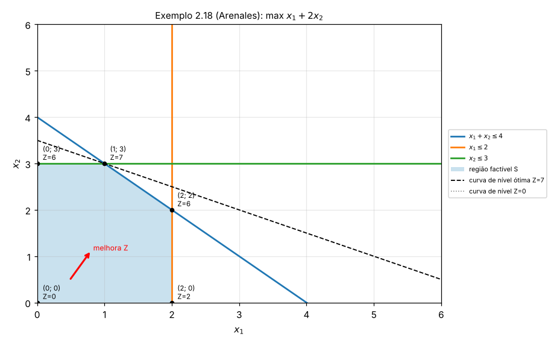

## Exemplo: fábrica de rádios (handout da disciplina)

$$
\begin{aligned}
\text{maximizar } & Z = 30X_1 + 40X_2 \\
\text{sujeito a: } & X_1 \le 24 \\
& X_2 \le 16 \\
& X_1 + 2X_2 \le 40 \\
& X_1, X_2 \ge 0
\end{aligned}
$$

| Vértice | De onde vem | $Z$ |
|---|---|---|
| $(0;\,0)$ | origem | $0$ |
| $(24;\,0)$ | $X_1=24$ e eixo | $720$ |
| $(24;\,8)$ | $X_1=24$ e $X_1+2X_2=40$ | $\mathbf{1.040}$ |
| $(8;\,16)$ | $X_2=16$ e $X_1+2X_2=40$ | $880$ |
| $(0;\,16)$ | $X_2=16$ e eixo | $640$ |

**Ótimo**: 24 rádios padrão e 8 de luxo, lucro de R\$ 1.040 por dia. As restrições **ativas** (que passam
pelo ótimo) são $X_1 \le 24$ e a dos operários. A linha de luxo tem folga de $16-8=8$ rádios.

??? note "Gráfico dos rádios"
    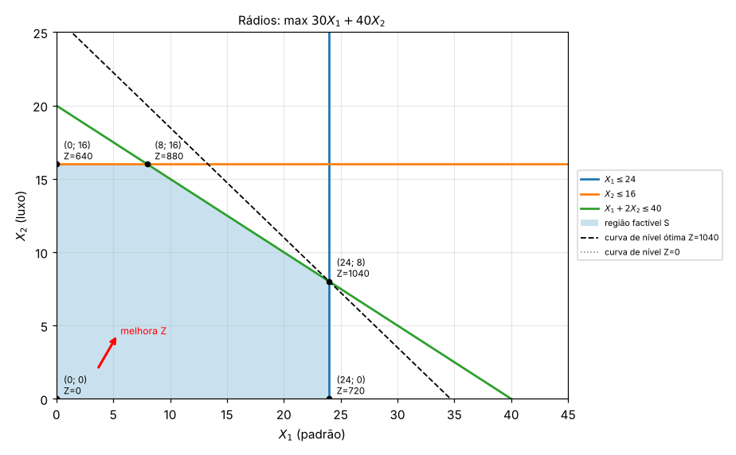

## Exemplo 2.6 do livro: geladeiras

Um fabricante vende no máximo 1.500 geladeiras de luxo e 6.000 básicas por mês. Tem 25.000 homens-hora
(luxo gasta 10 h, básica 8 h) e uma linha de montagem para 4.500 geladeiras. Lucro de \$100 (luxo) e \$50
(básica).

$$
\begin{aligned}
\text{maximizar } & Z = 100x_L + 50x_B \\
\text{sujeito a: } & 10x_L + 8x_B \le 25.000 \\
& x_L + x_B \le 4.500 \\
& 0 \le x_L \le 1.500, \quad 0 \le x_B \le 6.000
\end{aligned}
$$

Interceptos: a mão de obra corta os eixos em $(2.500;\,0)$ e $(0;\,3.125)$; a linha de montagem em
$(4.500;\,0)$ e $(0;\,4.500)$. A reta da linha de montagem fica inteira **acima** da de mão de obra dentro
do quadrante útil, então ela não corta $S$ (é uma restrição **redundante**). O mesmo vale para
$x_B \le 6.000$.

| Vértice | $Z$ |
|---|---|
| $(0;\,0)$ | $0$ |
| $(1.500;\,0)$ | $150.000$ |
| $(1.500;\,1.250)$ | $\mathbf{212.500}$ |
| $(0;\,3.125)$ | $156.250$ |

**Ótimo**: 1.500 de luxo e 1.250 básicas, lucro de \$212.500. Ativas: mercado de luxo e mão de obra.

??? note "Gráfico das geladeiras"
    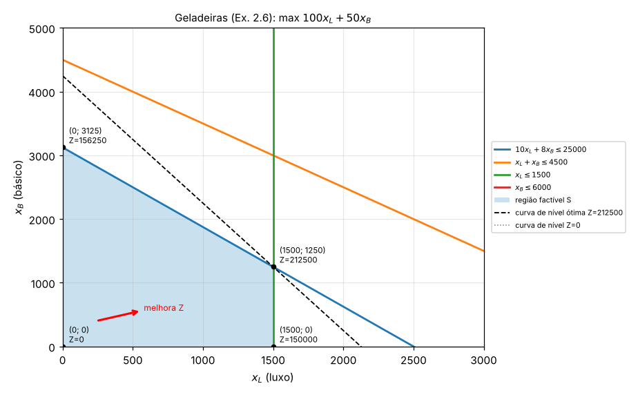

## Minimização

Em minimização, a lógica se inverte: desloca-se a curva de nível **contra** o gradiente, e o ótimo é o
vértice com **menor** $Z$. Com restrições "$\ge$", a região factível costuma ficar "aberta para fora",
longe da origem.

$$
\begin{aligned}
\text{minimizar } & Z = 4x_1 + 2x_2 \\
\text{sujeito a: } & 3x_1 + x_2 \ge 9 \\
& x_1 + x_2 \ge 5 \\
& x_1 + 3x_2 \ge 9 \\
& x_1 \le 8, \quad x_2 \le 10, \quad x_1,x_2 \ge 0
\end{aligned}
$$

Pelo teste da origem, $0 \ge 9$ é falso, então nas três primeiras restrições vale o lado **oposto** à
origem.

| Vértice | De onde vem | $Z$ |
|---|---|---|
| $(0;\,9)$ | $3x_1+x_2=9$ e eixo $x_2$ | $18$ |
| $(2;\,3)$ | $3x_1+x_2=9$ e $x_1+x_2=5$ | $\mathbf{14}$ |
| $(3;\,2)$ | $x_1+x_2=5$ e $x_1+3x_2=9$ | $16$ |
| $(8;\,1/3)$ | $x_1+3x_2=9$ e $x_1=8$ | $32{,}67$ |
| $(8;\,10)$ | $x_1=8$ e $x_2=10$ | $52$ |
| $(0;\,10)$ | $x_2=10$ e eixo | $20$ |

**Ótimo**: $(2;\,3)$ com $Z^*=14$.

??? note "Gráfico da minimização"
    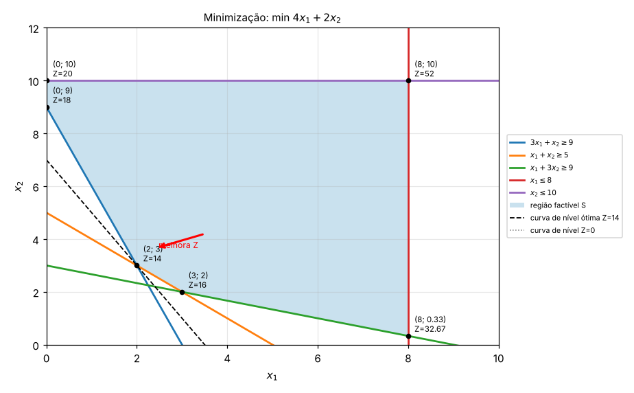

## Os quatro resultados possíveis

O gráfico também mostra quando o problema **não** tem uma solução única. Na prova, é comum perguntarem
qual caso aparece.

| Caso | Como aparece no gráfico | O que dizer |
|---|---|---|
| **Ótimo único** | A curva de nível toca $S$ em um só vértice | Solução ótima única |
| **Ótimos múltiplos** | A curva de nível é **paralela** a um lado de $S$ e encosta no lado inteiro | Infinitas soluções ótimas, todas com o mesmo $Z$ (todo o segmento entre os dois vértices) |
| **Ilimitado** | $S$ é aberta no sentido em que $Z$ melhora; a curva de nível pode ser empurrada para sempre | $Z \to +\infty$ (max) ou $Z \to -\infty$ (min): normalmente indica restrição esquecida no modelo |
| **Infactível** | As restrições não têm nenhum ponto em comum; $S$ é vazia | Não existe solução; as exigências são contraditórias |

!!! example "Ótimos múltiplos: max $Z=2x_1+2x_2$ com $x_1+x_2 \le 6$, $x_1 \le 4$, $x_2 \le 5$"
    Os vértices $(4;\,2)$ e $(1;\,5)$ dão ambos $Z=12$. Isso acontece porque $Z=2(x_1+x_2)$ é paralela à
    restrição $x_1+x_2 \le 6$: qualquer ponto do segmento entre $(4;\,2)$ e $(1;\,5)$ é ótimo.

    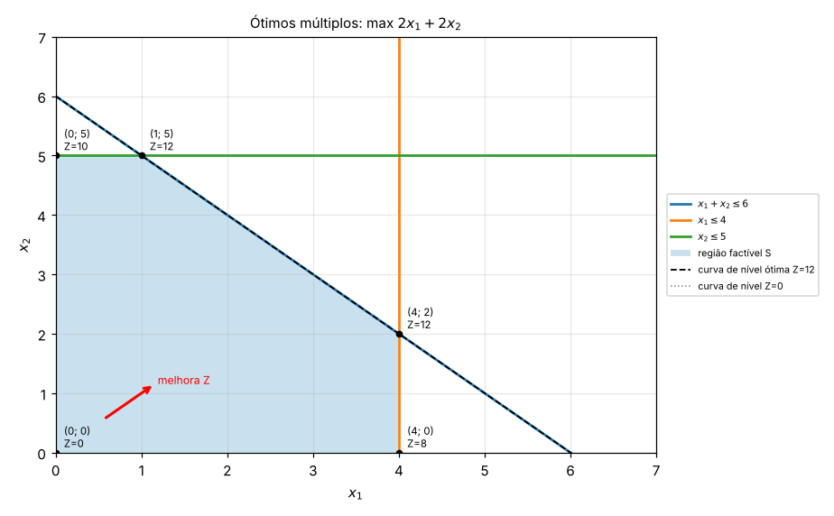

!!! example "Ilimitado: max $Z=x_1+x_2$ com $-x_1+x_2 \le 2$ e $x_1-2x_2 \le 2$"
    A região factível segue para cima e para a direita sem fim; as curvas de nível $Z=4, 8, 12, \dots$
    sempre encontram pontos de $S$. Não há ótimo finito.

    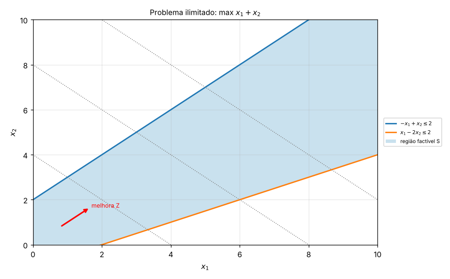

!!! example "Infactível: $x_1+x_2 \le 2$ e $x_1+x_2 \ge 5$"
    Não existe ponto com soma ao mesmo tempo no máximo 2 e no mínimo 5. O Solver responde "não foi possível
    encontrar uma solução viável". Curiosidade: o **Exemplo 2.2 do livro** (mistura de agregados para
    concreto) também é infactível com os dados apresentados. A faixa 76–152 mm obriga
    $x_1 \ge 0{,}5$; com a outra metade, a faixa 2,4–19 mm pede brita comercial e a faixa 38–76 mm pede
    seixo, e não dá para atender às duas ao mesmo tempo. O próprio livro comenta, logo depois, que nem todo
    problema tem solução possível e que novas fontes de agregados poderiam ser consideradas.

    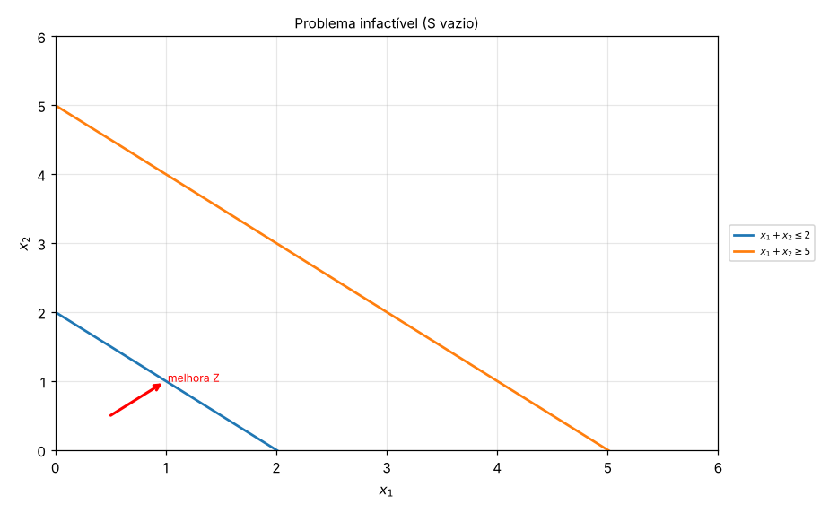

## Vocabulário que cai junto

- **Solução factível (viável)**: qualquer ponto de $S$, ou seja, que respeita todas as restrições.
- **Solução ótima**: a solução factível com o melhor $Z$.
- **Restrição ativa (*binding*)**: aquela que vale com igualdade no ótimo (a reta passa pelo ponto ótimo).
  Tem folga zero e é o "gargalo".
- **Folga**: quanto sobra de um recurso no ótimo. Em $\le$, folga $=b-(\text{lado esquerdo})$.
- **Restrição redundante**: aquela que não corta $S$ (removê-la não muda a região). Ex.: a linha de
  montagem no problema das geladeiras.

## Exercícios de resolução gráfica

Para cada um: desenhe as retas, sombreie $S$, liste os vértices e diga qual é o ótimo (ou qual dos casos
especiais acontece). As respostas estão escondidas.

**G1.** max $Z=3x_1+5x_2$; $x_1 \le 4$; $2x_2 \le 12$; $3x_1+2x_2 \le 18$; $x_1,x_2 \ge 0$.

??? success "Resposta G1"
    Retas: $x_1=4$ (vertical), $x_2=6$ (horizontal, vem de $2x_2 \le 12$), $3x_1+2x_2=18$ com interceptos
    $(6;\,0)$ e $(0;\,9)$.

    | Vértice | $Z$ |
    |---|---|
    | $(0;\,0)$ | 0 |
    | $(4;\,0)$ | 12 |
    | $(4;\,3)$ | 27 |
    | $(2;\,6)$ | **36** |
    | $(0;\,6)$ | 30 |

    Ótimo $(2;\,6)$, $Z^*=36$. Vértice $(2;\,6)$: com $x_2=6$, $3x_1+12=18$, logo $x_1=2$.

    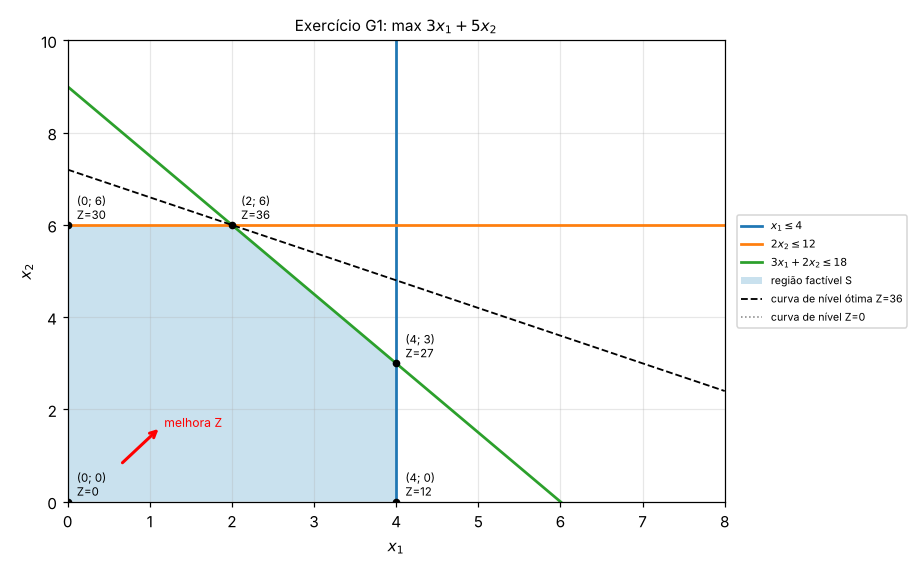

**G2.** Uma confecção faz camisas ($x_1$) e calças ($x_2$). O corte leva 1 h por camisa e 2 h por calça,
com 40 h disponíveis. A costura leva 2 h por camisa e 1 h por calça, com 50 h. Vende-se no máximo 15 calças.
Lucro de R\$ 20 por camisa e R\$ 30 por calça. Modele e resolva graficamente.

??? success "Resposta G2"
    $$
    \begin{aligned}
    \text{max } & Z = 20x_1 + 30x_2 \\
    \text{s.a. } & x_1 + 2x_2 \le 40 \quad \text{(corte)}\\
    & 2x_1 + x_2 \le 50 \quad \text{(costura)}\\
    & x_2 \le 15 \quad \text{(mercado)}\\
    & x_1, x_2 \ge 0
    \end{aligned}
    $$

    | Vértice | De onde vem | $Z$ |
    |---|---|---|
    | $(0;\,0)$ | origem | 0 |
    | $(25;\,0)$ | costura e eixo | 500 |
    | $(20;\,10)$ | corte e costura | **700** |
    | $(10;\,15)$ | corte e mercado | 650 |
    | $(0;\,15)$ | mercado e eixo | 450 |

    Vértice corte × costura: da costura, $x_2=50-2x_1$; no corte, $x_1+100-4x_1=40$, logo $x_1=20$ e
    $x_2=10$. Ótimo: 20 camisas e 10 calças, lucro R\$ 700. Sobram 5 calças de mercado.

    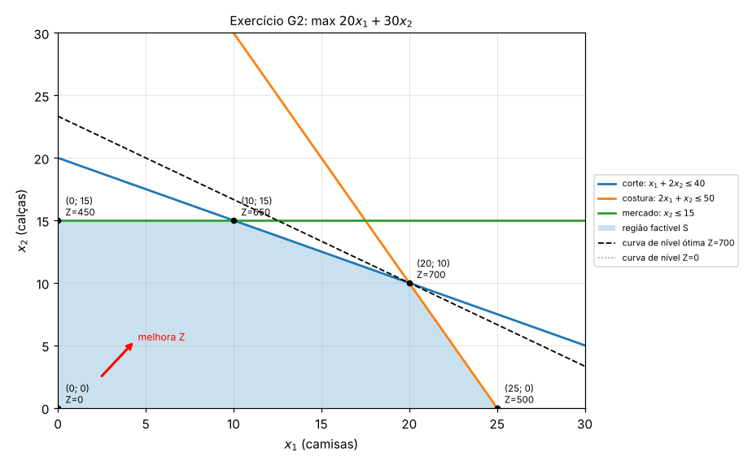

**G3.** Mistura de rações a custo mínimo: a ração A custa R\$ 3/kg e a B R\$ 4/kg. Exige-se proteína
$2x_A+x_B \ge 8$, fibra $x_A+2x_B \ge 10$ e volume $x_A+x_B \le 10$.

??? success "Resposta G3"
    | Vértice | $Z = 3x_A+4x_B$ |
    |---|---|
    | $(2;\,4)$ | **22** |
    | $(10;\,0)$ | 30 |
    | $(0;\,10)$ | 40 |
    | $(0;\,8)$ | 32 |

    Vértice proteína × fibra: $x_B=8-2x_A$ em $x_A+2(8-2x_A)=10$, ou seja, $16-3x_A=10$, logo $x_A=2$ e
    $x_B=4$. Ótimo: 2 kg de A e 4 kg de B, custo R\$ 22.

    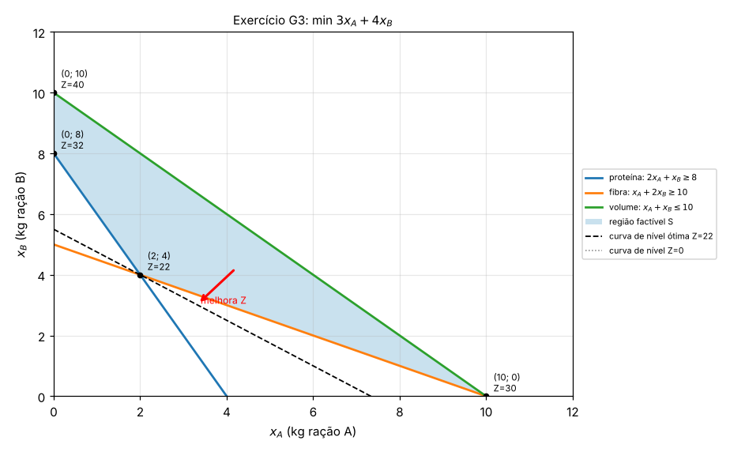

**G4.** max $Z=2x_1+x_2$; $x_1+x_2 \le 8$; $x_1-x_2 \le 2$; $x_2 \ge 2$; $x_1 \ge 1$.

??? success "Resposta G4"
    | Vértice | $Z$ |
    |---|---|
    | $(1;\,2)$ | 4 |
    | $(4;\,2)$ | 10 |
    | $(5;\,3)$ | **13** |
    | $(1;\,7)$ | 9 |

    Vértice $(5;\,3)$: somando $x_1+x_2=8$ com $x_1-x_2=2$ dá $2x_1=10$. Ótimo $(5;\,3)$, $Z^*=13$. Atenção:
    $x_1-x_2 \le 2$ passa pela região de um jeito "inclinado"; o teste da origem ($0 \le 2$, verdadeiro)
    mostra o lado certo.

    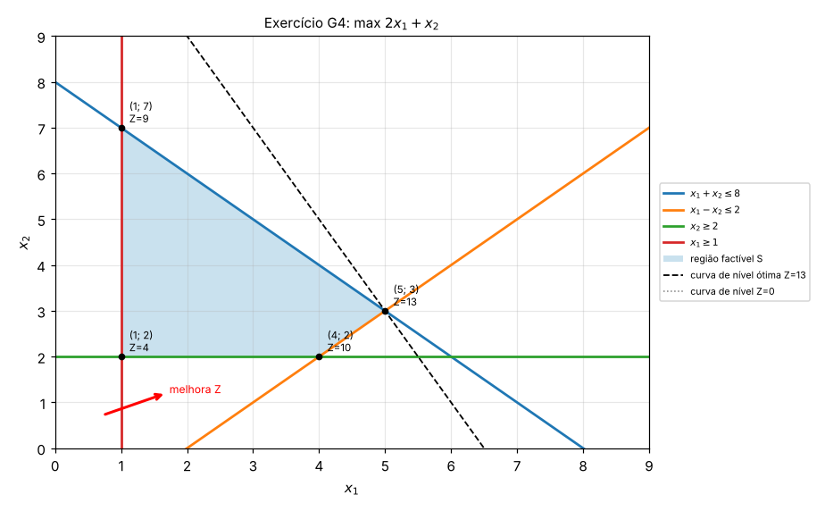

**G5.** max $Z=4x_1+2x_2$; $2x_1+x_2 \le 10$; $x_1+x_2 \le 7$; $x_2 \le 5$. Qual caso especial aparece?

??? success "Resposta G5"
    | Vértice | $Z$ |
    |---|---|
    | $(0;\,0)$ | 0 |
    | $(5;\,0)$ | **20** |
    | $(3;\,4)$ | **20** |
    | $(2;\,5)$ | 18 |
    | $(0;\,5)$ | 10 |

    **Ótimos múltiplos**: $Z=4x_1+2x_2 = 2(2x_1+x_2)$ é paralela à restrição $2x_1+x_2 \le 10$. Todo o
    segmento entre $(5;\,0)$ e $(3;\,4)$ é ótimo, com $Z^*=20$.

    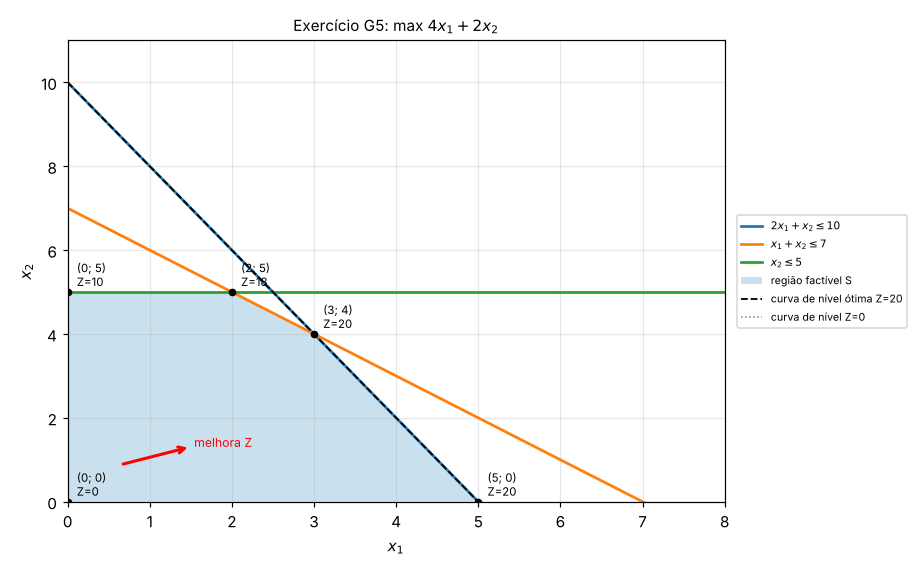

**G6.** min $Z=5x_1+8x_2$; $x_1+x_2 \ge 6$; $x_1 \le 4$; $x_2 \le 3$; $x_1 \ge x_2$.

??? success "Resposta G6"
    A restrição $x_1 \ge x_2$ vira $x_1-x_2 \ge 0$: a reta $x_1=x_2$ passa pela origem, então testa-se
    $(1;\,0)$: $1 \ge 0$, verdadeiro, vale o lado abaixo da diagonal.

    | Vértice | $Z$ |
    |---|---|
    | $(4;\,2)$ | **36** |
    | $(4;\,3)$ | 44 |
    | $(3;\,3)$ | 39 |

    Ótimo $(4;\,2)$ com $Z^*=36$. A região é um triângulo pequeno.

    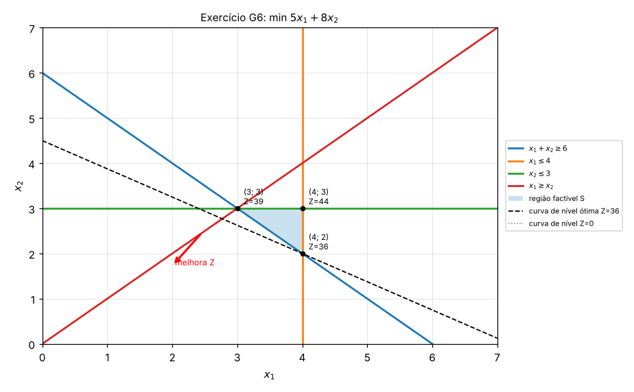

**G7.** Para o problema max $Z=x_1+x_2$ com $x_1+x_2 \ge 4$, $x_1 \le 3$ e $x_2 \ge 0$, o que acontece?
E se a função objetivo fosse **min** $Z=x_1+x_2$?

??? success "Resposta G7"
    Em max, $x_2$ não tem limite superior: a região sobe para sempre e $Z \to \infty$. O problema é
    **ilimitado** (falta uma restrição, por exemplo de capacidade).

    Em min, a curva de nível desce até encostar na reta $x_1+x_2=4$, que é paralela a ela. Há **ótimos
    múltiplos**: todo o segmento de $(0;\,4)$ a $(3;\,1)$, com $Z^*=4$. O mesmo conjunto de restrições
    pode ser ilimitado para um objetivo e ter ótimo para outro.
