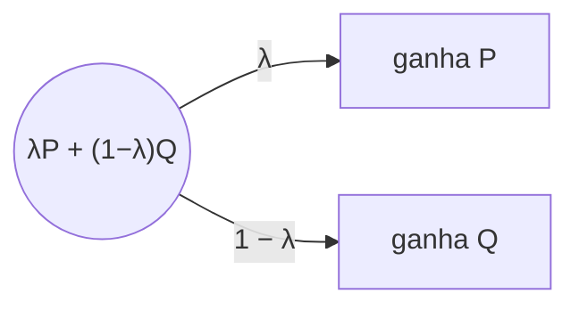
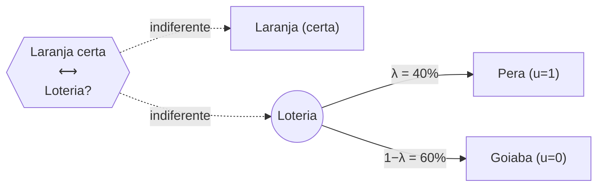

# Teoria da Decisão

Página completa do conteúdo de Teoria da Decisão da disciplina, com a matemática passo a passo. Base:
handout "Teoria da Decisão" do Prof. Adiel Filho (versão 2022.1) e a bibliografia indicada nele: Howard &
Abbas (2015); Raiffa (1977); Campello de Souza (2007); Hillier & Lieberman (2014); Berger (1980). Para
praticar, veja [Exercícios de teoria da decisão](exercicios-de-teoria-da-decisao.md).

!!! note "Mapa da página"
    1. O que é decisão e quais são os elementos de um problema de decisão.
    2. Decisão **sob incerteza** (sem probabilidades): critérios maximax, maximin, Laplace, Hurwicz e
       Savage.
    3. Decisão **sob risco** (com probabilidades): valor esperado e valor da informação.
    4. **Teoria da utilidade** de von Neumann-Morgenstern: axiomas, construção da função utilidade (exemplo
       das frutas) e utilidade para dinheiro.
    5. **Árvores de decisão** e o método *fold back*, com o exemplo do medicamento para diabetes.

    Os itens 1, 4 e 5 seguem o handout. Os critérios do item 2 e as fórmulas de valor esperado e valor da
    informação do item 3 vêm da bibliografia (Hillier & Lieberman, Raiffa); o handout cita "decisão sob
    incerteza", "decisão sob risco" e "*value of information*", mas não detalha os cálculos.

## 1. O que é decisão

**Decisão** é o *"curso de ação escolhido pela pessoa, como o meio mais efetivo à sua disposição, para
alcançar os objetivos pretendidos"*, ou a *"escolha entre duas ou mais alternativas que envolve
obrigatoriamente a alocação de recursos"* (Howard & Abbas, 2015). Decidir é, no fundo, um problema de
otimização: escolher a melhor alternativa.

A teoria da decisão estuda **como decidir quando é incerto o que vai acontecer**:

> "A teoria da decisão é um meio de se agir com lógica em situações incertas. E, segundo esta teoria, uma
> boa decisão deverá ser uma função lógica daquilo que se quer, daquilo que se sabe e daquilo que se pode
> fazer." — Souza (2007)

| Elemento | Significado | Na matemática vira |
|---|---|---|
| **O que se quer** | Preferências pelas consequências (que podem ser incertas ou distribuídas no tempo) | Função **utilidade** $u$ (ou o próprio valor monetário) |
| **O que se sabe** | Conhecimento dos elementos do problema e das relações entre eles | **Estados da natureza** $\theta$ e suas **probabilidades** |
| **O que se pode fazer** | Alternativas de ação disponíveis (exigem criatividade para serem encontradas) | Conjunto de **ações** $a_1, a_2, \dots$ |

**Características das decisões**: sequencialidade (uma decisão é consequência de fatos anteriores),
complexidade (depende do grau de detalhe do modelo), subjetividade (depende dos valores do decisor) e
institucionalidade (é moldada pela cultura e estrutura da organização).

**Perspectivas**: **descritiva** (descreve como as pessoas decidem de fato), **normativa** (diz como
deveriam decidir, se fossem racionais) e **prescritiva** (ajuda uma pessoa real a decidir melhor). A
teoria da decisão é normativa/prescritiva: não tenta explicar o comportamento das pessoas, e sim
organizar logicamente o problema.

!!! warning "Decisão ≠ consequência"
    Uma boa decisão **não garante** uma boa consequência. Dirigir sóbrio e sofrer um acidente é boa decisão
    com má consequência; dirigir bêbado e chegar em casa é má decisão com boa consequência. A qualidade de
    uma decisão é julgada pelo **processo** (usou bem o que se quer, o que se sabe e o que se pode fazer),
    não pelo resultado que a sorte trouxe.

**Perdas × ganhos**: estatísticos clássicos (Wald, 1950) raciocinam em **perdas** ou riscos; teóricos da
decisão, em **ganhos** ou utilidades. Na prática dá no mesmo: um é o negativo do outro.

## 2. Elementos de um problema de decisão e a matriz de decisão

Um problema de decisão simples é organizado em uma **matriz de decisão** (ou tabela de *payoffs*):

- **linhas** = ações (alternativas) $a_i$, que o decisor controla;
- **colunas** = estados da natureza $\theta_j$, que o decisor **não** controla;
- **células** = consequência (*payoff*) $c_{ij}$ de escolher $a_i$ quando ocorre $\theta_j$.

| | $\theta_1$ | $\theta_2$ | $\dots$ | $\theta_n$ |
|---|---|---|---|---|
| $a_1$ | $c_{11}$ | $c_{12}$ | $\dots$ | $c_{1n}$ |
| $a_2$ | $c_{21}$ | $c_{22}$ | $\dots$ | $c_{2n}$ |
| $\vdots$ | | | | |

Conforme o que se sabe sobre os estados, há três ambientes:

| Ambiente | O que se sabe | Exemplo do handout | Ferramenta |
|---|---|---|---|
| **Certeza** | Qual estado vai ocorrer | — | Otimização (programação linear etc.) |
| **Risco** | As **probabilidades** de cada estado | O engenheiro de uma obra no Norte consegue estimar a chance de a chuva interromper os suprimentos | Valor esperado, utilidade esperada, árvore de decisão |
| **Incerteza** | Só os estados possíveis, **sem** probabilidades | O mesmo engenheiro não consegue estimar essa chance | Critérios maximax, maximin, Laplace, Hurwicz, Savage |

!!! example "Exemplo que será usado nas próximas seções: a sorveteria"
    Uma sorveteria decide quanto sorvete produzir para o fim de semana: **pouco**, **médio** ou **muito**.
    O lucro (R\$) depende do clima:

    | Ação \ Clima | Frio | Ameno | Quente |
    |---|---|---|---|
    | $a_1$: Pouco | 200 | 250 | 300 |
    | $a_2$: Médio | 50 | 400 | 550 |
    | $a_3$: Muito | −150 | 250 | 800 |

**Dominância**: se uma ação é pior ou igual a outra em **todos** os estados (e pior em pelo menos um), ela
é **dominada** e pode ser descartada antes de qualquer cálculo. Na sorveteria nenhuma ação é dominada.

## 3. Decisão sob incerteza (sem probabilidades)

Sem probabilidades, não dá para calcular média. Os critérios clássicos traduzem diferentes "personalidades"
do decisor.

### Maximax (otimista)

Para cada ação, pega o **melhor** resultado; escolhe a ação com o maior desses melhores.

$$a^* = \arg\max_i \; \max_j \; c_{ij}$$

Sorveteria: melhores de cada linha = 300, 550, 800. Escolhe **Muito** (800).

### Maximin, ou critério de Wald (pessimista)

Para cada ação, pega o **pior** resultado; escolhe a ação com o maior desses piores ("o melhor dos
piores casos").

$$a^* = \arg\max_i \; \min_j \; c_{ij}$$

Sorveteria: piores = 200, 50, −150. Escolhe **Pouco** (200).

### Laplace (razão insuficiente)

Se não sei as probabilidades, trato todos os estados como **igualmente prováveis** e calculo a média
simples.

$$a^* = \arg\max_i \; \frac{1}{n}\sum_{j=1}^{n} c_{ij}$$

Sorveteria: Pouco $= 750/3 = 250$; Médio $= 1000/3 \approx 333{,}3$; Muito $= 900/3 = 300$. Escolhe
**Médio**.

### Hurwicz (coeficiente de otimismo $\alpha$)

Um meio-termo: dá peso $\alpha$ ao melhor caso e $1-\alpha$ ao pior. Com $\alpha=1$ vira maximax; com
$\alpha=0$, maximin.

$$H(a_i) = \alpha \max_j c_{ij} + (1-\alpha)\min_j c_{ij}$$

Sorveteria com $\alpha=0{,}6$: Pouco $=0{,}6(300)+0{,}4(200)=260$; Médio $=0{,}6(550)+0{,}4(50)=350$; Muito
$=0{,}6(800)+0{,}4(-150)=420$. Escolhe **Muito**.

### Savage (mínimo arrependimento, ou *minimax regret*)

O **arrependimento** (perda de oportunidade) é quanto se deixou de ganhar por não ter escolhido a melhor ação
para o estado que ocorreu:

$$r_{ij} = \max_k c_{kj} - c_{ij}$$

Monta-se a matriz de arrependimentos coluna por coluna (o melhor de cada coluna menos cada célula); para
cada ação pega o **maior** arrependimento; escolhe a ação com o **menor** desses.

| Arrependimento | Frio (máx 200) | Ameno (máx 400) | Quente (máx 800) | Pior arrependimento |
|---|---|---|---|---|
| Pouco | 0 | 150 | 500 | 500 |
| Médio | 150 | 0 | 250 | **250** |
| Muito | 350 | 150 | 0 | 350 |

Escolhe **Médio**.

!!! tip "Resumo para a prova"
    | Critério | Pergunta que ele faz | Sorveteria |
    |---|---|---|
    | Maximax | "E se tudo der certo?" | Muito |
    | Maximin | "E se tudo der errado?" | Pouco |
    | Laplace | "E se tudo for igualmente provável?" | Médio |
    | Hurwicz ($\alpha=0{,}6$) | "Sou 60% otimista" | Muito |
    | Savage | "Do que vou me arrepender menos?" | Médio |

    Critérios diferentes dão respostas diferentes: não existe critério "certo" sob incerteza; ele reflete a
    atitude do decisor. Por isso vale tanto a pena conseguir **probabilidades** (passar para decisão sob
    risco).

## 4. Decisão sob risco (com probabilidades)

### Valor monetário esperado (VME)

Com probabilidades $P(\theta_j)$, calcula-se para cada ação a média ponderada dos resultados e escolhe-se a
maior:

$$VME(a_i) = \sum_{j} P(\theta_j)\,c_{ij}$$

Sorveteria com $P(\text{frio})=0{,}3$, $P(\text{ameno})=0{,}5$ e $P(\text{quente})=0{,}2$:

$$VME(\text{Pouco}) = 0{,}3(200)+0{,}5(250)+0{,}2(300) = 60+125+60 = 245$$

$$VME(\text{Médio}) = 0{,}3(50)+0{,}5(400)+0{,}2(550) = 15+200+110 = \mathbf{325}$$

$$VME(\text{Muito}) = 0{,}3(-150)+0{,}5(250)+0{,}2(800) = -45+125+160 = 240$$

Decisão: **Médio**, com VME de R\$ 325.

### Valor esperado da informação perfeita (VEIP)

Quanto valeria saber **antes** qual clima vai fazer? Com informação perfeita, para cada estado escolho a
melhor ação daquele estado:

$$VE_{\text{c/ info perfeita}} = \sum_j P(\theta_j)\,\max_i c_{ij} = 0{,}3(200)+0{,}5(400)+0{,}2(800) = 420$$

$$VEIP = VE_{\text{c/ info perfeita}} - \max_i VME(a_i) = 420 - 325 = 95$$

**Interpretação**: nenhuma previsão do tempo, por melhor que seja, vale mais que R\$ 95 para essa decisão.
É o teto do que se deve pagar por informação.

**Perda de oportunidade esperada (POE)**: é o arrependimento médio de cada ação. A ação de menor POE é
sempre a mesma de maior VME, e o menor POE é igual ao VEIP. Médio:
$0{,}3(150)+0{,}5(0)+0{,}2(250)=95$.

!!! warning "Limitação do valor esperado"
    O VME trata R\$ 1 milhão certo e uma aposta de 50% de R\$ 2 milhões como iguais. Quase ninguém pensa
    assim: o decisor tem uma **atitude diante do risco**. É para isso que existe a **teoria da utilidade**:
    troca-se o dinheiro pela utilidade do dinheiro e calcula-se a **utilidade esperada**.

## 5. Teoria da utilidade de von Neumann-Morgenstern

"A utilidade diz respeito àquilo que se quer": o objetivo é um modelo matemático que represente **quanto**
o decisor deseja cada bem, para poder fazer contas com preferências.

??? note "Breve histórico (handout)"
    - **Bernoulli (1738)**: o preço de um bem é igual para todos, mas a utilidade depende das
      circunstâncias; R\$ 1.000 valem mais para um pobre que para um rico.
    - **Bentham (1789)**: princípio da utilidade e o "cálculo felicífico" (aspectos morais e éticos).
      Antes, Platão e Aristóteles (valor de uso × valor de troca) e São Tomás de Aquino (preço justo, usura).
    - **Marginalistas**: curvas de indiferença; **Pareto (1927)**: teoria do consumidor só com curvas de
      indiferença (utilidade **ordinal**).
    - **von Neumann e Morgenstern (1944/1947)**: *The Theory of Games and Economic Behavior*, com axiomas de
      comportamento racional diante do risco e a utilidade "cardinal fraca". É a teoria estudada hoje.
    - **Wald (1950)**: teoria estatística da decisão, com funções de perda.
    - **Kahneman (Nobel 2002)**: teoria dos prospectos e economia comportamental, que mostra onde as pessoas
      reais se afastam dos axiomas.

### Bens, loterias e relações de preferência

- $p$ é um **bem** (ou perda): dinheiro, quilos de algo, um estado de saúde, uma casa.
- $P$ é uma **distribuição de probabilidade** sobre os bens (um "prospecto"). Um bem certo é a distribuição
  que dá probabilidade 1 a ele ("com probabilidade 1", abreviado **cp1**).
- **Loteria**: para $0 \le \lambda \le 1$, $\lambda P + (1-\lambda)Q$ é o jogo em que se ganha $P$ com
  probabilidade $\lambda$ e $Q$ com probabilidade $1-\lambda$. Ganha-se só um dos dois.

**Relações de preferência** entre $P$ e $Q$:

| Símbolo | Leitura | Definição |
|---|---|---|
| $P \succsim Q$ | "P é pelo menos tão desejável quanto Q" | relação básica |
| $P \succ Q$ | "P é preferível a Q" | $P \succsim Q$ e **não** $Q \succsim P$ |
| $P \sim Q$ | "indiferente entre P e Q" | $P \succsim Q$ e $Q \succsim P$ |

**Ordem**: uma ordem é um conjunto de pares ordenados. Ex.: com $A = \{\text{laranja, maçã, banana,
goiaba}\}$ e laranja $\succsim$ banana $\succsim$ goiaba $\succsim$ maçã, a ordem é
$O = \{(\text{la},\text{ba}), (\text{la},\text{go}), (\text{la},\text{ma}), (\text{ba},\text{go}),
(\text{ba},\text{ma}), (\text{go},\text{ma})\}$. O conjunto é **totalmente ordenado** se valem: reflexiva
($x \sim x$), transitiva, antissimétrica e **completa** ($x \succsim y$ ou $y \succsim x$ para todo par).
Sem a completa, a ordem é **parcial**.

!!! note "Atenção: não se tem preferência por ações"
    Os elementos de desejo são os **bens/consequências**. A preferência por uma ação é derivada: prefere-se
    a ação porque as consequências que ela gera (com suas probabilidades) são preferidas.

### Os quatro axiomas de racionalidade

Preferir laranja a banana, ou banana a maçã, não tem problema algum. O que é irracional é preferir laranja a
banana, banana a maçã **e** maçã a laranja. Os axiomas proíbem esse tipo de incoerência.

**Axioma 1 — Completeza (ordem total)**: para quaisquer $P, Q$, vale $P \succsim Q$ ou $Q \succsim P$. Ou
seja, sempre vale exatamente um: $P \succ Q$, $P \sim Q$ ou $Q \succ P$. O decisor sempre consegue
comparar.

**Axioma 2 — Transitividade**: (a) $P \succ Q$ e $Q \succsim R \Rightarrow P \succ R$; (b) $P \sim Q$ e
$Q \sim R \Rightarrow P \sim R$. Garante a racionalidade (veta ciclos). O handout ilustra a indiferença
com faixas de cinza: faixas vizinhas parecem iguais, mas as extremas são claramente diferentes.

**Axioma 3 — Dominância (independência)**: (a) se $P \succ Q$ e $0 < \lambda \le 1$, então para todo $R$:
$\lambda P + (1-\lambda)R \succ \lambda Q + (1-\lambda)R$; (b) o mesmo com $\sim$. Misturar a **mesma**
coisa $R$ dos dois lados não muda a preferência. É esse axioma que garante que a utilidade é **linear nas
probabilidades** (vira valor esperado).

**Axioma 4 — Arquimediano (continuidade)**: se $P \succ Q \succ R$, existem $1 > \lambda > \mu > 0$ tais que

$$\lambda P + (1-\lambda)R \;\succ\; Q \;\succ\; \mu P + (1-\mu)R$$

Assim como entre dois números reais sempre há outro, entre "muita chance do melhor" e "pouca chance do
melhor" existe uma loteria **equivalente** a $Q$. É esse axioma que permite achar o $\lambda$ de
indiferença na construção da utilidade.

### Função utilidade

$u$ é uma **função utilidade** se:

1. $u$ associa um número real $u(P)$ a cada distribuição $P$;
2. **preserva a ordem**: $P \succsim Q \Leftrightarrow u(P) \ge u(Q)$;
3. é **linear** nas probabilidades: $u[\lambda P + (1-\lambda)Q] = \lambda u(P) + (1-\lambda)u(Q)$.

A unidade é o **útile**. A escala é **intervalar**: importam as diferenças entre utilidades, não o valor
absoluto, como na temperatura em °C. A utilidade é **cotada** (limitada), o que resolve o paradoxo de São
Petersburgo (um jogo de valor esperado infinito pelo qual ninguém pagaria muito).

**Teorema (von Neumann-Morgenstern)**: se os quatro axiomas valem, existe uma função utilidade. No
caminho, o handout prova os lemas:

| Lema | Enunciado | Em português |
|---|---|---|
| 1. Monotonicidade | $P \succ Q$, $1 \ge \lambda > \mu \ge 0 \Rightarrow \lambda P+(1-\lambda)Q \succ \mu P+(1-\mu)Q$ | Mais chance do melhor é sempre melhor |
| 2. Unicidade | $P \succ Q$ e $\lambda P+(1-\lambda)Q \sim \mu P+(1-\mu)Q \Rightarrow \lambda=\mu$ | Num mesmo intervalo, cada consequência tem uma única utilidade |
| 3. Representação | $P \succsim Q \Leftrightarrow u(P) \ge u(Q)$ | A utilidade guarda a ordem |
| 4. Linearidade | $u[\lambda P+(1-\lambda)Q] = \lambda u(P)+(1-\lambda)u(Q)$ | Utilidade de loteria = média ponderada |
| 5. Extensão | Se $u$ é utilidade, $u^* = au + b$ com $a > 0$ também é | Pode-se mudar a escala livremente (como °C ↔ °F) |

**Teorema 2**: a utilidade de qualquer loteria é o valor esperado das utilidades dos bens:

$$u(P) = E[v(p)] = \sum_{p} P(p)\,v(p)$$

em que $v(p)$ é a **função valor**, a utilidade do bem $p$ recebido com certeza. Consequência prática:
**basta conhecer $v$ dos bens** para calcular a utilidade de qualquer jogo.

### Como construir a função utilidade: a loteria de referência

1. Fixe um bem **muito desejável** $\bar P$ e um **muito indesejável** $\underline P$, e arbitre
   $u(\bar P)=1$ e $u(\underline P)=0$ (Lema 5 permite).
2. Para cada bem $Q$ entre os dois, pergunte: *"qual probabilidade $\lambda$ de ganhar $\bar P$ (senão,
   $\underline P$) faz você ficar indiferente entre o jogo e $Q$ com certeza?"*
3. Esse $\lambda$ é a utilidade de $Q$:

$$Q \sim \lambda\bar P + (1-\lambda)\underline P \;\Rightarrow\; u(Q) = \lambda\cdot 1 + (1-\lambda)\cdot 0 = \lambda$$

Formalmente, $u(Q) = \sup\{\lambda : Q \succ \lambda\bar P + (1-\lambda)\underline P\}$: o maior
$\lambda$ para o qual o decisor ainda prefere $Q$ certo. Acima dele passa a preferir o jogo.

!!! example "Exemplo do handout: R\$ 4.000"
    Mais desejável: R\$ 10.000 (cp1); menos desejável: R\$ 1.000 (cp1). O indivíduo fica indiferente entre
    R\$ 4.000 certos e um jogo com 70% de R\$ 10.000 e 30% de R\$ 1.000. Logo $u(4.000) = 0{,}7$ nessa escala.

    Repare: o valor esperado do jogo é $0{,}7(10.000)+0{,}3(1.000) = 7.300$, bem acima de 4.000. Esse
    indivíduo aceita trocar uma aposta de valor esperado R\$ 7.300 por R\$ 4.000 certos: é **avesso ao
    risco**.

### Exemplo das frutas (passo a passo)

**A ideia geral primeiro**: ordenar preferências ("gosto mais de maçã do que de pera") é fácil, mas não
diz **o quanto** mais se gosta, e não dá para fazer contas com um ranking. O método da loteria de
referência transforma preferências em números.

**Dados do problema**: um decisor tem a seguinte ordem de preferência entre 5 frutas (da mais para a menos
desejada):

$$Maçã \succ Pera \succ Laranja \succ Goiaba \succ Uva$$

Pelo Teorema 2, basta achar $v$ de cada fruta: depois, qualquer jogo tem utilidade
$u(P) = P(\text{Ma})v(\text{Ma}) + \dots + P(\text{Uv})v(\text{Uv})$.

**Passo 1 — Escolher dois pontos de referência e fixar suas utilidades.** Começa-se pela faixa do meio, com
**Pera** como referência superior e **Goiaba** como inferior:

$$u(Pera) = 1 \qquad u(Goiaba) = 0$$

Isso **não** significa que Pera é a fruta mais desejada (Maçã é); é só a referência desta primeira rodada.

**Passo 2 — Descobrir a utilidade da Laranja com uma loteria imaginária.** Pergunta-se: *"você prefere uma
Laranja com certeza, ou uma loteria com probabilidade $\lambda$ de ganhar Pera e $(1-\lambda)$ de ganhar
Goiaba?"* Com $\lambda=0$ o jogo dá Goiaba e ele prefere a Laranja; com $\lambda=1$ o jogo dá Pera e ele
prefere o jogo. Em algum ponto entre os dois fica indiferente (Axioma 4). Por introspecção, ele responde
$\lambda = 0{,}4$:

$$v(Laranja) = u(0{,}4\,Pe + 0{,}6\,Go) = 0{,}4\,v(Pera) + 0{,}6\,v(Goiaba) = 0{,}4 \times 1 + 0{,}6 \times 0 = \mathbf{0{,}4}$$

**Passo 3 — Uma segunda rodada, agora com os extremos reais (Uva até Maçã).** A primeira rodada não diz
nada sobre Maçã (acima de Pera) nem Uva (abaixo de Goiaba). Repete-se o procedimento com uma nova escala,
que o handout chama de $u_{Uv,Ma}$ ("nesta escala, Uva vale 0 e Maçã vale 1"):

$$u_{Uv,Ma}(Maçã) = 1 \qquad u_{Uv,Ma}(Uva) = 0$$

Por introspecção, o decisor responde:

$$u_{Uv,Ma}(Pera) = 0{,}8 \qquad u_{Uv,Ma}(Goiaba) = 0{,}1$$

(Pera certa equivale a 80% de chance de Maçã e 20% de Uva; Goiaba certa equivale a 10% de Maçã e 90% de
Uva.)

**Passo 4 — Juntar as duas escalas numa só.** Agora há números em duas escalas diferentes, como uma
temperatura em °C e outra em °F. Pelo Lema 5, duas escalas de utilidade das mesmas preferências diferem só
por uma transformação linear:

$$u^*(F) = a \cdot u_{Uv,Ma}(F) + b, \qquad a > 0$$

em que $u^*$ é a escala do Passo 1 (Pera $=1$, Goiaba $=0$). Para achar as **duas** incógnitas $a$ e $b$
são necessários **dois** pontos que já se conhece nas duas escalas. As únicas frutas medidas nas duas
rodadas são **Pera** e **Goiaba**; elas são a "ponte" entre as escalas:

| Fruta-ponte | Na escala Uva–Maçã | Tem de virar (escala do Passo 1) | Equação |
|---|---|---|---|
| Goiaba | 0,1 | 0 | $a(0{,}1) + b = 0$ |
| Pera | 0,8 | 1 | $a(0{,}8) + b = 1$ |

Subtraindo a primeira equação da segunda:

$$a(0{,}8 - 0{,}1) = 1 \;\Rightarrow\; a = \frac{1}{0{,}7}$$

Da primeira equação:

$$b = -0{,}1\,a = -\frac{0{,}1}{0{,}7}$$

Logo:

$$u^*(F) = \frac{u_{Uv,Ma}(F)}{0{,}7} - \frac{0{,}1}{0{,}7} = \frac{u_{Uv,Ma}(F) - 0{,}1}{0{,}7}$$

É exatamente a fórmula do handout, que em forma geral fica:

$$u^*(F) = \frac{u_{Uv,Ma}(F) - u_{Uv,Ma}(Goiaba)}{u_{Uv,Ma}(Pera) - u_{Uv,Ma}(Goiaba)}$$

!!! tip "De onde vem cada pedaço"
    - O **numerador** desloca a escala para que Goiaba caia no 0.
    - O **denominador** estica a escala para que a distância Goiaba–Pera vire 1.
    - Os números que entram no numerador e no denominador são os valores **das frutas-ponte na escala que
      se quer converter** (0,1 e 0,8), e **não** os de Maçã e Uva. Maçã e Uva são as frutas que se quer
      converter (o $F$ da fórmula).
    - "Ponte" quer dizer "conhecido nas duas escalas". Não tem a ver com ser a fruta mais ou menos
      preferida.

**Passo 5 — Aplicar a fórmula a cada fruta.**

| Fruta | $u_{Uv,Ma}(F)$ | Cálculo de $u^*(F)$ | Utilidade final |
|---|---|---|---|
| Maçã | $1$ | $(1 - 0{,}1)/0{,}7$ | $9/7 \approx 1{,}29$ |
| Pera | $0{,}8$ | $(0{,}8 - 0{,}1)/0{,}7$ | $1$ |
| Laranja | $0{,}38$ (ver abaixo) | já medida no Passo 2 | $0{,}4$ |
| Goiaba | $0{,}1$ | $(0{,}1 - 0{,}1)/0{,}7$ | $0$ |
| Uva | $0$ | $(0 - 0{,}1)/0{,}7$ | $-1/7 \approx -0{,}14$ |

A Laranja não foi medida na escala Uva–Maçã, mas a fórmula pode ser usada ao contrário. O handout faz:

$$\frac{u_{Uv,Ma}(La) - 0{,}1}{0{,}7} = 0{,}4 \;\Rightarrow\; u_{Uv,Ma}(La) = 0{,}1 + 0{,}7 \times 0{,}4 = 0{,}38$$

!!! tip "Como ler esse resultado"
    A ordem dos números bate com a ordem de preferência ($1{,}29 > 1 > 0{,}4 > 0 > -0{,}14$), como garante o
    Lema 3. A utilidade da Uva deu **negativa**: isso é só consequência de ter fixado Goiaba $=0$; o zero é
    arbitrário. Só a **ordem** e as **diferenças relativas** têm significado: a distância Pera–Laranja
    (0,6) é maior que a distância Laranja–Goiaba (0,4), ou seja, o decisor se importa mais com a primeira
    diferença.

**Passo 6 — Usar a utilidade para prever preferências.** O handout fecha com a pergunta: para que
$\lambda$ o decisor fica indiferente entre uma Pera certa e o jogo $\lambda\,Ma + (1-\lambda)\,La$?

$$u[\lambda Ma + (1-\lambda)La] = u(Pe) \;\Rightarrow\; \lambda\cdot\frac{9}{7} + (1-\lambda)\cdot 0{,}4 = 1$$

$$\lambda\left(\frac{9}{7} - 0{,}4\right) = 0{,}6 \;\Rightarrow\; \lambda\cdot\frac{31}{35} = \frac{21}{35} \;\Rightarrow\; \lambda = \frac{21}{31} \approx 0{,}68$$

Com apenas três respostas de introspecção (0,4; 0,8; 0,1), dá para prever as preferências do decisor em
infinitos outros jogos. Ex.: 50% Maçã e 50% Uva tem utilidade $0{,}5(9/7)+0{,}5(-1/7) = 4/7 \approx 0{,}57$,
maior que a da Laranja certa (0,4); o decisor prefere o saco-surpresa.

### Utilidade para dinheiro

Seria intuitivo usar o próprio valor em reais como utilidade ($u(p)=p$ ou $u(p)=Kp$), mas isso não
representa bem o comportamento das pessoas diante do risco. Constrói-se então a utilidade do dinheiro com
o mesmo método, com um cuidado: **intervalos grandes demais dão respostas "ruidosas"**. Perguntar a
alguém qual chance de ganhar R\$ 10 milhões equivale a R\$ 1 certo é impossível de responder com precisão.
Começa-se com faixas pequenas e vai-se estendendo.

O handout faz assim (notação $v_{a,b}(p)$ = utilidade de $p$ na escala em que $a$ vale 0 e $b$ vale 1):

**Etapa 1 — Escala de R\$ 0 a R\$ 100 mil.** $v_{0,10^5}(0)=0$ e $v_{0,10^5}(10^5)=1$. Para R\$ 1.000,
começa-se com $\lambda=0{,}01$ (o indivíduo ainda prefere os R\$ 1.000 certos) e vai-se aumentando até a
indiferença, em $\lambda=0{,}05$:

$$v_{0,10^5}(10^3) = 0{,}05$$

**Etapa 2 — Estender para R\$ 0 a R\$ 100 milhões.** Pergunta-se qual chance de ganhar R\$ 100 milhões ($10^8$) equivale
a R\$ 100 mil ($10^5$) certos. Resposta: 70%. Se a chance for menor, ele fica com os R\$ 100 mil; se for 70% ou mais,
arrisca. Então $v_{0,10^8}(10^5) = 0{,}7$.

**Etapa 3 — Colocar tudo na mesma escala.** Exatamente o Passo 4 das frutas:
$v_{0,10^8}(p) = a\,v_{0,10^5}(p) + b$. Os pontos-ponte, conhecidos nas duas escalas, são R\$ 0 e
R\$ 100 mil:

$$p = 0: \quad 0 = a \cdot 0 + b \;\Rightarrow\; b = 0$$

$$p = 10^5: \quad 0{,}7 = a \cdot 1 + 0 \;\Rightarrow\; a = 0{,}7$$

Logo $v_{0,10^8}(10^3) = 0{,}7 \times 0{,}05 = 0{,}035$. Com mais uma introspecção na faixa pequena,
$v_{0,10^5}(10^4) = 0{,}9$, que na faixa grande vira $0{,}7 \times 0{,}9 = 0{,}63$.

**Etapa 4 — Estender de novo para R\$ 0 a R\$ $10^{10}$.** Resposta: $v_{0,10^{10}}(10^8) = 0{,}999$. Com os
pontos-ponte 0 e $10^8$: $b=0$ e $a=0{,}999$. Multiplica-se tudo por 0,999:

| $p$ (R\$) | $0$ | $10^3$ | $10^4$ | $10^5$ | $10^8$ | $10^{10}$ |
|---|---|---|---|---|---|---|
| $v_{0,10^{10}}(p)$ | 0 | 0,034965 | 0,62937 | 0,6993 | 0,999 | 1 |

!!! note "Dinheiro não é simétrico"
    $R\$\,10^3 \sim \lambda\,10^5 + (1-\lambda)\,0$ e $-R\$\,10^3 \sim \lambda\,10^5 + (1-\lambda)\,0$
    (pagar R\$ 1.000 para jogar) **não** dão o mesmo $\lambda$. Para arriscar perder, exige-se uma
    probabilidade de ganho maior, porque a perda deixa o decisor "em maus lençóis", enquanto não jogar mantém
    o *status quo*. Perdas pesam mais que ganhos do mesmo tamanho (ideia que Kahneman depois formalizou).

### Curva em "S" e atitude diante do risco

A forma típica da utilidade do dinheiro é um **"S"**:

| Região | Forma da curva | Atitude | Comportamento |
|---|---|---|---|
| Quantias pequenas | **Convexa** (curva para cima) | **Propensão** ao risco | Aceita apostas desfavoráveis: "quem se preocupa em perder centavos?" (loterias, rifas) |
| Faixa intermediária | **Linear** | **Neutralidade** | Age pelo valor esperado |
| Quantias grandes | **Côncava** (curva para baixo) | **Aversão** ao risco | Recusa até apostas justas: prefere R\$ 1 milhão certo a 60% de R\$ 2 milhões (VE de R\$ 1,2 milhão), porque pode "sair de mão abanando" |

Três conceitos amarram a atitude ao risco com números:

- **Valor esperado** do jogo: $VE = \sum P(p)\,p$.
- **Equivalente certo** ($EC$): a quantia certa que o decisor acha tão boa quanto o jogo. Resolve-se
  $u(EC) = E[u(\text{jogo})]$, ou seja, $EC = u^{-1}(E[u])$.
- **Prêmio de risco**: $PR = VE - EC$. É quanto do valor esperado o decisor abre mão para não correr o
  risco.

| Atitude | Curva $u$ | Relação | Prêmio de risco |
|---|---|---|---|
| Avesso ao risco | Côncava | $EC < VE$ | $> 0$ |
| Neutro ao risco | Linear | $EC = VE$ | $= 0$ |
| Propenso ao risco | Convexa | $EC > VE$ | $< 0$ |

!!! example "Exemplo: $u(x) = \sqrt{x}$ (côncava)"
    Jogo: 50% de R\$ 0 e 50% de R\$ 10.000.

    $$E[u] = 0{,}5\sqrt{0} + 0{,}5\sqrt{10.000} = 0{,}5 \times 100 = 50$$

    $$EC = u^{-1}(50) = 50^2 = 2.500 \qquad VE = 5.000 \qquad PR = 5.000 - 2.500 = 2.500$$

    O decisor trocaria o jogo por qualquer valor certo acima de R\$ 2.500: é avesso ao risco.

### Exercício 03 do handout (Campello de Souza, 2007, cap. 2, questão 7)

João determinou que sua utilidade para dinheiro, para $-R\$\,30.000 \le p \le R\$\,150.000$, é

$$u(p) = 0{,}62\,\log_{10}(4 \times 10^{-6}\,p + 1)$$

**a)** Ele pode escolher entre **R\$ 30.000 certos** ($P$) e um jogo $Q$ com R\$ 0 (prob. 2/3) e
R\$ 150.000 (prob. 1/3). O que deve escolher?

$$u(P) = 0{,}62\log_{10}(4 \times 10^{-6} \times 30.000 + 1) = 0{,}62\log_{10}(1{,}12) \approx 0{,}0305$$

$$u(Q) = \tfrac23 \cdot 0{,}62\log_{10}(1) + \tfrac13 \cdot 0{,}62\log_{10}(1{,}6) = 0 + \tfrac13(0{,}1266) \approx 0{,}0422$$

Como $u(Q) > u(P)$, $Q \succ P$: **João deve participar do jogo**. Conferindo com o equivalente certo:
$u(EC) = 0{,}0422$ dá $EC \approx$ R\$ 42.400, abaixo do VE de R\$ 50.000 (João é avesso ao risco), mas
ainda acima dos R\$ 30.000 oferecidos.

**b)** Agora ele pode **pagar R\$ 30.000 para jogar**. Os resultados viram $-30.000$ (2/3) e $+120.000$
(1/3):

$$u(Q') = \tfrac23 \cdot 0{,}62\log_{10}(0{,}88) + \tfrac13 \cdot 0{,}62\log_{10}(1{,}48) \approx \tfrac23(-0{,}0344) + \tfrac13(0{,}1056) \approx 0{,}0122$$

O handout compara com $u(P)=0{,}0305$ (os R\$ 30.000 certos da letra a): $u(P) > u(Q')$, então **não deve
pagar para jogar**.

!!! note "Detalhe que vale discutir na prova"
    A comparação do handout faz sentido se a alternativa a jogar continua sendo **receber R\$ 30.000**. Se a
    alternativa for simplesmente **não fazer nada** (ficar com R\$ 0, $u(0)=0$), então
    $u(Q') \approx 0{,}0122 > 0$ e João **pagaria** para jogar; o equivalente certo de $Q'$ é cerca de
    R\$ 11.600, positivo. A resposta depende de qual é a alternativa "não jogar". Em qualquer problema,
    deixe explícito com o que se está comparando.

## 6. Árvores de decisão

Quando há **várias etapas**, com decisões e incertezas encadeadas (risco sequencial), a matriz não basta e
usa-se a árvore de decisão (diagrama de fluxo de decisões). Ela organiza cronologicamente as escolhas
**controladas pelo decisor** e as **determinadas pelo acaso**.

### Componentes

| Símbolo | Nó | Significado |
|---|---|---|
| □ quadrado | **Decisão** | O decisor escolhe um ramo |
| ○ círculo | **Evento (chance)** | A natureza escolhe; cada ramo tem uma probabilidade, e as probabilidades somam 1 |
| ◁ triângulo | **Fim** | Desfecho, com o valor (fluxo de caixa, utilidade) daquele caminho |
| — | **Raiz** | Início: a decisão (ou incerteza) de hoje; quer-se o valor da árvore neste nó |

### As cinco etapas da análise (handout)

1. Dividir a análise em **fases de risco** (gerar cenários).
2. Estimar as **probabilidades** dos resultados em cada fase.
3. Definir os **pontos de decisão**.
4. Calcular os **fluxos de caixa** e os valores nos **nós de fim** (somando tudo que aconteceu no
   caminho; trazendo a valor presente, se houver tempo envolvido).
5. Executar o caminho inverso da árvore (**fold back** ou *rollback*):
    - em cada **nó de evento**: valor $=\sum (\text{probabilidade} \times \text{valor do ramo})$;
    - em cada **nó de decisão**: valor $=$ o **maior** valor entre os ramos (corta-se, com "//", os ramos
      descartados).

A árvore entrega dois dados-chave: o **valor esperado hoje** (no nó raiz) e a **faixa de variação** dos
valores nos nós de fim, que mostra o risco do investimento. Vantagens: resposta dinâmica ao risco (decide-se
de novo a cada etapa), cálculo do **valor da informação** e apoio à gestão de risco e ações preventivas
(*hedge*).

??? note "O exemplo da urna (início da seção no handout)"
    O decisor primeiro escolhe se participa ou não de um jogo de adivinhar a urna. Participando, decide se
    colhe informação antes: nenhuma observação ($e_0$), uma ($e_1$), um par ($e_2$) ou observações
    sequenciais ($e_3$). Pelo caminho $e_1$ ele paga \$8 de taxa de amostragem, tira uma bola (V ou P, a
    "natureza" escolhe), e então decide entre $a_1$ e $a_2$; por fim a natureza revela o estado
    ($\theta_1$ ou $\theta_2$). No caminho $(e_1, V, a_1, \theta_2)$, além dos \$8, há uma compensação
    final de −\$5: perde \$13 no total. A árvore alterna nós de decisão e de acaso em ordem cronológica.

### Exemplo do handout: medicamento para diabetes

Uma droga que passou no teste pré-clínico precisa de 3 etapas do FDA:

- **Fase 1** (1 ano): custa \$50 milhões; 70% de chance de sucesso.
- **Fase 2** (2 anos): custa \$100 milhões; resultados possíveis: sucesso só para tipo 1 (30%), para tipos 1
  e 2 (10%), só para tipo 2 (10%) ou fracasso (50%).
- **Fase 3** (4 anos): só tipo 1 ou só tipo 2 custa \$250 milhões, com 80% de sucesso; tipos 1 e 2 custa
  \$300 milhões, com 75% de sucesso.
- Se passar, decide-se **desenvolver** (custo e fluxo anual abaixo) ou **abandonar**. TMA de 10% ao ano.

| Tratamento | Custo de desenvolvimento | Fluxo de caixa anual |
|---|---|---|
| Só tipo 1 | \$500 milhões | \$300 milhões por 15 anos |
| Só tipo 2 | \$500 milhões | \$125 milhões por 15 anos |
| Tipos 1 e 2 | \$600 milhões | \$400 milhões por 15 anos |

**Etapa 4 — valores nos nós de fim.** Tudo é trazido ao ano 0 dividindo por $1{,}1^t$. O fluxo de 15 anos
vira um valor único com o fator de valor presente de anuidade:

$$PVA(10\%, 15) = \frac{1 - 1{,}1^{-15}}{0{,}1} \approx 7{,}6061$$

Exemplo, tipos 1 e 2 com sucesso na fase 3 e "desenvolver" (gastos nos anos 0, 1 e 3; o desenvolvimento e
os fluxos começam no ano 7):

$$-50 - \frac{100}{1{,}1} - \frac{300}{1{,}1^3} + \frac{-600 + 400 \times 7{,}6061}{1{,}1^7} \approx 887{,}05$$

| Caminho (nó de fim) | Valor (\$ milhões, VP) |
|---|---|
| Tipos 1 e 2 → sucesso → desenvolver | 887,05 |
| Tipos 1 e 2 → sucesso → abandonar, ou fracasso na fase 3 | −366,30 |
| Só tipo 2 → sucesso → desenvolver | −97,43 |
| Só tipo 2 → sucesso → abandonar, ou fracasso na fase 3 | −328,74 |
| Só tipo 1 → sucesso → desenvolver | 585,62 |
| Só tipo 1 → sucesso → abandonar, ou fracasso na fase 3 | −328,74 |
| Fracasso na fase 2 | $-50 - 100/1{,}1 = -140{,}91$ |
| Fracasso na fase 1 | −50 |

**Etapa 5 — fold back** (da direita para a esquerda):

1. **Decisões depois da fase 3** (escolhe o maior): tipos 1 e 2: $\max(887{,}05;\,-366{,}30) = 887{,}05$
   (desenvolver); só tipo 2: $\max(-97{,}43;\,-328{,}74) = -97{,}43$ (desenvolver, porque perde menos que
   abandonar, já que o custo da fase 3 já foi gasto); só tipo 1: 585,62 (desenvolver).
2. **Eventos da fase 3**:

    $$\text{Tipos 1 e 2: } 0{,}75(887{,}05) + 0{,}25(-366{,}30) \approx 573{,}71$$

    $$\text{Só tipo 2: } 0{,}8(-97{,}43) + 0{,}2(-328{,}74) \approx -143{,}69$$

    $$\text{Só tipo 1: } 0{,}8(585{,}62) + 0{,}2(-328{,}74) \approx 402{,}75$$

3. **Evento da fase 2**:

    $$0{,}1(573{,}71) + 0{,}1(-143{,}69) + 0{,}3(402{,}75) + 0{,}5(-140{,}91) \approx 93{,}37$$

4. **Evento da fase 1**:

    $$0{,}7(93{,}37) + 0{,}3(-50) \approx 50{,}36$$

5. **Decisão na raiz**: testar (50,36) ou abandonar (0)? **Testar**, com valor esperado de \$50,36 milhões.

!!! tip "O que esse exemplo ensina"
    - Os valores dos nós de fim acumulam **tudo** que foi gasto e recebido no caminho.
    - Uma decisão futura pode escolher um ramo **negativo** (desenvolver só tipo 2 dá −97,43) se a
      alternativa for pior; o dinheiro já gasto (*custo afundado*) não volta.
    - O valor da árvore (50,36) esconde uma faixa enorme de resultados (de −366 a +887): isso é o **risco**
      que a árvore deixa visível.

### Valor da informação em árvores

Muitas árvores começam com a decisão "comprar informação ou não" (pesquisa de mercado, teste, amostra). O
roteiro:

1. Calcule o melhor VME **sem** informação.
2. Calcule o VME **com** a informação: para cada resultado possível da pesquisa, atualize as
   probabilidades com **Bayes**, escolha a melhor ação e pondere pelos resultados da pesquisa.
3. **Valor esperado da informação amostral**: $VEIA = VME_{\text{com info}} - VME_{\text{sem info}}$. Vale a
   pena comprar a informação se $VEIA > \text{custo}$. Sempre $VEIA \le VEIP$.

Bayes, para atualizar a probabilidade do estado $\theta$ dado o resultado $R$ da pesquisa:

$$P(\theta \mid R) = \frac{P(R \mid \theta)\,P(\theta)}{P(R)}, \qquad P(R) = \sum_{\theta} P(R \mid \theta)\,P(\theta)$$

Há um exemplo completo no exercício D7 da página de exercícios.

## 7. Receita para a prova

| Se o problema der... | Faça |
|---|---|
| Matriz sem probabilidades | Os 5 critérios (maximax, maximin, Laplace, Hurwicz, Savage) e compare |
| Matriz com probabilidades | VME de cada ação; VEIP $=$ VE com info perfeita $-$ melhor VME |
| Respostas de indiferença ($\lambda$) | Cada $\lambda$ é uma utilidade na escala daquela pergunta |
| Duas escalas diferentes | Ache $a$ e $b$ de $u^* = au + b$ com os **dois itens conhecidos nas duas escalas** |
| Uma função $u(p)$ | Utilidade esperada de cada alternativa; maior vence. Se pedir, $EC = u^{-1}(E[u])$ e $PR = VE - EC$ |
| Várias etapas | Árvore: valores nos nós de fim, depois fold back (média nos círculos, máximo nos quadrados) |
| Informação a comprar | Bayes para as probabilidades posteriores, VME com informação, VEIA e comparar com o custo |
